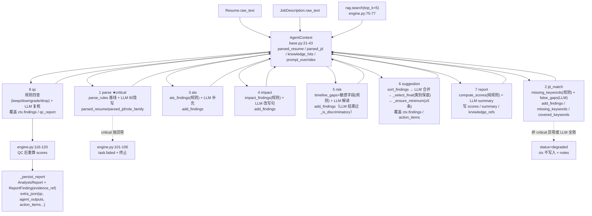

# ZhenResume 多 Agent 架构设计分析

> 分析对象：`E:\ZhenResume`（FastAPI + SQLAlchemy），聚焦 `backend/app/agents/`。
> 方法：逐文件通读 `agents/*.py`、`services/prompts.py`、`services/evidence.py`、`services/llm.py`、
> `services/analyze.py`（规则层）、`workflow/engine.py`（驱动）、`schemas.py`、`models.py`、`docs/api-contract.md`。
> 规则：所有非显然结论均给出 `文件:行号` 与 ≤15 行原文摘录。无法从代码确定的判断一律标注「推测」。
> 未修改除本文件外的任何文件。

---

## 0. 一句话结论

这是一条**固定的 8 节点线性流水线**（无分支、无循环、无回环），用**手写状态机**替代 LangGraph；
每个节点只做一件事，**规则层（`services/analyze.py`）给出确定性硬事实，LLM 负责语义判断与改写润色**，
两者通过 `merge_findings` 逐条合并；LLM 不可用时由每个 Agent 自带的 `mock_factory` 回落，
使整条链路在 mock 模式下仍产出契约合规报告。

```python
# backend/app/workflow/engine.py:3-5
"""工作流引擎：手写状态机，替代 LangGraph（MVP-lite 的核心简化）。

为什么可以不用 LangGraph：
8 个节点是一条确定的线性链，没有分支、没有循环、没有人机回环，LangGraph 的
```

---

## 1. 8-Agent 流水线总览

### 1.1 注册与顺序

顺序即契约，代码里用注释显式锁定：

```python
# backend/app/agents/__init__.py:12-22
# 顺序即契约 §4.2 的 step_name 顺序，不要随意调整
AGENT_PIPELINE = [
    ParseAgent,
    JdMatchAgent,
    AtsAgent,
    ImpactAgent,
    RiskAgent,
    SuggestionAgent,
    ReportAgent,
    QcAgent,
]
```

`docs/api-contract.md:240` 与之一致：`` `step_name` 顺序固定为：`parse`, `jd_match`, `ats`, `impact`, `risk`, `suggestion`, `report`, `qc` ``。

### 1.2 主表

| 序号 | Agent（name / title） | critical | 读取的 ctx 输入 | 写回的 ctx 字段 / 输出 data 字段 | 失败影响 |
|---|---|---|---|---|---|
| 1 | `parse` / 解析 Agent | **True** | `resume_text`、`jd_text`、`parsed_jd`（创建时可能有） | `parsed_resume`、`parsed_jd`、`role_family`、`outputs["parse"]` = `{parsed_resume, parsed_jd, role_family, work_count, project_count, bullet_count, skill_count}` | 抛异常 → 引擎置任务 `failed`，全链终止 |
| 2 | `jd_match` / JD 匹配 Agent | False | `parsed_resume`、`parsed_jd`、`jd_text`、`knowledge_hits` | `findings`（增量）、`missing_keywords`、`covered_keywords`、`outputs["jd_match"]` = `{match_summary, missing_keywords, covered_keywords, coverage, false_gaps, findings_count, coverage_comment}` | degraded：无新增 finding，后续 ATS 仍会产出关键词缺失条目 |
| 3 | `ats` / ATS Agent | False | `parsed_resume`、`parsed_jd`、`resume_text` | `findings`（增量）、`outputs["ats"]` = `{ats_summary, coverage, findings_count}` | degraded：丢失 LLM 补充的版式问题，规则 ATS 条目仍在（mock_factory 已写入） |
| 4 | `impact` / 影响力 Agent | False | `parsed_resume`、`role_family`、`knowledge_hits` | `findings`（增量）、`outputs["impact"]` = `{impact_summary, bullet_count, quantified_count, quantified_ratio, metric_hints, findings_count}` | degraded：无量化改写句产出，Suggestion 只能基于既有 findings |
| 5 | `risk` / 风险 Agent | False | `parsed_resume`、`resume_text`、`jd_text` | `findings`（增量）、`outputs["risk"]` = `{risk_summary, timeline_count, sensitive_fields_resume, sensitive_fields_jd, findings_count}` | degraded：合规/时间线 LLM 判断缺失（规则 risk 条目仍在）；risk 维度得分可能虚高 |
| 6 | `suggestion` / 建议 Agent | False | 全部 `findings`、`parsed_jd`、`knowledge_hits`、`missing_keywords`/`covered_keywords` | `findings`（**覆盖式重写**）、`action_items`、`outputs["suggestion"]` = `{findings_count, severity_breakdown, action_items}` | degraded：走 mock 的 `_finalize(ctx.findings)`，条数仍由 `_ensure_minimum` 保底 ≥5 |
| 7 | `report` / 报告合成 Agent | False | `findings`、`parsed_resume`、`parsed_jd`、`resume_text`、`knowledge_hits` | `scores`、`summary`、`knowledge_refs`、`outputs["report"]` = `{scores, risk_level, severity_breakdown, summary, knowledge_refs, disclaimer}` | degraded：`summary` 回落 `_compose_summary` 确定性文本，分数不受影响（分数本就由规则算） |
| 8 | `qc` / 质检 Agent | False | 全部 `findings`、`resume_text`、`jd_text` | `findings`（**删/降级**）、`qc_report`、`outputs["qc"]` | degraded：仅规则质检生效（`decisions` 为空），报告仍可出厂；降级本身不阻断 |

失败语义来源：`base.py:93-104`（见 §2）。`critical=True` 全库仅 `ParseAgent` 一处（grep `critical` 仅命中 `base.py`、`parse_agent.py:59`、`engine.py:101`）。

### 1.3 五种状态（status）的分布

- 节点级 `status ∈ done | degraded`（`base.py:67` 默认 `done`）；
- `degraded` 有两个来源：① `safe_run` 捕获异常（`base.py:100-104`）；② LLM 重试全败回落 mock_factory（`llm.py:129 degraded=True`），再由各 Agent 透传 `status="degraded" if result.degraded else "done"`（如 `ats_agent.py:64`）；
- 引擎另写 `step.status = "failed"`（`engine.py:102`）与 `workflow_steps` 的 `pending/running/done/failed/degraded`（`models.py:188-189`）。

---

## 2. Agent 契约：`run()` / `safe_run()` / `AgentOutput` / 降级语义

### 2.1 抽象接口

```python
# backend/app/agents/base.py:85-104
class Agent(ABC):
    name: str = "agent"
    title: str = "Agent"
    critical: bool = False

    @abstractmethod
    async def run(self, ctx: AgentContext, llm: LLMClient) -> AgentOutput: ...

    async def safe_run(self, ctx: AgentContext, llm: LLMClient) -> AgentOutput:
        """统一异常处理：非 critical 的失败降级为空产出，由引擎记录 notes。"""
        try:
            return await self.run(ctx, llm)
        except Exception as exc:  # noqa: BLE001
            if self.critical:
                raise
            return AgentOutput(
                data={},
                status="degraded",
                notes=f"{self.name} 执行失败，已降级：{type(exc).__name__}: {str(exc)[:200]}",
            )
```

要点（逐条可从上面代码读出）：

1. `run` 是纯业务实现；`safe_run` 是**唯一的异常边界**，子类不覆写（8 个 Agent 均未覆写，均只实现 `run`）。
2. 非 critical 失败返回 `AgentOutput(data={}, status="degraded")` —— **ctx 不被写入任何字段**，
   因为降级分支不执行 `run` 内的 `ctx.xxx = ...`。这保证了「半成品状态」不会污染共享状态。
3. critical 失败**重新抛出**（`base.py:99`），异常上抛到引擎（见 §2.3）。

### 2.2 `AgentOutput` 与可观测三元组

```python
# backend/app/agents/base.py:63-82
@dataclass
class AgentOutput:
    data: dict
    llm: LLMResult | None = None
    status: str = "done"  # done | degraded
    notes: str | None = None

    @property
    def tokens(self) -> int:
        if not self.llm:
            return 0
        return int(self.llm.tokens_in + self.llm.tokens_out)
    ...
    @property
    def latency_ms(self) -> int:
        return int(self.llm.latency_ms) if self.llm else 0
```

- `tokens` / `cost` / `latency_ms` 都是从 `LLMResult` 派生的**只读属性**，因此 8 个 Agent 的 8 个
  `AgentOutput(..., llm=result, ...)` 构造是**强制的可观测性契约**：只要在返回时带上 `llm=result`，
  引擎就能落库。若某个 Agent 忘了带，该步的 tokens/cost/latency 全为 0（`base.py:71-82`），
  且不会被任何测试发现（无断言）。
- 注意 `latency_ms` 只反映 **LLM 调用耗时**，不含 Agent 自身的规则计算耗时；`engine.py:108`
  只在它为 0 时才回落到墙钟：

```python
# backend/app/workflow/engine.py:108
            step.latency_ms = output.latency_ms or int((time.perf_counter() - started) * 1000)
```

### 2.3 引擎级 critical 处理 vs `safe_run` —— 两层不同职责

```python
# backend/app/workflow/engine.py:93-106
            started = time.perf_counter()
            try:
                output = await agent.safe_run(ctx, llm)
                if output.status == "degraded":
                    step.status = "degraded"
                else:
                    step.status = "done"
                step.notes = output.notes
            except Exception as exc:  # noqa: BLE001 —— critical Agent 失败即终止整个任务
                step.status = "failed"
                step.latency_ms = int((time.perf_counter() - started) * 1000)
                step.notes = f"{type(exc).__name__}: {str(exc)[:300]}"
                _fail(db, task, f"{agent.title} 执行失败：{str(exc)[:200]}")
                return None
```

| 维度 | `Agent.safe_run` | 引擎 `try/except` |
|---|---|---|
| 判定依据 | 类属性 `critical`（`base.py:88,98`） | 是否有异常穿透 `safe_run` |
| 非 critical 异常 | 吞掉，返回 `degraded` 空产出 | 收不到异常，正常走 `step.status = "degraded"` |
| critical 异常 | 重新抛出 | 捕获 → `step.status="failed"` → `_fail()` → 任务 `failed`，**整个流水线 return None** |
| 副作用 | 无（降级分支不写 ctx） | 写 `task.error`、`completed_at`，终止后续所有节点 |
| 降级可观测性 | 写进 `notes`（`base.py:103`） | 写进 `step.notes` 与 `task.error` |

**关键差异**：`safe_run` 是「单节点容错」，引擎 `except` 是「任务级熔断」。
由于只有 `parse` 是 critical，实际语义是：**只有简历/JD 结构化的失败会让任务失败，其余 7 个节点
的失败一律转化为报告质量下降**（degraded 步骤对前端可见，见 `docs/api-contract.md:229-232`）。

**注意（易误读）**：`safe_run` 只捕获 `run` 内的异常，**不处理语义失败**。
例如 LLM 返回合法 JSON 但内容为空（`result.data == {}`），`safe_run` 不会降级；
各 Agent 依靠 `mock_factory` 兜底字段或 `or baseline_xxx` 表达式来兜底
（如 `ats_agent.py:52-56`、`report_agent.py:57`）。

---

## 3. 共享状态设计：`AgentContext`

### 3.1 字段全貌（含分类）

```python
# backend/app/agents/base.py:21-43
@dataclass
class AgentContext:
    """工作流共享状态。Agent 只读输入部分，产出写回自己负责的字段。"""

    task_id: str
    resume_text: str
    jd_text: str
    parsed_resume: ParsedResume
    parsed_jd: ParsedJd
    role_family: str = "general"
    knowledge_hits: list[dict] = field(default_factory=list)
    prompt_overrides: dict[str, str] = field(default_factory=dict)

    # 逐层累积的产出
    findings: list[dict] = field(default_factory=list)
    missing_keywords: list[str] = field(default_factory=list)
    covered_keywords: list[str] = field(default_factory=list)
    action_items: list[str] = field(default_factory=list)
    knowledge_refs: list[dict] = field(default_factory=list)
    scores: dict = field(default_factory=dict)
    summary: str = ""
    qc_report: dict = field(default_factory=dict)
    outputs: dict = field(default_factory=dict)
```

| 字段 | 类别 | 由谁写 | 由谁读 |
|---|---|---|---|
| `task_id` | 输入（身份） | 引擎 | 无 Agent 读取（仅日志/调试语义） |
| `resume_text` / `jd_text` | 输入（不可变事实） | 引擎 `engine.py:67-68` | 全部 Agent |
| `parsed_resume` | 输入 → **被 parse 覆盖** | 引擎 `_safe_resume`→`parse_agent.py:81` | 2–8 全部 |
| `parsed_jd` | 输入 → **被 parse 覆盖** | 引擎 → `parse_agent.py:85` | 2–8 全部 |
| `role_family` | parse 产出 | `parse_agent.py:87` | impact（`impact_agent.py:29`）、suggestion（`suggestion_agent.py:232`） |
| `knowledge_hits` | 引擎预置输入 | 引擎 `engine.py:75-77`（RAG 一次检索） | jd_match / impact / suggestion 的 `knowledge_digest()` |
| `prompt_overrides` | 引擎预置输入 | 引擎 `engine.py:71` | `ctx.prompt()`（`base.py:48-51`） |
| `findings` | 累积产出（**多写者**） | jd_match / ats / impact / risk 追加；suggestion 覆盖；qc 删改 | suggestion / report / qc / 引擎 |
| `missing_keywords`、`covered_keywords` | jd_match 产出 | `jd_match_agent.py:101-102` | suggestion（`_positive_findings`） |
| `action_items` | suggestion 产出 | `suggestion_agent.py:68` | 引擎 → 报告 `extra_json`（`engine.py:175`） |
| `knowledge_refs` | report 产出 | `report_agent.py:27-36` | 引擎 → 报告（`engine.py:176`）；qc 计数（`qc_agent.py:116`） |
| `scores` | report 产出 → **qc 后重算** | `report_agent.py:26`、`engine.py:118` | 引擎 `_persist_report` |
| `summary` | report 产出 | `report_agent.py:58` | 引擎（`engine.py:170`） |
| `qc_report` | qc 产出 | `qc_agent.py:103-110` | 引擎（`engine.py:177`） |
| `outputs` | 逐 Agent 自注册 | 每个 Agent `ctx.outputs[self.name] = output` | 引擎 → `extra_json.agent_outputs`（`engine.py:179`） |

### 3.2 写回方式：三个原语，没有隐藏通道

```python
# backend/app/agents/base.py:45-51
    def add_findings(self, items: list[dict]) -> None:
        self.findings.extend(items or [])

    def prompt(self, name: str) -> str:
        from ..services import prompts

        return prompts.resolve(name, self.prompt_overrides)
```

1. **追加**：`ctx.add_findings(...)`（jd_match / ats / impact / risk）。
2. **覆盖**：直接赋值 `ctx.findings = ...`（suggestion `suggestion_agent.py:67`、qc `qc_agent.py:102`）。
   这是「收敛点」设计：前 4 个 Agent 只增不改，第 6 个统一排序裁剪，第 8 个统一删降级。
3. **字段级赋值**：`ctx.scores = / ctx.summary = / ctx.qc_report = / ctx.outputs[name] =`。

值得注意的边界情况：

- `jd_match_agent.py:74` 会从 `ctx.findings` 中**全局删除**命中 `false_gaps` 的条目：
  ```python
  # backend/app/agents/jd_match_agent.py:73-74
          kept_gaps = [f for f in baseline_gaps if not _suppressed_by(f, false_gaps)]
          ctx.findings = [f for f in ctx.findings if not _suppressed_by(f, false_gaps)]
  ```
  在当前流水线顺序下 jd_match 是第 2 步，此时 `ctx.findings` 仍为空（parse 不产 finding），
  因此第 74 行**实际是空操作**；它的作用是防御「顺序被调整」。（由顺序 + parse 无 finding 推出，非注释声明。）
- `ctx.outputs["parse"]` 被引擎显式排除出报告的 `agent_outputs`：
  ```python
  # backend/app/workflow/engine.py:179
              "agent_outputs": {k: v for k, v in ctx.outputs.items() if k != "parse"},
  ```
  推测（无注释说明）：避免把完整解析结果（含全部原文段落）重复塞进 `AnalysisReport.extra_json`。

### 3.3 为什么用显式状态而不是全局变量

代码给了三条明确理由：

```python
# backend/app/workflow/engine.py:7-10
但接口刻意与 LangGraph 对齐，升级时只需替换本文件：
- 每个节点是 `async (state, llm) -> partial_state`；
- 节点间通过显式状态对象（AgentContext）传递，不靠隐式全局变量；
- 每次执行都落一行 `workflow_steps`，input/output/tokens/cost/latency 全部可观测。
```

工程收益（可从代码直接验证）：

1. **可替换性**：所有 Agent 的签名是统一的 `async (ctx, llm) -> AgentOutput`（`base.py:91`），
   引擎循环是唯一驱动点（`engine.py:81-114`），换成 LangGraph / Celery 只需替换 `engine.py`。
2. **单进程单任务隔离**：`AgentContext` 每次工作流新建（`engine.py:65`），无跨任务共享；
   唯一的进程级全局是 LLM 客户端单例（`llm.py:188-195`），它无请求态，只持有 mode/provider/model。
3. **可观测性天然对齐**：状态累积过程被 `_input_digest` 抽样成每步 `input_json`
   （`engine.py:204-218`，含 `findings_so_far`），不需要在 Agent 里写日志埋点。
4. **可测试性**：Agent 单测只需构造 `AgentContext`，无需 DB（`prompt_overrides` 由引擎注入，
   见 `prompts.py:4-5`：「避免 Agent 里出现数据库依赖」）。

代价（同样可从代码读出）：

- **没有状态校验**：任何 Agent 都能写任何字段，类型仅靠 dataclass 声明，运行期不校验
  （如 `ctx.scores` 是裸 `dict`）。若某 Agent 写错字段名，Python 会静默创建新属性吗？
  —— 不会，`@dataclass` 未加 `slots=True`，**赋值未知属性不会报错**（普通类行为），
  这是潜在静默 bug 面（`base.py:21-43` 未使用 `__slots__`，也无 `frozen`）。
- **findings 无统一守恒约束**：允许 `len(ctx.findings)` 在流程中间远超最终上限 12（见 §6.2）。

---

## 4. 逐 Agent 机制详解

所有 8 个 Agent **全部调用** `llm.complete_json(...)`（grep `complete_json(` 命中 8 个 Agent + `llm.py` 定义），
即没有「纯规则 Agent」，也没有「纯 LLM Agent」；差别在于**规则层承担的权重**与 **mock 策略**。

调用签名统一为：

```python
# backend/app/services/llm.py:78-85
    async def complete_json(
        self,
        *,
        system: str,
        user: str,
        mock_factory: Callable[[], dict],
        agent: str = "unknown",
    ) -> LLMResult:
```

`mock_factory` 在两种情况下被调用：`mode == "mock"`（`llm.py:90-104`）与 live 重试全败（`llm.py:116-131`）。
**`agent` 参数目前未参与任何逻辑**：`_call_deepseek(self, *, system, user, agent)` 收下了它，
但 payload 只使用 model/messages/response_format/temperature/max_tokens（`llm.py:136-146`），
`agent` 既不做路由、也不进 header、也不落日志。→ 该参数当前是**预留占位**。

---

### 4.1 ParseAgent（第 1 步，critical）

**机制**：规则解析基线 + LLM 纠错 + **逐字段合并兜底**（不是二选一）。

```python
# backend/app/agents/parse_agent.py:61-80
    async def run(self, ctx: AgentContext, llm: LLMClient) -> AgentOutput:
        baseline = parse_resume_text(ctx.resume_text)

        def mock_factory() -> dict:
            return baseline.model_dump()
        ...
        result: LLMResult = await llm.complete_json(
            system=ctx.prompt("parse_agent"), user=user, mock_factory=mock_factory, agent=self.name
        )

        parsed = _merge_parsed(baseline, result.data)
        ctx.parsed_resume = parsed
```

- 规则基线：`services/parse_rules.parse_resume_text`（分节、条目头识别、日期切分、技能抽取，
  `parse_rules.py:235`）。
- 合并策略（`parse_agent.py:16-53`）：LLM 结果先过 `ParsedResume.model_validate`，**校验失败整段回落基线**
  （`parse_agent.py:19-21`）；随后对 `basics.*`、`education/work/projects/skills/certificates/timeline`
  逐个「LLM 为空 → 用基线补」，并对 work 按 `(company, start)` 补漏条目（`parse_agent.py:47-51`）——
  注释解释了动机：避免模型"越改越少"（`parse_agent.py:4-5`）。
- JD 补解析（`parse_agent.py:84-85`）：仅当 `parsed_jd` 既无 title 又无 skills_core 时用
  `parse_jd_text` 规则解析。**注意：本 Agent 不调用 LLM 解析 JD** —— JD 结构化完全由规则层完成。
- `role_family` 由 `guess_role_family(ctx.parsed_jd)` 从规则表 `ROLE_FAMILY_RULES` 推断
  （`parse_rules.py:506,522`），**不走 LLM**。

**System prompt**：`parse_agent`（`prompts.py:25-34`）。
**必须返回的 JSON 形状**（prompt 中声明）：

```text
# backend/app/services/prompts.py:29-33
"\n输出 JSON 结构：{basics:{name,email,phone,city,links[]},"
" education:[{school,degree,major,start,end,highlights[]}],"
" work:[{company,title,start,end,location,highlights[]}],"
" projects:[{name,role,start,end,highlights[],tech[]}],"
" skills:[], certificates:[], timeline:[{start,end,label,type}]}"
```

（对应 `schemas.py:208-215` 的 `ParsedResume`；`TimelineItem` 见 `schemas.py:201-205`。）

**mock_factory 策略**：`baseline.model_dump()` —— 直接返回规则解析结果，因此
mock 模式下 `_merge_parsed(baseline, baseline)` 是幂等的恒等变换。

**失败影响**：唯一 critical。`parse_agent.py:3` 直言「解析失败则整条链路没有意义」。
另外它会在 `data` 中附带计数（`work_count` 等，`parse_agent.py:89-97`），并在无 work/project 时
追加一条 note（`parse_agent.py:101-102`）。

---

### 4.2 JdMatchAgent（第 2 步）

**机制**：规则算硬事实 + LLM 做「真差距 / 表述差异」的语义裁决，
并且是**唯一允许 LLM 推翻规则结论的地方**：

```python
# backend/app/agents/jd_match_agent.py:3-5
规则层给出「字面缺失」与「年限/学历差距」的硬事实；
LLM 负责区分「真差距」与「表述差异」（例如简历写「服务治理」而 JD 写「微服务」），
因此本 Agent 允许 LLM 从缺失清单里剔除误报 —— 这是唯一允许 LLM 推翻规则结论的地方。
```

- 规则层：`analyze.missing_keywords`（大小写不敏感子串匹配，`analyze.py:97-111`）
  + `analyze.gap_findings`（年限/学历/关键词重合度，`analyze.py:550-616`）。
- 误报剔除（`jd_match_agent.py:64-74`）：LLM 的 `false_gaps[].keyword` 作为子串，
  在 `title + issue + original_text` 上做包含匹配（`_suppressed_by`，`jd_match_agent.py:124-129`）。
- LLM 新增差距（`jd_match_agent.py:77-97`）：`real_gaps[]` 若 `priority == "high"` 记 `red`，否则 `yellow`；
  与既有 gap 标题重复则跳过（`jd_match_agent.py:84-85`）。

**必须返回的 JSON 形状**：

```text
# backend/app/services/prompts.py:39-40
"\n输出 JSON：{match_summary:string, real_gaps:[{keyword,reason,priority}],"
" false_gaps:[{keyword,reason}], coverage_comment:string}"
```

**mock_factory 策略**（含明确的设计取舍注释）：

```python
# backend/app/agents/jd_match_agent.py:36-45
        def mock_factory() -> dict:
            # real_gaps 留空：关键词缺失已由 ATS Agent 逐条产出，规则层再重复一遍
            # 会挤占报告条数（红色名额被关键词问题占满，真正的风险项反而被截断）。
            # 这个字段的用途是「LLM 发现的、规则层没识别出的语义差距」，mock 模式下不存在此能力。
            return {
                "match_summary": baseline_summary,
                "real_gaps": [],
                "false_gaps": [],
                "coverage_comment": f"关键词覆盖率 {ratio:.0%}",
            }
```

→ 即「**mock 时刻意不重复产出关键词类 finding**」，避免报告条数被同质问题占满。

**输出 data**：`{match_summary, missing_keywords, covered_keywords, coverage, false_gaps, findings_count, coverage_comment}`
（`jd_match_agent.py:105-113`）。

**注意（顺序语义）**：这里传 `real_gaps_as_findings` 给 `coerce_findings`
（`jd_match_agent.py:70`），但 `prompts.py:39-40` 声明的字段名是 `real_gaps`；
两个 key 被分别消费（`real_gaps` 走手工构造，`real_gaps_as_findings` 走 coerce），
**prompt 未要求模型输出 `real_gaps_as_findings`** → 该分支在 live 模式下大概率恒为空（由字段名不一致推出，推测）。

---

### 4.3 AtsAgent（第 3 步）

**机制**：规则检测 + LLM 确认/补充/剔除，合并去重。

```python
# backend/app/agents/ats_agent.py:3-4
规则层负责确定性检测（缺技能栏、无联系方式、表格线、篇幅），
LLM 负责补充版式与措辞层面的可解析性问题。两者合并去重。
```

规则层 `analyze.ats_findings`（`analyze.py:114-198`）覆盖 5 类确定性检查：
关键词缺失（**只对前 4 个缺失词产出条目**，且严重度按整体覆盖率定，`analyze.py:121-140`）、
无技能栏（red）、无联系方式（yellow）、篇幅 > 3000 字（yellow）、表格线正则（yellow）。

**必须返回的 JSON 形状**：

```text
# backend/app/services/prompts.py:46-47
"\n输出 JSON：{findings:[{category:'ats',severity:'red'|'yellow'|'green',title,original_text,issue,suggestion,rewritten_text}],"
" ats_summary:string}"
```

**合并顺序**：`merge_findings(llm_findings, baseline)` —— **LLM 版本优先**（`ats_agent.py:52-53`），
去重键相同时保留 LLM 那条。

**mock_factory 策略**：`{"findings": baseline, "ats_summary": baseline_summary}`（`ats_agent.py:34-35`），
即 mock 下 findings 完全来自规则层，且已经是 coerce 过的合规结构。

**输出 data**：`{ats_summary, coverage, findings_count}`（`ats_agent.py:57-61`）。

---

### 4.4 ImpactAgent（第 4 步）

**机制**：规则判定客观事实（是否含数字、是否弱动词开头），LLM 负责改写句与补充发现。

```python
# backend/app/agents/impact_agent.py:3-4
规则层判定「是否含数字指标 / 是否用弱动词开头」，这是客观事实；
LLM 负责把弱表述改写成可直接复制的结果导向句（不编造数字，缺数据的位置用 [补充指标：…] 占位）。
```

- 量化判定：`analyze.QUANT_SIGNAL_RE`（含 %/万/倍/人/QPS… 与千分位数字，`analyze.py:21-25`）+ `_is_quantified`（`analyze.py:204-205`）。
- 要点过滤：`content_bullets` 剔除「技术栈：…」这类标签行（`analyze.py:208-210`）。
- 岗位化提示词：`METRIC_HINTS[role_family]`（backend/frontend/algorithm/… 11 个族 + general，`analyze.py:52-64`），
  同时进入 prompt 与输出（`impact_agent.py:29,40,62`）。
- `quant_ratio = len(quantified)/len(bullets)`（`impact_agent.py:26-28`），供报告与评分复用。

**必须返回的 JSON 形状**：

```text
# backend/app/services/prompts.py:53
"\n输出 JSON：{findings:[{category:'impact',severity,title,original_text,issue,suggestion,rewritten_text}], impact_summary:string}"
```

**mock_factory 策略**：`{"findings": baseline, "impact_summary": baseline_summary}`（`impact_agent.py:36-37`），
baseline 由 `coerce_findings(analyze.impact_findings(...))` 得到。
另有 `_bullets_digest` 在 prompt 里对每条要点标注 `[有数字]/[无数字]`（`impact_agent.py:70-77`）。

**输出 data**：`{impact_summary, bullet_count, quantified_count, quantified_ratio, metric_hints, findings_count}`（`impact_agent.py:57-64`）。

---

### 4.5 RiskAgent（第 5 步）

**机制**：规则做时间线算术 + 敏感字段扫描，LLM 做解读与补充，且有**双重合规防线**。

```python
# backend/app/agents/risk_agent.py:3-5
这一层同时承担合规职责（aaa.md §4「公平性：不输出性别、年龄、婚育等歧视性建议」）：
规则层用 DISCRIMINATION_RE 扫描简历与 JD 中的敏感字段，
并在此明确要求 LLM 不得基于这些字段做任何能力判断。
```

- 规则层 `analyze.risk_findings` = `timeline_gaps`（>6 个月空窗按 12 个月分 red/yellow、
  ≥2 个月重叠 yellow，且**已主动解释的空窗转为 green 正面条目**，`analyze.py:409-495`）
  + 技能/项目矛盾（双向子串判定，宁漏不误报，`analyze.py:503-526`）
  + 敏感字段（`analyze.py:528-542`）。
- 第一道防线：prompt 层（`risk_agent.py:51-52`）与 `COMMON_SYSTEM` 铁律 3（`prompts.py:19`）。
- 第二道防线：**代码兜底过滤** LLM 结果：

```python
# backend/app/agents/risk_agent.py:77-81
def _is_discriminatory(finding: dict) -> bool:
    """兜底过滤：任何把敏感字段当作能力判断依据的条目一律剔除。"""
    text = f"{finding.get('issue', '')} {finding.get('suggestion', '')} {finding.get('title', '')}"
    bad = re.compile(r"(适合|不适合|优先|劣势|优势|扣分|加分).{0,6}(男|女|年龄|已婚|未婚|婚育|户籍|本地户口)")
    return bool(bad.search(text))
```

- 第三道防线在 QC（`qc_agent.py:25-27,138-139`，见 §7）。

**必须返回的 JSON 形状**：`{findings:[{category:'risk',severity,title,original_text,issue,suggestion,rewritten_text}], risk_summary:string}`（`prompts.py:59`）。

**mock_factory 策略**：`{"findings": baseline, "risk_summary": baseline_summary}`（`risk_agent.py:39-40`）。

**输出 data**：`{risk_summary, timeline_count, sensitive_fields_resume, sensitive_fields_jd, findings_count}`（`risk_agent.py:65-71`）。
注意 `sensitive_fields_*` 用的是**本文件自己的正则**（`analyze.DISCRIMINATION_RE`，
与 `qc_agent.py:25-27` 的 `DISCRIMINATION_RE` 是两套不同词表）—— 见 §8 漂移点。

---

### 4.6 SuggestionAgent（第 6 步，447 行，最大）

**机制**：规则汇总排序 + LLM 合并润色 + **条数保底**（验收标准 ≥5 条）。它是唯一的
「findings 覆盖写者」，把前 4 个 Agent 的候选收敛为最终 ≤8 条。

```python
# backend/app/agents/suggestion_agent.py:1-7
"""建议 Agent：把所有发现项收敛成「可执行清单」，并保证条数达标。

关键职责：
1. 合并重复、剔除空话、按严重度排序，红色优先；
2. 保证至少 5 条可执行建议（aaa.md §5 验收标准），不足时由 `_supplementary_findings` 补齐；
3. 产出 action_items（下一步行动清单）。
"""
```

**四段式流程**：

1. **规则候选**：`candidates = analyze.sort_findings(ctx.findings)` → `baseline = _finalize(candidates)`
   （`suggestion_agent.py:25-26`，`_finalize` 只取前 `MAX_FINAL=8` 并补 `evidence_quote` 别名，`suggestion_agent.py:88-95`）。
2. **LLM 收敛**（`suggestion_agent.py:47-54`）：`coerce_findings(...)` 后，
   **LLM 为主但强制保留被漏掉的红色风险**：
   ```python
   # backend/app/agents/suggestion_agent.py:49-54
           if llm_findings:
               # LLM 版本为主，但保留规则层中被 LLM 漏掉的红色风险（不能因为模型疏忽而丢风险）
               red_kept = [f for f in baseline if f["severity"] == "red" and not _covered(f, llm_findings)]
               findings = merge_findings(llm_findings, red_kept)
           else:
               findings = baseline
   ```
3. **类别保底裁剪** `_select_final`（`suggestion_agent.py:98-129`）：先给每个 category 保底一条，
   再按严重度补足到 8 条。注释给了血泪动机：
   ```python
   # backend/app/agents/suggestion_agent.py:101-104
       为什么不能只按严重度取前 N 条：关键词缺失类问题动辄 4–8 条且都是红色，
       会把"时间线空窗""技能与项目矛盾"这类只有黄色、但危害更大的风险挤出报告，
       导致风险维度得分虚高（曾经出现过弱简历风险安全度 100 分的情况）。
       先给每个类别保底一条，再按严重度补足，才能保证五个维度都被看见。
   ```
4. **条数保底** `_ensure_minimum`（`suggestion_agent.py:187-216`）：不足 5 条时依次调用
   `_supplementary_findings`（补"简历确实缺失"的通用检查项，`suggestion_agent.py:328-436`）
   → 仍不足则 `_positive_findings`（把**已验证的优点**写成 green 条目，`suggestion_agent.py:219-325`）。
   `_positive_findings` 的 docstring 明确说明这是为了避免「硬造 5 个问题就是编造问题」
   （`suggestion_agent.py:194-197`）。这是整个设计里最有意思的取舍之一：**用 green 条目满足条数 KPI，
   而不是用假问题**。

**action_items 生成**：优先用 LLM 的（≤6 条），不足 3 条回落 `_action_items(findings)`
（`suggestion_agent.py:59-65`）；后者只取 red/yellow、按 suggestion 前 40 字去重、格式为
`「定位 → 建议」`，不足 3 条再补两条固定兜底句（`suggestion_agent.py:141-171`）。

**必须返回的 JSON 形状**：

```text
# backend/app/services/prompts.py:68
"\n输出 JSON：{findings:[{category,severity,title,original_text,issue,evidence_quote,suggestion,rewritten_text}], action_items:[string]}"
```

注意此处**只声明 `evidence_quote`，不声明 `evidence` 对象** —— 证据结构由后端
`resolve_evidence` 重建（§6.3），这是刻意的「不信模型 offset」设计。

**mock_factory 策略**：

```python
# backend/app/agents/suggestion_agent.py:28-32
        def mock_factory() -> dict:
            return {
                "findings": [dict(f, evidence_quote=(f.get("evidence") or {}).get("quote", "")) for f in baseline],
                "action_items": _action_items(baseline),
            }
```

即 mock 下把规则候选原样回灌为「LLM 输出」，round-trip 经过 `coerce_findings` 重新定位证据，
等价于「规则结果 + 证据再锚定」。

**输出 data**：`{findings_count, severity_breakdown, action_items}`（`suggestion_agent.py:70-74`），
并把补充情况写进 notes（`suggestion_agent.py:78-80`）。

---

### 4.7 ReportAgent（第 7 步）

**机制**：**分数 100% 规则计算，LLM 只写 summary**。理由写在该文件 docstring：

```python
# backend/app/agents/report_agent.py:3-6
评分由规则层计算（`analyze.compute_scores`），不让 LLM 打分 —— 理由：
同一份简历两次诊断必须给出同样的分数，否则「修改后重新诊断，对比分数变化」这一卖点就是假的。
LLM 只负责写总结（summary）。
```

- `scores = analyze.compute_scores(...)`（`report_agent.py:22`）：权重
  ATS 30% / 影响力 25% / 清晰度 20% / 竞争力 15% / 风险 10%（`analyze.py:662-664`）；
  同一类别最多计前 2 条扣分（`_penalty(..., cap=2)`，`analyze.py:676-683`）；
  risk 维度**不设上限**且直接按条目数扣分（red −32/yellow −22/green −5，`analyze.py:654-660`）。
- `risk_level` 由 risk 分派生：≥80 green，60–79 yellow，<60 red（`analyze.py:686-692`，与契约 `docs/api-contract.md:301` 一致）。
- `knowledge_refs` 只取 top3 且**只保留元数据（doc_id/chunk_id/title/scope/score），不含正文**
  （`report_agent.py:27-36`）—— 隐私与体积考虑。
- LLM prompt 明确禁止复述分数、禁止罗列全部问题（`report_agent.py:49-50`）。

**必须返回的 JSON 形状**：`{summary:string, highlights:[string]}`（`prompts.py:74`）。
注意 **`highlights` 被 prompt 要求但代码未使用**：`result.data.get("highlights")` 从未被读取，
只有 `mock_factory` 里用 `_highlights(ctx)` 填了它（`report_agent.py:41`）—— 一个 unused 输出字段。

**mock_factory 策略**：`{"summary": baseline_summary, "highlights": _highlights(ctx)}`，
其中 `baseline_summary = _compose_summary(...)` 是**确定性文本生成器**（`report_agent.py:73-87`），
保证「live 失败时也不会让报告缺字段」。

**输出 data**：`{scores, risk_level, severity_breakdown, summary, knowledge_refs, disclaimer}`（`report_agent.py:60-67`）。
`disclaimer` 常量同时被引擎复用到报告层（`engine.py:178`）。

---

### 4.8 QcAgent（第 8 步）→ 见 §7 专章

**机制速览**：规则四查 + LLM 复核决策，动作 `keep/downgrade/drop`，改完 findings 后由引擎重算分数。

---

## 5. Prompt 工程

### 5.1 注册表结构：代码默认值 + DB 覆盖

```python
# backend/app/services/prompts.py:1-5
"""Prompt 注册表。

代码里的是默认值，管理后台可以通过 `prompt_templates` 表覆盖（版本自增）。
工作流启动时一次性加载覆盖项注入 AgentContext，避免 Agent 里出现数据库依赖。
"""
```

- 表结构：`prompt_templates(id, name, version, content)`（`models.py:333-340`）。
- 管理接口：`GET /api/v1/admin/prompts`、`POST /api/v1/admin/prompts`（版本自增）
  （`docs/api-contract.md:366-367`），请求体 `PromptUpsert{name, content}`（`schemas.py:77-79`）。
- 8 个 key：`parse_agent`/`jd_match_agent`/`ats_agent`/`impact_agent`/`risk_agent`/`suggestion_agent`/`report_agent`/`qc_agent`
  （`prompts.py:24-83`），与 Agent 的 `name` **命名不同**（Agent 是 `parse`/`ats`…），
  映射关系硬编码在各 Agent 的 `ctx.prompt("xxx_agent")` 调用里。

### 5.2 `load_overrides` / `resolve`

```python
# backend/app/services/prompts.py:86-99
def load_overrides(db: Session) -> dict[str, str]:
    """取每个 name 的最新版本作为覆盖值。"""
    rows = db.execute(select(PromptTemplate).order_by(PromptTemplate.name, PromptTemplate.version)).scalars().all()
    overrides: dict[str, str] = {}
    for row in rows:
        if row.content:
            overrides[row.name] = row.content
    return overrides


def resolve(name: str, overrides: dict[str, str] | None = None) -> str:
    if overrides and name in overrides:
        return overrides[name]
    return DEFAULTS.get(name, COMMON_SYSTEM)
```

机制要点（可逐行验证）：

1. `load_overrides` 按 `(name, version)` 升序取全部行，**后写覆盖前写** → 同名的最高 version 胜出（`prompts.py:88-93`）。
2. `content` 为空串/None 的行被跳过（`prompts.py:91`），因此「清空内容」无法恢复默认值，只会沿用旧版本
   —— 若该 name 无任何有效行，则回落代码默认值。
3. `resolve` 的兜底是 `COMMON_SYSTEM`（`prompts.py:99`）：**未知 prompt 名不会报错，只会得到铁律段而没有任务说明**。
   由于 8 个 `ctx.prompt()` 的名字都是常量字符串，正常路径不会触发；但若管理员写入的行 `name` 拼错，
   该行永远不会被使用（静默失效）。
4. 覆盖是**整段替换**（`prompts.py:97-98` 返回 `overrides[name]`，不拼接 `COMMON_SYSTEM`）：
   一旦覆盖，铁律 1–5 也一并消失，除非管理员在自己的内容里重新写上。
   → 这是**合规风险点**（可从代码推出，非注释声明）：`COMMON_SYSTEM` 的「不编造/必有引文/不歧视/可执行/只输出 JSON」
   五条铁律在覆盖模式下不再由代码强制，只剩 QC 的后置过滤兜底。
5. 注入时机：工作流启动时一次（`engine.py:71 prompt_overrides=prompts.load_overrides(db)`），
   8 个节点共享同一份快照 → 一次任务内 prompt 版本一致（不会中途换版本）。

### 5.3 System / User 双层结构

所有 Agent 的统一形态：

- **system** = `resolve("<name>_agent")` = `COMMON_SYSTEM` + 该 Agent 的任务说明 + 输出 JSON 骨架
  （`prompts.py:24-83`）。`COMMON_SYSTEM` 全文：

```python
# backend/app/services/prompts.py:14-22
COMMON_SYSTEM = (
    "你是资深简历诊断专家，服务中国大陆求职者与中小企业 HR。"
    "铁律：\n"
    "1) 只依据用户提供的简历原文与 JD 原文下结论，绝不编造经历、公司、数字或技术栈；\n"
    "2) 每条结论必须给出原文引文（quote），引文必须是原文的连续片段，不得改写；\n"
    "3) 不输出任何涉及性别、年龄、婚育、户籍、民族、外貌等歧视性判断或建议；\n"
    "4) 建议必须可执行：给出能直接复制进简历的改写句，而不是「建议优化表述」这类空话；\n"
    "5) 只输出 JSON，不要输出 markdown 代码块或任何解释性文字。"
)
```

- **user** = 结构化的 `【…】` 分节块：事实输入 + **规则引擎初步发现摘要** + 明确祈使句结尾。

#### 代表例 1：ParseAgent 的 user prompt（把规则结果当"草稿"交给模型纠错）

```python
# backend/app/agents/parse_agent.py:67-74
        user = (
            "【简历纯文本开始】\n"
            f"{ctx.resume_text[:12000]}\n"
            "【简历纯文本结束】\n\n"
            "【规则引擎初步结构化结果】\n"
            f"{baseline.model_dump_json(indent=None)}\n\n"
            "请输出纠正与补全后的完整 JSON。"
        )
```

特征：**唯一把整段原文（截断 12000 字）塞进 prompt 的 Agent**；其余 Agent 只给摘要/前 N 字。
对应 system 里的任务句（`prompts.py:27-28`）：「规则引擎已给出初版，你要做的是纠错与补全…
不要臆造未出现的内容。」

#### 代表例 2：SuggestionAgent 的 user prompt（收敛 + 条数约束）

```python
# backend/app/agents/suggestion_agent.py:34-41
        user = (
            f"【岗位】{ctx.parsed_jd.title}（{ctx.parsed_jd.seniority or '年限未标注'}）\n"
            f"【已发现的全部问题（共 {len(candidates)} 条）】\n{_digest(candidates, 20)}\n\n"
            f"【岗位知识库依据】\n{ctx.knowledge_digest(limit=3)}\n\n"
            "请合并重复项、剔除空话，最多保留 8 条（红色优先），"
            "确保每条都有可直接复制的 rewritten_text（缺数据用 [补充：…] 占位），"
            "并给出 3–5 条当天可执行的 action_items。"
        )
```

`_digest` 的格式是「序号 + [severity/category] + title + 原文 + 问题」四行一条
（`suggestion_agent.py:439-447`），与 system 中的「最多保留 8 条」（`prompts.py:64`）形成双重约束。

#### 代表例 3：知识库注入（只在 3 个 Agent 出现）

`ctx.knowledge_digest()` 的实现在 `base.py:53-60`：

```python
# backend/app/agents/base.py:53-60
    def knowledge_digest(self, limit: int = 3, max_chars: int = 300) -> str:
        """把检索到的知识库切片压成提示词片段。"""
        if not self.knowledge_hits:
            return "（无可用知识库依据，请仅依据简历与 JD 原文判断）"
        lines: list[str] = []
        for hit in self.knowledge_hits[:limit]:
            lines.append(f"- [{hit.get('title') or '知识库'}] {str(hit.get('text') or '')[:max_chars]}")
        return "\n".join(lines)
```

调用点仅 3 处：`jd_match_agent.py:56`、`impact_agent.py:43`、`suggestion_agent.py:37`。
→ **ats / risk / parse / report / qc 的 prompt 里没有知识库正文**。
其中 qc 的 system 要求检查「④ 是否引用了知识库依据」（`prompts.py:79`），
但 user prompt 未提供知识库内容（`qc_agent.py:60-65`），规则层检查也是空实现（`qc_agent.py:160-161`）
→ **知识库引用要求在 QC 环节实际上无法被验证**（§8 漂移点 4）。

---

## 6. `finding_utils.py` + `evidence.py`：发现项契约与证据锚定

### 6.1 finding schema（严格结构）

```python
# backend/app/agents/finding_utils.py:90-99
        item = {
            "category": category,
            "severity": severity,
            "title": title,
            "original_text": original,
            "issue": issue,
            "suggestion": suggestion,
            "rewritten_text": rewritten,
            "evidence": resolve_evidence(ctx, quote, field),
        }
```

白名单与上限：

```python
# backend/app/agents/finding_utils.py:16-22
VALID_SEVERITY = {"red", "yellow", "green"}
VALID_CATEGORY = {"ats", "impact", "clarity", "risk", "gap"}

# 空话检测：只有这类措辞而没有具体动作的建议一律视为无效
EMPTY_TALK_RE = re.compile(r"^(建议)?(优化|完善|提升|加强|改进|注意|丰富)(一下)?(表述|内容|描述|简历)?[。.]?$")

MAX_FINDINGS = 12
```

与契约一致：`docs/api-contract.md:302`（severity/category 枚举）、`:303`（至少 5 条、按 severity 排序）、
`:304`（red 必须有可定位 quote）、`:305`（`evidence.source ∈ resume|jd|knowledge`）。
持久化字段见 `models.py:158-178`（`ReportFinding`，含 `evidence_ref` JSON、`sort_order`）。

### 6.2 归一化 / 去重 / 合并

`coerce_findings`（`finding_utils.py:43-109`）是「模型输出不可信」与「前端契约必须稳定」之间的闸门
（文件 docstring `finding_utils.py:1-7`）。它做 7 件事：

| 步骤 | 行为 | 行号 |
|---|---|---|
| ① 类型过滤 | 非 list 返回 `[]`；非 dict 元素跳过 | 45-46, 51-53 |
| ② 枚举兜底 | category 越界 → `default_category`；severity 越界 → `yellow` | 55-61 |
| ③ 字段别名 | `issue｜problem`、`suggestion｜advice`、`rewritten_text｜rewrite` | 63-67 |
| ④ 引文优先级 | `evidence_quote > quote > evidence.quote > original_text` | 73-80 |
| ⑤ 硬性三条 | 缺 issue / suggestion / rewritten_text 一律丢弃 | 82-84 |
| ⑥ 空话过滤 | `EMPTY_TALK_RE` 命中且无改写句 → 丢弃 | 85-86 |
| ⑦ 去重 + 截断 | `_dedupe_key` 去重，最多 `limit=12` 条 | 101-107 |

第 ④ 步的注释解释了为什么不能直接用 `original_text` 优先：

```python
# backend/app/agents/finding_utils.py:70-72
        # 引文优先级：显式 quote > 规则层已构造的 evidence.quote > original_text。
        # 注意不能直接用 original_text 兜底优先 —— 例如「JD 关键词缺失」这类发现项，
        # original_text 是 JD 首行（岗位名），真正该引用的证据是关键词本身。
```

去重键只取 `category + (original_text|title) 前 48 字`：

```python
# backend/app/agents/finding_utils.py:38-40
def _dedupe_key(item: dict) -> str:
    basis = (item.get("original_text") or item.get("title") or "")[:48]
    return f"{item.get('category')}|{basis}"
```

跨 Agent 合并：

```python
# backend/app/agents/finding_utils.py:112-123
def merge_findings(*groups: list[dict]) -> list[dict]:
    """跨 Agent 合并并按 (category, original_text) 去重，保留先出现的（严重度更高的先来）。"""
    merged: list[dict] = []
    seen: set[str] = set()
    for group in groups:
        for item in group or []:
            key = _dedupe_key(item)
            if key in seen:
                continue
            seen.add(key)
            merged.append(item)
    return merged[:MAX_FINDINGS]
```

- 「保留先出现的（严重度更高的先来）」是**调用方责任**，`merge_findings` 自己不排序、不比较严重度。
  实际调用中：`ats/impact/risk` 传 `(llm_findings, baseline)`（LLM 优先），
  `jd_match` 传 `(kept_gaps, llm_gaps)`（规则优先）→ **两套优先级策略并存**（见 §8 漂移点 1）。
- `merge_findings` 的 12 条上限只作用于**单次调用**；`ctx.add_findings` 是 `extend` 无上限
  （`base.py:45-46`），因此中途 `len(ctx.findings)` 可达 4×12=48（4 个累积 Agent），
  直到 suggestion 才收敛到 ≤8。契约只约束最终报告，中间态不受约束。
- 严重度排序定义在 `analyze.sort_findings`（`analyze.py:698-704`）：
  red→yellow→green，同级按 `category_order = {ats:0, impact:1, risk:2, clarity:3, gap:4}` 固定，
  目的是「保证前端展示稳定」。

### 6.3 证据锚定（`evidence.py`）与 `rewritten_text` 的产生

**核心取舍**：不让模型输出 offset，只让它输出 `quote`，由后端重新定位：

```python
# backend/app/services/evidence.py:4-6
设计取舍：不依赖模型输出 offset（模型数不准），而是让模型只输出 quote，
由后端在这一层做字符串定位 —— 定位失败就是「无证据」，交由质检 Agent 处理。
```

三级定位（`locate_quote`，`evidence.py:43-75`）：

| 级别 | 策略 | 行号 |
|---|---|---|
| 1 | `raw_text.find(quote)` 精确匹配 | 52-55 |
| 2 | 折叠空白后匹配（应对模型把换行写成空格），用 `index_map` 把折叠下标映射回原文下标 | 57-65 |
| 3 | 退化为**最长可定位前缀**（`min_prefix=8`），应对模型截断/润色尾部 | 67-73 |

`_normalized_index_map`（`evidence.py:20-40`）逐字符建 `(折叠文本, 原下标数组)`，把多空白折叠为单个空格；
`build_evidence`（`evidence.py:89-111`）据此产出契约结构：

```python
# backend/app/services/evidence.py:108-111
    evidence: dict = {"source": source, "quote": quote, "span": span, "field": field}
    if span is None and source in ("resume", "jd"):
        evidence["unverified"] = True
    return evidence
```

`resolve_evidence`（`finding_utils.py:25-35`）在其上增加「自动判定 source」与 knowledge 分支：

```python
# backend/app/agents/finding_utils.py:25-35
def resolve_evidence(ctx: AgentContext, quote: str, field: str | None = None) -> dict:
    """按引文实际出现的位置判定 source，并给出 span。"""
    quote = (quote or "").strip()
    if quote and locate_quote(ctx.resume_text, quote):
        return build_evidence(source="resume", quote=quote, field=field, resume_text=ctx.resume_text)
    if quote and locate_quote(ctx.jd_text, quote):
        return build_evidence(source="jd", quote=quote, field=field, resume_text=ctx.resume_text, jd_text=ctx.jd_text)
    for hit in ctx.knowledge_hits:
        if quote and quote in (hit.get("text") or ""):
            return {"source": "knowledge", "quote": quote, "span": None, "field": field, "doc_id": hit.get("doc_id"), "chunk_id": hit.get("chunk_id")}
    return {"source": "resume", "quote": quote, "span": None, "field": field, "unverified": True}
```

即「简历 → JD → 知识库 → 兜底 unverified」的优先级链；`knowledge` 分支无 span（知识片段无原文坐标）。

**未被使用的工具**：`evidence.snippet()`（`evidence.py:78-86`，按 span 取上下文 ±30 字）
在 `backend/` 内**未发现任何调用点**（grep `snippet(` 仅命中定义处）。
报告渲染（`report_render.py:67-72`）只用 `quote` 与 `span` 文本，不用 snippet。→ 死代码。

**`rewritten_text` 的产生路径**（三条，全部非空才可能进报告）：

1. **规则模板**：规则层直接写死占位符，例如 `analyze.py:474`
   `f"{prev_end_token} – {next_start_token}：[一句话说明，例如「全职备考并通过 XX 认证 / 独立承接 XX 项目」]"`
   —— 数字/事实缺口统一用 `[…]` 占位，这是「不编造」的落地手段。
2. **LLM 生成**：`ats/impact/risk/suggestion` 的 prompt 都要求 `rewritten_text`，
   且 `COMMON_SYSTEM` 铁律 4 要求「能直接复制进简历」（`prompts.py:20`）。
3. **suggestion 的正面/补充条目**：`_positive_findings` / `_supplementary_findings` 里逐条手写
   （如 `suggestion_agent.py:346-347`、`360`、`374`）。

`suggestion` prompt 还规定缺口写法统一为 `[补充：…]`（`prompts.py:65`），
而 impact 用 `[补充指标：…]`（`prompts.py:52`、`impact_agent.py:45`）—— 两套占位符约定并存。

---

## 7. `qc_agent.py` 深度分析

### 7.1 定位与文件级声明

```python
# backend/app/agents/qc_agent.py:1-12
"""质检 Agent：报告出厂前的最后一道闸门。

按 aaa.md §五.3 的四项要求逐条校验：
    ① 是否有原文依据（红色风险必须有可定位引文）
    ② 是否含歧视性内容
    ③ 是否给出可执行建议
    ④ 是否引用知识库来源

动作：不合格条目 keep / downgrade / drop。降级比删除优先 —— 保留信息量，
但绝不让「无证据的红色风险」出现在报告里。
质检是流水线最后一步，它会改动 findings，因此引擎会在 qc 之后**重算分数**，
否则总分与最终展示的问题清单会不一致。
"""
```

### 7.2 规则四查（`_check`，`qc_agent.py:131-161`）

按**短路顺序**执行，且顺序本身有语义（歧视一票否决在最前）：

```python
# backend/app/agents/qc_agent.py:137-161
    # ① 歧视性内容 —— 一票否决，直接删
    if DISCRIMINATION_RE.search(text_blob):
        return {"index": index, "action": "drop", "rule": "discrimination", "reason": "输出含性别/年龄/婚育等敏感内容，已拦截"}

    # ② 红色风险必须有可定位引文
    if severity == "red":
        locatable = bool(quote) and (
            locate_quote(ctx.resume_text, quote) is not None
            or locate_quote(ctx.jd_text, quote) is not None
            or evidence.get("source") == "knowledge"
        )
        if not locatable:
            return {..., "action": "downgrade", "rule": "no_evidence", ...}

    # ③ 可执行建议
    if not str(finding.get("rewritten_text") or "").strip() or not str(finding.get("suggestion") or "").strip():
        return {"index": index, "action": "drop", "rule": "not_actionable", "reason": "缺少可复制的改写句或具体建议"}

    # ④ 知识库引用：报告级检查，无引用时不拦截，仅记录
    return {"index": index, "action": "keep", "rule": "ok", "reason": ""}
```

| 检查 | 动作 | rule 标记 | 实际效力 |
|---|---|---|---|
| ① 歧视内容（`text_blob` = title+issue+suggestion+rewritten_text） | **drop** | `discrimination` | 强力，且被 `fairness_pass_rate` 统计 |
| ② red 且引文不可定位 | **downgrade**（red→yellow） | `no_evidence` | 强力；`knowledge` source 直接豁免 |
| ③ 缺 rewritten_text 或 suggestion | **drop** | `not_actionable` | **近乎不可达**：`coerce_findings` 已强制这两项非空（`finding_utils.py:82-84`）→ 仅作为防御 |
| ④ 知识库引用 | 无动作 | `ok` | **空实现**（注释自承「报告级检查」），见 §8 |

严重度降级映射（只降一级，green 不动）：

```python
# backend/app/agents/qc_agent.py:29
SEVERITY_DOWNGRADE = {"red": "yellow", "yellow": "green", "green": "green"}
```

### 7.3 主循环：先规则，后 LLM 复核

**规则阶段**（`qc_agent.py:43-54`）：遍历 `ctx.findings`，`drop` 计数并进 violations；
`downgrade` 时**先 `dict(finding)` 复制再改 severity**（`qc_agent.py:52-53`）—— 避免原地改动
共享 dict（`findings` 里的 dict 同时被 `ctx.outputs` 等处引用，浅拷贝只保护 severity 这一个 key）。

**LLM 阶段**（`qc_agent.py:71-92`）：

```python
# backend/app/agents/qc_agent.py:83-92
            if action == "drop":
                violations.append({"index": idx, "action": "drop", "reason": f"LLM 质检：{reason or '不合格'}", "rule": "llm"})
                kept[idx] = None  # type: ignore[assignment]
                dropped += 1
            elif action == "downgrade":
                item = kept[idx]
                if item and item["severity"] != "green":
                    item["severity"] = SEVERITY_DOWNGRADE[item["severity"]]
                    downgraded += 1
                    violations.append({"index": idx, "action": "downgrade", "reason": f"LLM 质检：{reason or '建议降级'}", "rule": "llm"})
```

- LLM 决策的 `index` 指向 **规则阶段之后的 `kept` 列表**（越界或非 int 一律忽略，`qc_agent.py:75-82`）。
- drop 用哨兵 `None` 占位再统一过滤（`qc_agent.py:94`），保证后续 index 不错位。
- **LLM 的 downgrade 是原地修改**（`qc_agent.py:88-90`），与规则阶段不同（此处不复制）——
  不一致但后果有限（此时 `kept` 已脱离 `ctx.findings` 的列表结构，dict 仍共享）。
- prompt 里声明的索引只覆盖**摘要显示的前 12 条**（`_digest` 默认 `limit=12`，`qc_agent.py:164-172`），
  但代码接受任意 `idx < len(kept)`（`qc_agent.py:81`）→ 若 `kept` 超过 12 条，
  模型看不到的尾部条目仍可被其「猜中」的 index 影响（理论风险，非当前 bug）。

**mock_factory 策略**（关键设计：mock 下 LLM 不参与决策）：

```python
# backend/app/agents/qc_agent.py:56-58
        # 二次确认：LLM 复核（mock 模式下无决策，不影响结果）
        def mock_factory() -> dict:
            return {"decisions": [], "fairness_comment": "规则质检通过"}
```

→ mock 模式与 live 失败时，QC **退化为纯规则质检**，结果确定可复现。

**必须返回的 JSON 形状**：

```text
# backend/app/services/prompts.py:81
"\n输出 JSON：{decisions:[{index:int,action:'keep'|'downgrade'|'drop',reason:string}], fairness_comment:string}"
```

代码只消费 `decisions`；`fairness_comment` **未被读取**（grep 无命中）—— 又一个 unused 输出字段。

### 7.4 质检后的重排与「条数再保底」

```python
# backend/app/agents/qc_agent.py:94-96
        kept = [f for f in kept if f]
        kept = _ensure_minimum(kept, ctx)
        kept = analyze.sort_findings(kept)
```

`_ensure_minimum` 是**从 suggestion_agent 直接 import 的同一函数**（`qc_agent.py:23`）。
这带来一个明确可读的张力：**QC drop 掉的条目可能被"≥5 条"的验收标准重新填充**，
且补充来源 `_supplementary_findings` 的第一条是 `severity="red"`（`suggestion_agent.py:338-349`），
其证据来自 `resolve_evidence(ctx, label, "work")`（`suggestion_agent.py:347`）——
若 `label`（公司+职位）在简历原文中定位不到，`resolve_evidence` 会返回 `unverified: True`
（`finding_utils.py:35`），此时该 red 条目**未经本轮 QC 校验就进入最终报告**。
（推论：代码顺序决定它发生在 `_check` 之后；严重程度取决于解析标签能否在原文定位。）

### 7.5 `qc_report` 形状与 fairness 指标

```python
# backend/app/agents/qc_agent.py:98-117
        evaluated = max(evaluated, 1)
        fairness_pass_rate = 1.0 - (len([v for v in violations if v.get("rule") == "discrimination"]) / evaluated)
        fairness_pass_rate = max(0.0, min(1.0, fairness_pass_rate))

        ctx.findings = kept
        ctx.qc_report = {
            "passed": not any(v["action"] == "drop" for v in violations),
            "evaluated": evaluated,
            "dropped": dropped,
            "downgraded": downgraded,
            "fairness_pass_rate": round(fairness_pass_rate, 4),
            "violations": violations[:10],
        }

        output = {
            **ctx.qc_report,
            "final_findings_count": len(kept),
            "severity_breakdown": {sev: len([f for f in kept if f["severity"] == sev]) for sev in ("red", "yellow", "green")},
            "knowledge_refs_count": len(ctx.knowledge_refs),
        }
```

语义解读（逐项）：

- `passed`：**只有发生 drop 才为 False**；downgrade 不算失败（降级被视为可接受的收敛）。
- `evaluated`：进入 QC 时的 findings 条数（`qc_agent.py:41`），下界 1 防除零。
- `fairness_pass_rate`：**仅统计 rule=="discrimination" 的违规**，分母是全部被检条目
  （不是「应该含歧视但没含」的比例，也不是 LLM 复核违规的比例）。
  因此 LLM 判定含歧视的条目只进 `violations`、**不扣 fairness 分**（`qc_agent.py:99` 只看 `rule`）。
- `violations[:10]`：报告只留前 10 条，但 `fairness_pass_rate` 用截断前的全量计算（顺序正确）。
- 落库路径：`ctx.qc_report` → `AnalysisReport.extra_json["qc"]`（`engine.py:177`）+ `workflow_steps.output_json`（qc 步）。
- 前端可见的 `fairness_pass_rate` 在管理后台统计里出现过（`docs/api-contract.md:361`），
  说明该字段是对外承诺的一部分。

### 7.6 为什么 QC 之后必须重算分数

引擎在 qc 步之后立刻重算（这是流水线里**唯一**的分数重算点）：

```python
# backend/app/workflow/engine.py:116-120
            if agent.name == "qc":
                # QC 会改动 findings，必须在它之后再定稿分数，保证总分与问题清单一致
                ctx.scores = analyze.compute_scores(ctx.findings, ctx.parsed_resume, ctx.parsed_jd, ctx.resume_text)
                report = _persist_report(db, task, ctx)
                report_id = report.id
```

必要性来自评分模型本身（`analyze.py:626-673`）：分数**是 findings 的函数**
（`_penalty` 按 category+severity 扣分、risk 分直接按 risk 类条目数扣分）。
QC 会 drop/downgrade findings → 若沿用 report 步算出的分数，就会出现
「分数低但问题清单里没有对应问题」或反之的自相矛盾。
`_persist_report` 还会用重算后的 risk 分再派生一次 `risk_level`（`engine.py:169`），
避免 risk_level 与 risk 分不一致。

**残留不一致点**：重算只覆盖 `scores`（与派生的 `risk_level`），
**不重算 `summary` 与 report 步的 `severity_breakdown`**。
`ctx.summary` 由 ReportAgent 在 QC 之前生成（`report_agent.py:58`），
`_compose_summary` 还把当时的红/黄条数与总分写进文本（`report_agent.py:78-86`）——
QC 改动 findings 后，这段文本可能与最终分数/清单不符。
（引擎只对分数做了补偿，注释也只声明分数，见 `engine.py:13`：「**QC 之后重算分数**」。）

---

## 8. 多 Agent 设计取舍与可见的漂移/重复

### 8.1 rule-first vs LLM-first：每个 Agent 的"主权"不同

| Agent | 规则层角色 | LLM 角色 | LLM 能否推翻规则 |
|---|---|---|---|
| parse | 提供基线（含全部字段） | 纠错补全 | 能改字段值，但**空字段回落基线**（`parse_agent.py:19-53`） |
| jd_match | 缺失清单 + 差距候选 | 判定真差距/表述差异 | **能**（唯一显式声明，`jd_match_agent.py:5`） |
| ats | 5 类确定性检测 | 补充版式问题 | 能补充/剔除，但规则条目由 `merge_findings` 兜住 |
| impact | 量化/弱动词事实 | 改写句 | 不能改事实判定（quant_ratio 另算） |
| risk | 时间线算术 + 敏感字段 | HR 视角解读 | 不能撤销规则条目；其歧视性输出被代码过滤 |
| suggestion | 排序 + 类别保底 + 条数保底 | 合并/润色 | 能删条目，但 **red 被强制保留**（`suggestion_agent.py:50-52`） |
| report | **全部分数** | 仅 summary 文本 | 不能改分数 |
| qc | 四查 + 降级/删除 | 二次复核决策 | 能 drop/downgrade（`qc_agent.py:83-92`） |

统一原则（`analyze.py:1-9` 文件级声明）：

```python
# backend/app/services/analyze.py:5-8
2. **可解释、可回归**：同一份简历两次跑出的分数必须一致，否则「二次诊断对比分数变化」就是假的；
3. **mock 模式下它就是全部**：无 API Key 时报告质量完全由这一层决定。

live 模式下，各 Agent 会把这些候选交给 LLM 做判断与润色，但不会推翻这里的硬事实。
```

→ **规则层是不可回退的地板，LLM 是在地面上的增强层**。这与常见「LLM-first + 规则校验」相反，
好处是确定性与可演示性（无 Key 也能跑），代价是**规则词表/正则成为质量天花板**。

### 8.2 每 Agent 自带 mock_factory：一致性与代价

- **一致性**：全部 8 个 Agent 的 `mock_factory` 都**不是硬编码假数据**，而是**调用规则层**产出的真实结果
  （parse→基线 dump；ats/impact/risk→规则 findings；suggestion→规则候选；report→确定性 summary；qc→空决策）。
  这让 mock 模式成为「纯规则产品」而非「演示壳子」。
- **代价 1：mock 与 live 的行为差异不可测**。`mock_factory` 是闭包，只在 `llm.py:92` / `llm.py:118` 被调用，
  没有测试能同时比较两条路径（未发现对比测试；`scripts/verify.py:179,194,213` 只校验契约字段）。
- **代价 2：mock 覆盖了「LLM 失败」与「未配置 Key」两种语义**，二者在 `LLMResult.degraded` 上被区分
  （`llm.py:103` 无 degraded，`llm.py:129` degraded=True），但 `AgentOutput.status` 只在 llm 路径区分；
  `safe_run` 的异常降级（`base.py:100-104`）**不经过 mock_factory**，
  此时 `data={}`，`ctx.outputs[name]` **不会被写入** → 报告 `agent_outputs` 里该键缺失，
  而 tokens/cost 为 0、`step.status="degraded"` 是唯一线索。前端/调用方不能假设 8 个 key 都存在。

### 8.3 可观测性：tokens/cost/latency 的真实覆盖范围

| 数据 | 来源 | 局限 |
|---|---|---|
| `step.tokens` / `cost` | `AgentOutput.tokens/cost` ← `LLMResult` | mock 模式恒为 0（`llm.py:97-99`、`llm.py:124-126`），**无法反映规则层开销** |
| `step.latency_ms` | `AgentOutput.latency_ms`（LLM 调用耗时），为 0 时回落墙钟 | 规则计算耗时（如 `analyze.py` 全量正则 + 时间线）在 live 下不计入 |
| `step.input_json` | `_input_digest`（只存计数摘要） | 刻意不存全文（`engine.py:14`、`engine.py:221-235` 截断） |
| `step.output_json` | `output.data` 经 `_truncate`（单串 4000 字/列表 30 项/字典 40 键） | parse 的输出（含完整解析）也会入 `workflow_steps`，只是被截断 |
| `notes` | 各 Agent 的降级/补充说明 | 这是「为什么降级」的唯一载体（`base.py:103`、`llm.py:130`） |
| 管理后台聚合 | `step_breakdown: [{step_name, calls, avg_latency_ms, cost}]`（`docs/api-contract.md:362`） | 依赖上面的 tokens/cost 准确性 |

**缺口**：没有 per-step 的「live/mock 模式」字段。要知道某步是真调用还是回落，
只能解析 `notes` 文本（`llm.py:130` 的中文串）或看 `tokens == 0`（但 mock 也叫 0）。
→ 这是可观测性的实际短板（由字段清单推出）。

`agent` 参数未被 `_call_deepseek` 使用（§4 开头），意味着**即使未来加多 provider 路由，
也没有按 Agent 分模型的钩子**——目前只能全局 `settings.llm_model`（`llm.py:138`）。

### 8.4 可见的重复/漂移清单（逐条附证据）

1. **合并优先级不统一**：`jd_match` 规则优先（`jd_match_agent.py:99`），
   `ats/impact/risk` LLM 优先（`ats_agent.py:53`、`impact_agent.py:53`、`risk_agent.py:61`）。
   同一去重键命中时，谁进报告取决于 Agent，而非统一策略。
2. **`analyze.missing_keywords` 被重复计算 3 次**：`jd_match_agent.py:21`、`ats_agent.py:25`、
   以及 `compute_scores` 内部（`analyze.py:642`）。纯函数、无副作用，属可接受冗余（性能非瓶颈）。
3. **`coverage` 被两处独立计算并都写入输出**：`jd_match`（`jd_match_agent.py:28-29,109`）
   与 `ats`（`ats_agent.py:26-27,59`），两者算法相同但**分别写进各自的 output**，
   报告层实际以 `scores` 为准（`analyze.py:642-652` 再算一次）→ 三处口径需同步维护。
4. **`analyze.clarity_findings` 定义但从未被调用**（`analyze.py:299`；grep 全 backend 仅定义处命中）。
   但 `clarity` 是合法 category、参与排序（`analyze.py:700`）与扣分（`analyze.py:651`）。
   → clarity 类发现项**只可能来自 LLM 输出的 category 字段**或 suggestion 的补充条目
   （`suggestion_agent.py:285-323`、`339-405`）。这是最大的「规则层空洞」。
5. **QC 的 ④ 知识库检查是空实现**（`qc_agent.py:160-161`），且 QC 的 user prompt 未注入知识库正文
   （`qc_agent.py:60-65` 无 `knowledge_digest()`）→ 无法验证，只统计 `knowledge_refs_count`（`qc_agent.py:116`）。
6. **`evidence.snippet()` 未被使用**（`evidence.py:78-86`，grep 无调用）。
7. **unused LLM 输出字段**：`report.highlights`（`prompts.py:74` 要求，代码不读）、
   `qc.fairness_comment`（`prompts.py:81` 要求，代码不读）。
8. **`real_gaps_as_findings` 与 prompt 声明的 `real_gaps` 不一致**
   （`jd_match_agent.py:70` vs `prompts.py:39-40`）→ 该分支 live 下预计恒空（推测）。
9. **两套敏感词正则并存**：`analyze.DISCRIMINATION_RE`（`analyze.py:50`，含"生育状况"）
   与 `qc_agent.DISCRIMINATION_RE`（`qc_agent.py:25-27`，含"超过\d+岁|籍贯|民族"）。
   `risk_agent` 用前者扫描，`qc_agent` 用后者拦截 → 词表升级需改两处，易漂移。
10. **QC 之后 `_ensure_minimum` 重新注入未质检条目**（`qc_agent.py:95` + `suggestion_agent.py:187-216`）：
    「≥5 条」的验收标准与「不得有无证据的红色」的质检标准在代码里直接对撞，
    当前实现选择了前者优先（补充项可能是 red + unverified，见 §7.4）。
11. **`summary` / report 的 `severity_breakdown` 不随 QC 重算**（§7.6）：
    重算只覆盖 `scores` 与 `risk_level`（`engine.py:118`、`engine.py:169`）。
12. **`workflow_steps` 中 parse 步的 output 含完整解析结果**，而报告层刻意排除 parse
    （`engine.py:179`）→ 隐私策略在两张表间不一致（截断不等于脱敏）。

### 8.5 设计上确实成立的部分（避免只列问题）

- **零 LLM 也能出厂**：8 个 mock_factory + 规则评分 + 规则条数保底，使
  `llm_mode=mock`（`docs/api-contract.md:48`）下报告仍满足契约（≥5 条、有引文、有改写句）。
- **证据链不可伪造**：offset 不由模型给出，`unverified` 标记 + QC downgrade 形成闭环
  （`evidence.py:4-6`、`qc_agent.py:141-154`）。
- **合规三层防御**：prompt 铁律 → `risk_agent._is_discriminatory` 代码过滤 → `qc_agent` 一票否决 drop。
- **确定性与可比性**：分数纯规则（`analyze.compute_scores`），使「改后重测对比」成立。
- **降级不静默**：`notes` 会写明 mock/失败原因，且 `step.status=degraded` 对前端可见
  （`engine.py:96-100`）。
- **流水线可替换**：引擎是唯一驱动点（`engine.py:81-114`），Agent 只依赖 `(ctx, llm)` 二元签名。

---

## 9. 数据流图

### 9.1 Mermaid（含 ctx 状态累积）



### 9.2 ASCII（findings 的生命周期）

```text
 规则层 analyze.py            Agent 层（谁改写 findings）
 ─────────────────            ──────────────────────────────────────────────
 ats_findings ─────┐
 gap_findings ─────┼──► [2 jd_match]  +findings（LLM 可剔误报；mock 下 real_gaps 空）
 impact_findings ──┼──► [3 ats]       +findings（规则 5 类 + LLM 版式）
 risk_findings ────┼──► [4 impact]    +findings（量化/弱动词 + LLM 改写句）
 timeline_gaps ────┘    [5 risk]      +findings（时间线/矛盾/敏感字段）
                                     │
                    ctx.findings ≈ 累积 ≤ 4×12 条（add_findings 无上限，base.py:45-46）
                                     ▼
                        [6 suggestion] 覆盖写：
                          sort → LLM 合并 → red 强制保留 → 每类别保底1条 → 补足8条
                          → 不足5条：_supplementary_findings → _positive_findings(green)
                                     │  ctx.findings ≤ 8
                                     ▼
                        [7 report] 读 findings 算 5 维分 + LLM 写 summary
                                     ▼
                        [8 qc] discrimination→drop / red无引文→downgrade / 缺改写句→drop
                               → _ensure_minimum（可能重新补条）→ sort
                                     ▼
                        engine 重算 scores（唯一重算点）→ 落库
                                     ▼
               AnalysisReport.scores / risk_level（重算）
             + ReportFinding[]（QC 后的最终清单，含 evidence_ref）
             + extra_json.summary（QC 前生成，未重算 ← 漂移点）
             + extra_json.qc{qc_report}
```

---

## 10. 明确的不确定项（标注为推测/需确认）

1. `real_gaps_as_findings`（`jd_match_agent.py:70`）在 live 下是否有非空概率 —— 取决于模型是否
   会输出 prompt 未声明的字段名。**推测为恒空**。
2. `_ensure_minimum` 在 QC 后重新注入 red+unverified 条目的**实际发生频率**：需要真实样本
   （判断 `f"{company} {title}"` 能否在原文定位）。代码路径确定，发生条件是数据相关的。
3. 管理后台覆盖 prompt 后是否有人工评审 `COMMON_SYSTEM` 铁律是否仍被包含 ——
   `prompts.py` 无任何校验代码，**无法从代码判定**。
4. `ctx.outputs` 排除 `parse` 的动机只有推断（体积/隐私），代码无注释。
5. `agent` 参数是否为未来多模型路由预留 —— 无 TODO 或注释，**未知**。
6. 未读取的文件：`services/cost.py`（单价表）、`serializers.py` 全文、`rag.py` 全文（
   仅确认 `search` 返回结构与 `build_query` 存在）；若需评估成本精度与知识库切片的证据可信度，
   应补充阅读这三处。
