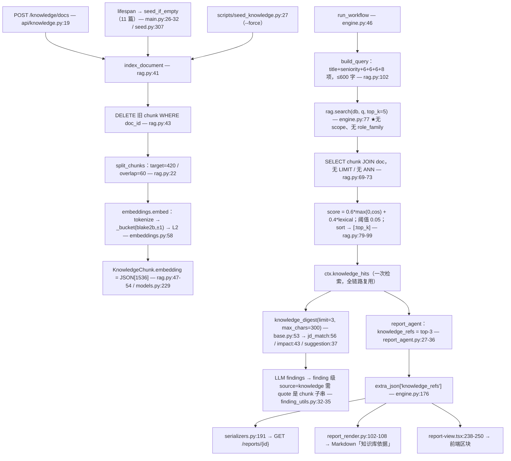

# ZhenResume 知识库 RAG 设计分析（证据版）

分析对象：`E:\ZhenResume\backend`（FastAPI + SQLAlchemy，SQLite）。
方法：全文阅读 `services/rag.py`、`services/embeddings.py`、`models.py`、`api/knowledge.py`、`services/seed.py`、`scripts/seed_knowledge.py`、`config.py`、`schemas.py`，grep 全仓消费者；并用仓库自带 venv 对 `backend/data/zhenresume.db` 做**只读**查询与函数复现（未修改任何文件，除本文件外）。

本文中所有数字均来自：仓库源码行号引用、`SEED_DOCS` 实际统计（11 篇）、本机 DB 实测（17 篇 / 22 切片）、或对真实函数/真实向量的一次性复现实验。凡属实测的，均标 `[实测]`。

---

## 0. 结论速览

| 维度 | 实际实现 | 位置 |
|---|---|---|
| 切片 | 段落正则聚合，target=420 / overlap=60，**超长单段不切** | `services/rag.py:18-38` |
| 向量 | **本地确定性哈希向量**（blake2b + 符号 + L2），非语义 embedding | `services/embeddings.py:58-64` |
| 维度 | `settings.embedding_dim = 1536` | `config.py:44` |
| 存储 | SQLite `JSON` 列存 1536 维 float 数组（无向量索引） | `models.py:228-229` |
| 检索 | Python 侧暴力全表扫描 + 混合打分 `0.6*cos + 0.4*lexical` | `services/rag.py:60-99` |
| 过滤 | 仅支持 `scope`；**`role_family` 有列、有索引、有返回值，但检索从不使用** | `rag.py:70-71` / `rag.py:92` |
| 触发点 | 每个分析任务开始时检索**一次**，`top_k=5`，全链路复用 | `workflow/engine.py:74-77` |
| 注入 | 3 个 Agent 的 prompt 拿到 `knowledge_digest()`（默认 limit=3 / 每片 300 字），report Agent 不注入 | `agents/base.py:53-60` |
| 溯源 | 报告级 `knowledge_refs`（取 top-3），落 `analysis_reports.extra_json` | `agents/report_agent.py:27-36`、`engine.py:176` |
| 向量库 | **无 pgvector、无 ANN、无 `<=>`**——全仓仅注释里提到未来迁移 | `grep pgvector/Vector/<=>` 结果见 §6 |
| 种子 | 11 篇 / 4 个 scope，启动时 `seed_if_empty` 灌入（切片后 16 个 chunk） | `services/seed.py:19-304`、`main.py:26-32` |

---

## 1. RAG 流水线总览（每阶段的函数 + file:line）

| 阶段 | 函数 / 位置 | 说明 |
|---|---|---|
| ① 文档录入 | `create_doc` — `app/api/knowledge.py:19-40` | `POST /api/v1/knowledge/docs`，`db.flush()` 拿 id 后立刻索引 |
| ① 文档录入（脚本） | `main()` — `scripts/seed_knowledge.py:20-33` → `seed_if_empty` — `app/services/seed.py:307-334` | `--force` 清空重建 |
| ② 切片 | `split_chunks` — `app/services/rag.py:22-38` | 段落正则 → 420/60 聚合 |
| ③ 向量化 | `embeddings.embed` — `app/services/embeddings.py:58-64`（内部 `tokenize` :30-48、`_bucket` :51-55、`l2_normalize` :67-71） | 每 chunk 一次 |
| ④ 存储 | `index_document` — `app/services/rag.py:41-57` | 先 `delete` 旧切片，再逐条 `db.add`，`db.flush()` |
| ⑤ 查询构造 | `build_query` — `app/services/rag.py:102-115` | 调用点唯一：`engine.py:75` |
| ⑥ 混合检索 | `search` — `app/services/rag.py:60-99` | 调用点两处：`engine.py:77`（top_k=5，无 scope）、`api/knowledge.py:75`（可传 scope） |
| ⑦ 提示词注入 | `AgentContext.knowledge_digest` — `app/agents/base.py:53-60` | 被 `jd_match_agent.py:56`、`impact_agent.py:43`、`suggestion_agent.py:37` 调用 |
| ⑧ 报告溯源 | `ReportAgent.run` — `app/agents/report_agent.py:27-36` → `engine._persist_report` — `engine.py:159-181` → `serializers.py:191` → `services/report_render.py:102-108` → `frontend/components/report-view.tsx:238-250` | 三层落点：DB `extra_json`、Markdown 导出、前端卡片 |

触发时序（`app/workflow/engine.py:65-77`）：

```python
        ctx = AgentContext(
            task_id=task_id,
            resume_text=resume.raw_text or "",
            jd_text=jd.raw_text or "",
            parsed_resume=_safe_resume(resume.parsed_json),
            parsed_jd=_safe_jd(jd.parsed_json),
            prompt_overrides=prompts.load_overrides(db),
        )

        # RAG 检索：一次检索，全链路复用，避免每个 Agent 重复打库
        query = rag.build_query(ctx.parsed_jd.model_dump(), ctx.parsed_resume.model_dump())
        if query.strip():
            ctx.knowledge_hits = rag.search(db, query, top_k=5)
```

两个容易忽略的事实：

1. 检索发生在**任何 Agent 之前**，用的是入库时规则解析的 `parsed_json`（`api/jds.py:26,32`、`api/resumes.py:94,101`），而不是 ParseAgent 之后 LLM 修正过的版本。
2. `ctx.knowledge_hits` 只存一次；后续 3 个 Agent 各自调用 `knowledge_digest()`，是纯内存字符串拼接，无二次查库。

---

## 2. 切片策略（深度）

### 2.1 参数与完整实现

`_CHUNK_TARGET = 420` / `_CHUNK_OVERLAP = 60`（`rag.py:18-19`），实现（`rag.py:22-38`，逐字）：

```python
def split_chunks(content: str, *, target: int = _CHUNK_TARGET, overlap: int = _CHUNK_OVERLAP) -> list[str]:
    """按段落聚合成定长切片，带少量重叠以保留跨段语义。"""
    paragraphs = [p.strip() for p in re.split(r"\n\s*\n|\n(?=[#\-*\d])", content or "") if p.strip()]
    if not paragraphs:
        return []

    chunks: list[str] = []
    buf = ""
    for para in paragraphs:
        if buf and len(buf) + len(para) + 1 > target:
            chunks.append(buf)
            buf = (buf[-overlap:] + "\n" + para) if overlap else para
        else:
            buf = f"{buf}\n{para}" if buf else para
    if buf:
        chunks.append(buf)
    return chunks
```

### 2.2 段落正则的精确语义

`re.split(r"\n\s*\n|\n(?=[#\-*\d])", content or "")`：

- 第一个分支 `\n\s*\n`：空行分段（含只含空白的行）。
- 第二个分支 `\n(?=[#\-*\d])`：换行**后面**紧跟 `#`（Markdown 标题）、`-`（无序列表）、`*`、或数字（有序列表 `1.`）时切分。注意是**零宽前瞻**，`\n` 被吃掉，列表标记保留在下一段段首。
- **软换行不切分**：一行以中文/字母开头时不会成为切分点。实测（`[实测]`）：构造 `"前置说明。"*30 + "\n" + "1. …"*4 + "\n" + "后续段落。"*40`（443 字），正则产出 6 个段落，其中 `i=4` 的段落长度为 **223**——因为 "后续段落。…"（200 字）不以 `#-*数字` 开头，被**并入**了第 4 条列表项。
- `p.strip()` 之后空段落被丢弃（`if p.strip()`），所以 tab/全角空格行也会被当空行处理。

### 2.3 缓冲区如何携带 overlap

- 只有当 `buf` 非空且 `len(buf) + len(para) + 1 > target` 时才 flush；flush 后新 buffer 的初值是**上一块尾部 `overlap` 个字符** + `"\n"` + 当前段（`rag.py:33`）。
- 因此 overlap 是**按字符切片**的，可能从词/句中间截断；Python 字符串切片按码位，不会产生半个 UTF-8 字符，但会出现半截词。
- overlap 会进入下一块的**长度预算**：下一段的 flush 判断基于含 overlap 的 `buf`，所以块长普遍略小于 `target`。实测（`[实测]`）该 443 字文档输出 `chunks=2, lens=[219, 284]`，`219 + 284 = 503 = 443 + 60`，即**恰好插入了一次 60 字重叠**；对上一块尾部 60 字做子串回溯验证，命中长度正好 **60**。

### 2.4 种子数据的真实切片结果（`[实测]`）

用仓库内 `split_chunks` 跑 `SEED_DOCS`：**11 篇 → 16 个 chunk**。

- `role/backend` 595 字 → 2 块（403, 246）；`role/frontend` 472 → 2（411, 115）；`role/algorithm` 394 → 1（388）
- `role/product` 322 → 1（316）；`role/data` 323 → 1（317）；`role/marketing` 301 → 1（296）
- `resume_template/general` 516 → 2（402, 168）；491 → 2（390, 158）；317 → 1（314）
- `compliance/general` 399 → 1（395）；`industry/general` 518 → 2（382, 191）

可见：`target=420` 只在跨段累计时生效，单块长度分布 115–411，**尾块普遍偏短**（115/158/168/191），因为它们只是"剩下没装进去的部分"。

### 2.5 失败模式（全部 `[实测]`）

| 失败模式 | 复现输入 | 结果 | 后果 |
|---|---|---|---|
| **单个超长段落不切** | 无空行、无列表标记的 3200 字文本 | `chunks=1, lens=[3200]` | 该块远超 target；检索粒度变粗，一个 chunk 里混多个主题；`lexical_overlap` 分母是 query 侧，仍能算分，但向量被稀释 |
| **overlap + 超长段叠加** | `"A"*100 + "\n\n" + "B"*500 + "\n\n" + "C"*100` | `lens=[100, 561, 161]` | 561 > 420，且 561 = 60(overlap) + 1 + 500；target 只是"软约束" |
| **软换行段落膨胀** | §2.2 的 443 字样例 | 段落 4 = 223 字 | 列表项与其后的散文被绑成一个检索单元 |
| **无兜底长度上限** | 任意超长 content | 无 `content` 长度校验（`schemas.py:46` 只有 `min_length=1`） | 5 万字文档会产出数万字的单块（若无空行） |
| **overlap 可能大于块本身** | 极短段落序列 | 尾块可短于 60（如上表 115/158） | 短块与 overlap 重复度高，去重靠 `chunk_id` 不成立 |

> 关键结论：`target/overlap` 是**聚合目标**，不是**硬上限**。没有 `max_chunk_chars`、没有按句号/换行的二次切分、没有 token 数上限校验收口。

---

## 3. 向量化

### 3.1 为什么用哈希而不是真实 embedding 模型

`services/embeddings.py:1-12` 的模块 docstring（逐字）：

```python
"""文本向量化。

**重要取舍**：DeepSeek 目前不提供 embedding 接口（只有 chat/completions）。
为了让 RAG 在 MVP 阶段零成本、可离线、结果可复现，这里用**本地确定性哈希向量**：

- 中文按「单字 + 相邻双字」切分，英文按词切分（覆盖中文岗位知识库的主要检索场景）
- 用 blake2b 哈希到固定维度（不用内置 hash()，因为其对 str 带随机种子，跨进程不稳定）
- L2 归一化后可直接用点积当余弦相似度

升级路径：把 `embed()` 换成 bge-m3 或 text-embedding-3-small 的调用即可，
`knowledge_chunks.embedding` 换成 pgvector 的 Vector(1536) 列，检索层无需改动。
"""
```

即三条理由：**DeepSeek 无 embedding 接口**（`config.py:34-37` 只暴露 chat 模型配置）、**零成本可离线**、**可复现**（避开了 `hash()` 的 `PYTHONHASHSEED` 随机化）。代价是它**没有语义**：同义改述、词序、上下文一律不可感知。

### 3.2 分词：CJK 单字 + 相邻双字，英文按词

正则与停用词（`embeddings.py:22-27`）：

```python
_CJK_RUN_RE = re.compile(r"[\u3400-\u4dbf\u4e00-\u9fff\uf900-\ufaff]+")
_LATIN_RE = re.compile(r"[a-zA-Z][a-zA-Z0-9+#.\-]*|\d+[a-zA-Z]*")
_STOPWORDS = {
    "的", "了", "和", "与", "及", "或", "在", "是", "有", "为", "对", "等",
    "the", "and", "for", "with", "you", "are", "our", "will", "that", "this",
}
```

`tokenize`（`embeddings.py:30-48`，逐字）：

```python
def tokenize(text: str) -> list[str]:
    """产出检索用 token：中文单字 + 双字，英文/数字词。"""
    text = (text or "").lower()
    tokens: list[str] = []

    for run in _CJK_RUN_RE.findall(text):
        for ch in run:
            if ch not in _STOPWORDS:
                tokens.append(ch)
        for i in range(len(run) - 1):
            bigram = run[i : i + 2]
            if bigram not in _STOPWORDS:
                tokens.append(bigram)

    for word in _LATIN_RE.findall(text):
        if word not in _STOPWORDS and len(word) > 1:
            tokens.append(word)

    return tokens
```

要点与边界：

- 先在 `run` 内按**连续 CJK 串**处理：单字全出，双字为 `run[i:i+2]`，**不跨标点/空格**（所以"后端,工程师"不会产出"端工"这种跨标点 bigram）。
- 停用词只做**精确匹配**：双字 bigram 形如 `"的X"` 不在集合里，仍会进入 token——停用词过滤对 bigram 基本无效。
- CJK 范围是 Ext-A `\u3400-\u4dbf`、BMP `\u4e00-\u9fff`、兼容区 `\uf900-\ufaff`；**不含 Ext-B（U+20000 以上）**，生僻字直接丢失。日文假名、希腊字母 `α`、全角字母都不参与（`_LATIN_RE` 字母类是 ASCII）。
- `\d+[a-zA-Z]*` 在 `str` 模式下 `\d` 为 Unicode Nd，全角数字也会命中；`[a-zA-Z0-9+#.\-]*` 允许保留 `C++`、`Node.js`、`K8s` 这类技术名词。
- `len(word) > 1` 会丢掉单字母（`R` 语言、`C` 语言检索失效）。
- 全量小写（`embeddings.py:32`）：`Kubernetes` 与 `kubernetes` 视为同一个 token，但**不做同义归并**（`K8s` ≠ `Kubernetes`），这与知识库自身在 `seed.py:293-294` 里描述的 ATS 行为并不一致。

### 3.3 哈希分桶（含符号）与完整向量

`_bucket` 与 `embed`（`embeddings.py:51-64`，逐字）：

```python
def _bucket(token: str, dim: int) -> tuple[int, float]:
    """哈希到 [0, dim)，并给一个确定性的正负号以降低碰撞偏置。"""
    digest = hashlib.blake2b(token.encode("utf-8"), digest_size=8).digest()
    value = int.from_bytes(digest, "big")
    return value % dim, 1.0 if (value >> 63) & 1 else -1.0


def embed(text: str, dim: int | None = None) -> list[float]:
    dim = dim or settings.embedding_dim
    vec = [0.0] * dim
    for token in tokenize(text):
        idx, sign = _bucket(token, dim)
        vec[idx] += sign
    return l2_normalize(vec)
```

数学与取舍：

- **参数表**：`blake2b(digest_size=8)` → 64 位无符号整数 `v`；桶 `idx = v mod 1536`；符号 `sign = +1 if bit63(v) else -1`（这是标准的 feature hashing / hashing trick + 符号函数）。
- **符号的作用**：不带符号的 hashing trick 里，任意两个 token 碰撞都只会**正向累加**，产生系统性正偏置（"所有文本看起来都相似"）。带 ±1 后，碰撞项的期望贡献为 0，只增加方差——这直接压低了无关文本之间的余弦。
- **符号的独立性与取模**：符号取自同一个 64 位摘要的最高位，而桶位取自整个 `v mod dim`，二者并不严格独立（实践上无害，但"符号与桶独立"的说法在此代码里不成立）；`dim=1536 = 3 × 2^9` 不是 2 的幂，`v % dim` 有极轻微不均匀（对 64 位输入可忽略），换 2048 维可用位掩码更省。
- **权重**：每个 token 权重恒为 1，等价于**词频 (TF)**，没有 sublinear TF（`1+log tf`）、没有 IDF、没有停用词加权。长 chunk 中高频 bigram（如"工程/能力/经历"）会持续累积，这正是 §4.4 里通用文档挤进前排的机制之一。
- **L2 归一化**（`embeddings.py:67-71`）：`norm = sqrt(sum(v*v))`；`norm == 0` 时**原样返回全 0 向量**（不做除零保护式替换），随后 `cosine` 的 `na == 0` 分支返回 `0.0`（`embeddings.py:81-82`），链路安全。
- **碰撞量级（估算，`[实测]` 得 token 规模）**：单个 chunk 的 token 数在 **62–547**（22 个 chunk 实测 min/max），桶数 1536。以 547 个（含大量重复）token 计，按生日问题近似，去重后大约 300–400 个不同 token 落到 1536 个桶里，**期望有多组碰撞**——但符号相消使其主要体现为数值噪声而非系统性偏置。

### 3.4 哈希向量的噪声地板（`[实测]`）

对真实库中 22 个 chunk 的已存向量，用真实 `embed/cosine/lexical_overlap` 复现：

| 探针 query | top1 混合分 | ≥0.05 的 chunk 数 |
|---|---|---|
| `zzzqqq xxyyww vvbbnn`（纯无意义 ASCII） | 0.0387 | 0 / 22 |
| `qqq zzz 12345 abcdefg` | 0.0597 | 1 / 22 |
| `薯调羹 鹌鹑 龘靐齉`（低频/生僻字） | 0.0385 | 0 / 22 |

全部 22 个 chunk 两两余弦：`min=0.0186, median=0.1364, max=1.0000`（`max=1.0` 来自 `scripts/verify.py:292-298` 写入的同名测试文档产生的重复向量）。
结论：**无关文本的余弦中位数 ~0.14**，乘以 0.6 后约 0.08，**高于默认 `min_score=0.05`**——即阈值拦不住噪声，但纯 ASCII 无意义 query 能落到阈值以下（0.0387 < 0.05）。

---

## 4. 混合打分

### 4.1 打码公式与去噪/钳制

`search` 的核心循环（`rag.py:77-99`，逐字）：

```python
    query_vec = embeddings.embed(query)
    hits: list[dict] = []
    for chunk, doc in rows:
        text = chunk.chunk_text or ""
        vector_score = embeddings.cosine(query_vec, chunk.embedding)
        lex_score = embeddings.lexical_overlap(query, text)
        score = 0.6 * max(0.0, vector_score) + 0.4 * lex_score
        if score < min_score:
            continue
        hits.append(
            {
                "chunk_id": chunk.id,
                "doc_id": doc.id,
                "title": doc.title or "",
                "scope": doc.scope or "",
                "role_family": doc.role_family or "",
                "score": round(min(score, 1.0), 4),
                "text": text,
            }
        )

    hits.sort(key=lambda h: h["score"], reverse=True)
    return hits[:top_k]
```

- **负余弦被钳到 0**（`max(0.0, vector_score)`）：避免"负相关"反向拉低一个词面命中的块；副作用是丢失了"明确不相关"的区分能力。
- **上钳**（`round(min(score, 1.0), 4)`）：`0.6*1 + 0.4*1 = 1.0` 理论可达，属防御性写法。
- **阈值**：`min_score: float = 0.05`（`rag.py:66` 默认值）。两个调用点都没传 `min_score`：`engine.py:77`、`api/knowledge.py:75` → 线上恒为 0.05。
- **top_k**：`rag.py:64` 默认 5；工作流**硬编码 5**（`engine.py:77`）；API 走请求体 `top_k: int = Field(default=5, ge=1, le=20)`（`schemas.py:52`）。`config.py:45` 的 `rag_top_k: int = 5` **全仓未被读取**（grep `rag_top_k` 只命中定义处），属死配置。
- **排序稳定性**：`hits.sort(key=..., reverse=True)` 是稳定排序，同分时保持 SQL 返回顺序（无 `ORDER BY`，`rag.py:69`）→ **同分块的相对顺序依赖 SQLite 的行返回顺序，不可复现**；`hits[:top_k]` 因此有边界抖动风险。

### 4.2 余弦实现

`embeddings.py:74-83`（逐字）：

```python
def cosine(a: list[float] | None, b: list[float] | None) -> float:
    """向量已归一化，点积即余弦；此处仍做防御性归一化。"""
    if not a or not b or len(a) != len(b):
        return 0.0
    dot = sum(x * y for x, y in zip(a, b))
    na = math.sqrt(sum(x * x for x in a))
    nb = math.sqrt(sum(y * y for y in b))
    if na == 0 or nb == 0:
        return 0.0
    return max(-1.0, min(1.0, dot / (na * nb)))
```

虽然向量入库前已 L2 归一化，这里仍**每对都重算两个范数**：每 chunk 多 2×1536 次乘加。22 行无感，10 万行就是纯浪费（且 `len(a) != len(b)` 直接返回 0，维度不一致会静默变成"不相关"，掩盖迁移事故）。

### 4.3 词面重合度

`embeddings.py:86-94`（逐字）：

```python
def lexical_overlap(query: str, text: str) -> float:
    """词面重合度，作为向量分的补充信号（对短关键词检索更稳）。"""
    q = set(tokenize(query))
    if not q:
        return 0.0
    t = set(tokenize(text))
    if not t:
        return 0.0
    return len(q & t) / len(q)
```

- 分母是**query 的 token 集合大小**，所以它是"query 覆盖率"而非对称相似度：极短 query（1–2 个 token）只要命中就接近 1.0。
- 集合化抹掉词频与 `chunk` 长度，也**没有 IDF**：`工程`、`能力`、`经历` 这类高频 bigram 的命中与低频专有名词（`RocketMQ`）的命中等价。
- 结构上偏向"长文本更容易覆盖 query"——因为 chunk 越长，命中集合越大。这与 §3.3 的 TF 累积叠加，共同造成通用长文档占优。

### 4.4 为什么纯向量对短查询不稳 + 实测排名

哈希向量只表达**字面 token 分布**，不含上下文。短查询（如单个 `Kubernetes`）在 1536 维里只有 1 个单字 + 若干 bigram 的稀疏命中，而长 chunk 的向量是几百个 token 的叠加，其与任何 query 的余弦都会趋于噪声中位（~0.14）。0.6 的权重会让"字面命中"被稀释，因此 0.4 的 `lexical_overlap` 是实际决定排序的信号——这也是 docstring `rag.py:3-5` 的自我说明：

```python
"""知识库 RAG：切片、入库、检索。

检索打分 = 0.6 × 向量余弦 + 0.4 × 词面重合度。
纯向量对短查询（如「Kubernetes」）召回不稳，混合打分的工程性价比更高。
MVP 在 Python 侧做暴力检索；换 pgvector 后改为 SQL `ORDER BY embedding <=> :q` 即可。
"""
```

实测（真实库 22 chunk，真实函数）暴露两个具体现象：

| query | top-1（score / cos / lex） | 观察 |
|---|---|---|
| `Kubernetes 服务治理 高并发 分布式事务` | role/backend《后端工程师能力模型与量化标准》 0.5422 / 0.3322 / 0.8571 | 命中正确；12/22 chunk ≥ 0.05（候选过宽） |
| `后端工程师` | **role/frontend《前端工程师能力模型与量化标准》 0.5191** / 0.4962（backend 第二） | **单标题式短 query 排序错误**：两块都命中 `工程师`/`工程`/`程师`，frontend 块因 token 分布恰好更接近而反超 |
| `产品经理 需求分析` | role/product 0.4998 / 0.3092 / 0.7857 | 正确；但 2–5 名是 data/frontend/backend，全部为 `skill_model` 模板化文案 |
| `简历 排版 表格 ATS` | industry《ATS 关键词匹配…》0.4474 与 resume_template《简历结构与排版规范》0.4232 | 正确；第 3 名是 compliance，属噪声 |

即：**多字段 query 表现尚可，单字段/单关键词 query 不可靠**。而 `build_query`（§5）恰好把 JD 标题 + 技能 + 关键词 + 职责拼成长 query，实际路径比上表第一行更接近可用区。

---

## 5. 查询构造

`build_query`（`rag.py:102-115`，逐字）：

```python
def build_query(parsed_jd: dict | None, parsed_resume: dict | None) -> str:
    """用 JD 的岗位名 + 技能 + 关键词拼检索 query。"""
    jd = parsed_jd or {}
    parts: list[str] = []
    for key in ("title", "seniority"):
        if jd.get(key):
            parts.append(str(jd[key]))
    for key in ("skills_core", "keywords", "responsibilities"):
        values = jd.get(key) or []
        if isinstance(values, list):
            parts.extend(str(v) for v in values[:6])
    skills = (parsed_resume or {}).get("skills") or []
    parts.extend(str(s) for s in skills[:8])
    return " ".join(parts)[:600]
```

字段与配额：

| 来源 | 字段 | 条数上限 |
|---|---|---|
| JD | `title`、`seniority` | 各 1（若存在） |
| JD | `skills_core` | 6 |
| JD | `keywords` | 6 |
| JD | `responsibilities` | **6 条整句** |
| 简历 | `skills` | 8 |
| 合计 | `" ".join(...)` | **600 字符硬截断**（`[:600]`） |

- 只用 JD 的结构化字段，**不用 `jd_text` 原文**，也不用简历的经历/项目文本。
- `responsibilities` 是自然语言长句（不是关键词），会显著拉长 query 且稀释信号；`skills_bonus` 未使用。
- 简历侧只贡献 `skills`；`parsed_resume` 为空时退化为纯 JD query。

实测（`[实测]`，取 DB 中真实一条 JD 的 `parsed_json` 复现）：产出 query 长度 **229 字符**，内容为：

```
后端开发工程师 3-5年 Java Go Spring Spring Boot Spring Cloud MySQL 高并发 分布式 微服务 性能优化 稳定性 架构设计 1. 负责核心服务架构设计与开发，保障高并发场景下的稳定性； 2. 负责微服务体系搭建，推动服务治理落地； …… Python Docker MySQL Redis Kafka Go
```

注意尾部 `Docker MySQL Redis Kafka Go` 来自简历技能栏——**JD 与简历技能被拼进同一个 query**。这是个刻意的折中（让检索同时对齐"岗位要求"和"候选人已有"），但也意味着 query 的语义中心会随简历漂移：换一份简历，为同一 JD 检索到的知识依据就会变。

`engine.py:76` 有 `if query.strip():` 守卫，query 为空则不检索（`ctx.knowledge_hits` 保持 `[]`），此时 `knowledge_digest()` 走 `base.py:56` 的兜底文案。

---

## 6. 存储模型与迁移

### 6.1 表结构

`models.py:205-233`：

- `knowledge_docs`：`id String(36)` PK（Python 侧 `uuid4`，`models.py:31-32`）；`scope String(50)` **`index=True`**（:210）；`role_family String(100)` **`index=True`**（:211）；`doc_type String(50)`；`title String(255)`；`content Text`；`doc_metadata` 映射到列名 `"metadata"`、`JSON`（:216，注释说明与 DDL 对齐）。
- `knowledge_chunks`：`id String(36)` PK；`doc_id String(36)` FK → `knowledge_docs.id` `ondelete=CASCADE`，**无索引**；`chunk_text Text`；`embedding JSON`（SQLite 下是 JSON 数组，:228-229）；`doc_metadata JSON`（列名 `"metadata"`）。

关系：`KnowledgeDoc.chunks` 为 `cascade="all, delete-orphan"`（`models.py:219`），删 doc 会连带删 chunk；同样 `ondelete="CASCADE"` 在 SQLite 侧由 `PRAGMA foreign_keys=ON` 生效（`db.py:34-38`）。

### 6.2 向量的实际落盘形态（`[实测]`，本机 DB）

- `SELECT length(embedding) FROM knowledge_chunks` 抽样：**13081 / 11592 / 13047 字节**——即每块 1536 个浮点数的 JSON 文本（约 11.5–13 KB）。
- `metadata` 实例：`{"index": 0, "title": "后端工程师能力模型与量化标准", "scope": "role", "seeded": true}`。构造见 `rag.py:52`：

```python
                doc_metadata={"index": i, "title": doc.title, "scope": doc.scope, **(doc.doc_metadata or {})},
```

  注意 `**` 展开在最后：`doc_metadata` 可以覆盖 `index/title/scope`。chunk 元数据**不含** `role_family`/`doc_type`/`doc_id`（doc_id 是列），所以按 `role_family` 过滤必须 join `knowledge_docs`——而检索侧确实 join 了（`rag.py:69`）。
- 索引现状（`[实测]` 读 `sqlite_master`）：
  - `knowledge_docs`：`ix_knowledge_docs_scope`、`ix_knowledge_docs_role_family`；
  - `knowledge_chunks`：**仅有主键自动索引**，`doc_id` 无索引。
  后果：`index_document` 的 `DELETE ... WHERE doc_id = ?`（`rag.py:43`）和 join 在数据量上升后是全表扫描。

### 6.3 为什么现在是 Python 侧暴力检索

`search` 把符合条件的**全部行**取回内存（`rag.py:69-73`）：

```python
    stmt = select(KnowledgeChunk, KnowledgeDoc).join(KnowledgeDoc, KnowledgeChunk.doc_id == KnowledgeDoc.id)
    if scope:
        stmt = stmt.where(KnowledgeDoc.scope == scope)

    rows = db.execute(stmt).all()
```

- 没有 `LIMIT`、没有 ANN，代价 = O(全部 chunk 数 × 1536) 的 Python 循环 + `json.loads` 反序列化。`[实测]` 本机 22 行的规模完全无压力。
- SQLite 没有 VECTOR 类型，`models.py:7-8` 已说明：

```python
4. SQLite 没有 VECTOR 类型，`knowledge_chunks.embedding` 先用 JSON 存向量；
   换 PG 时改为 `Vector(1536)` 并建 HNSW 索引即可，检索层代码不用动。
```

- README 中把它列为明示差异（`README.md:168`）："PostgreSQL + pgvector | SQLite（DDL 同构）+ Python 侧暴力检索 | …升级动作：改 `DATABASE_URL`；`knowledge_chunks.embedding` 从 JSON 换成 `Vector(1536)` 并建 HNSW 索引"。

### 6.4 pgvector / ANN 的真实状态：**完全未使用**

grep `pgvector|Vector|<=>|hnsw|HNSW|embedding` 的全仓结果中，`Vector`/`pgvector`/`<=>` **只出现在注释与文档**里，无任何可执行代码路径：

- `aaa.md:174,277,349,351,370`：DDL 草案 `embedding VECTOR(1536)`、技术选型表（"LlamaIndex + pgvector"）。
- `README.md:135,168,316-317,335`：目录说明、差异表、已知边界、下一步；`models.py:4,7-8,228`：迁移注释；`db.py:3`、`config.py:29`："换 DATABASE_URL 即可"注释；`embeddings.py:3,10-11`、`rag.py:5`：升级路径注释。
- `Dockerfile:64`：注释（且该注释里的数字有误，见 §8.3）。

即：**没有 pgvector 依赖、没有 `Vector` 列、没有 `<=>` 查询、没有 HNSW/IVFFlat 索引、没有 Alembic 迁移**（`README.md:321`："没有 Alembic 迁移：`init_db()` 直接建表"）。

### 6.5 迁移到 pgvector 的精确清单

**必须改（否则不生效）**

1. `backend/pyproject.toml`（或 requirements）加 `pgvector`（SQLAlchemy 侧 `from pgvector.sqlalchemy import Vector`）。
2. `models.py:229`：`embedding: Mapped[list | None] = mapped_column(JSON)` → `mapped_column(Vector(1536))`。
3. `config.py:30` `database_url` 改为 `postgresql+psycopg://...`；`db.py:22,28,32-39` 的 SQLite 专用分支（`check_same_thread`、WAL pragma）会自动失效，但建议清理。
4. **建索引**（`init_db` 不会自动建 ANN 索引）：
   `CREATE INDEX ix_knowledge_chunks_embedding ON knowledge_chunks USING hnsw (embedding vector_cosine_ops);`
5. `rag.search`（`rag.py:69-99`）改为"ANN 取候选 → 再算 lex"两段式，否则 `ORDER BY embedding <=> :q` 只是把暴力排序搬进 SQL，且**混合打分无法直接下推**：`0.6*cos + 0.4*lexical` 里的 `lexical_overlap` 依赖 Python 分词（`embeddings.py:30-48`），SQL 里没有等价函数。可行写法是先 `ORDER BY embedding <=> :q LIMIT top_k*N`（N 取 5–10），再在 Python 里对候选做 lex 融合与重排。
6. **补 `knowledge_chunks.doc_id` 索引**（当前缺失，§6.2）。

**不用改**：`split_chunks`（`rag.py:22-38`）、`build_query`（`rag.py:102-115`）、`index_document` 的"先删后插"语义（`rag.py:41-57`）；`knowledge_digest` 与三个 Agent 的注入点（`base.py:53-60`、`jd_match_agent.py:56`、`impact_agent.py:43`、`suggestion_agent.py:37`）；`knowledge_refs` 的产出/落库/渲染（`report_agent.py:27-36`、`engine.py:176`、`serializers.py:191`、`report_render.py:102-108`）；API 契约（`docs/api-contract.md:341-343`）与前端类型（`frontend/lib/types.ts:486-523`）。

**换真实 embedding 时必然发生、但代码里没有机制保障的两件事**

- **维度必须与模型一致**：`config.py:44` 的 1536 与 `text-embedding-3-small` 一致，但 docstring 同时提到 `bge-m3`——**bge-m3 的 dense 维度是 1024**，直接换会触发 `embeddings.py:76` 的 `len(a) != len(b)` 分支，`cosine` **静默返回 0.0**，检索退化为纯词面分而不报错。必须同时改 `embedding_dim`、`Vector(1024)` 并重建列。
- **存量 JSON 向量会变成垃圾**：必须全量重新切片入库。当前**没有 re-index API**（见 §8.2），唯一途径是 `python -m scripts.seed_knowledge --force`（`scripts/seed_knowledge.py:5,22,27`），它会删掉全部 `knowledge_docs`（`seed.py:313-316`）——**手工通过 API 录入的文档会一起被删**。

---

## 7. 检索结果的消费与溯源

### 7.1 注入：`knowledge_digest`

`app/agents/base.py:31,39,53-60`（逐字）：

```python
    knowledge_hits: list[dict] = field(default_factory=list)
    ...
    knowledge_refs: list[dict] = field(default_factory=list)
    ...
    def knowledge_digest(self, limit: int = 3, max_chars: int = 300) -> str:
        """把检索到的知识库切片压成提示词片段。"""
        if not self.knowledge_hits:
            return "（无可用知识库依据，请仅依据简历与 JD 原文判断）"
        lines: list[str] = []
        for hit in self.knowledge_hits[:limit]:
            lines.append(f"- [{hit.get('title') or '知识库'}] {str(hit.get('text') or '')[:max_chars]}")
        return "\n".join(lines)
```

- **默认 limit=3 / 每片 300 字**：即使检索取了 top-5，提示词最多只看到 3 片 × 300 字 = 900 字（不含标题）。第 4、5 条命中**永远不会进入任何 prompt**。
- 格式是 `- [标题] 正文前 300 字`，**不带 doc_id/chunk_id/score**——模型无法引用出处，只能复述内容。
- **三个消费点**（都用默认 `max_chars=300`；`suggestion_agent` 只是把 `limit` 显式写成默认值）：

```python
# app/agents/jd_match_agent.py:56 / impact_agent.py:43
            f"【岗位知识库依据】\n{ctx.knowledge_digest()}\n\n"
# app/agents/suggestion_agent.py:37
            f"【岗位知识库依据】\n{ctx.knowledge_digest(limit=3)}\n\n"
```

- **`report_agent` 不注入知识**：其 user prompt（`report_agent.py:43-51`）只含岗位、五维分、问题分布与最严重问题。它仅从 `ctx.knowledge_hits` **读取**元信息生成引用。同理 `ats_agent`、`risk_agent`、`qc_agent`、`parse_agent` 都不用 digest（grep `knowledge_digest` 仅 3 处命中）。
- 因此知识库的**内容**只影响 jd_match / impact / suggestion 三个 Agent 的输出，从而间接影响 findings 与分数；它不直接决定报告分值（分数由 `analyze.compute_scores` 规则计算，`report_agent.py:22`）。

### 7.2 溯源：`knowledge_refs`

`app/agents/report_agent.py:27-36`（逐字）：

```python
        ctx.knowledge_refs = [
            {
                "doc_id": hit.get("doc_id"),
                "chunk_id": hit.get("chunk_id"),
                "title": hit.get("title") or "",
                "scope": hit.get("scope") or "",
                "score": hit.get("score"),
            }
            for hit in ctx.knowledge_hits[:3]
        ]
```

- 取 **top-3**，字段比契约多一个 `"score"`：契约样例是 `{ "doc_id", "chunk_id", "title", "scope" }`（`docs/api-contract.md:291-293`），实现多返回 `score`（前端类型 `frontend/lib/types.ts:405` 的 `KnowledgeRef` 需能容忍）。
- 落库路径：`report_agent` 写入 `output["knowledge_refs"]`（`report_agent.py:65`）→ `ctx.outputs` → `engine._persist_report` 的 `extra_json["knowledge_refs"]`（`engine.py:172-181`）。
- 读出：`serializers.py:191` `"knowledge_refs": extra.get("knowledge_refs") or []`（缺省为空数组，契约不破）。
- Markdown 导出：`services/report_render.py:102-108` 渲染为「## 六、知识库依据」+ `- [scope] title（相关度 score）`。
- 前端：`frontend/components/report-view.tsx:238-250` 仅在 `report.knowledge_refs.length > 0` 时渲染该区块。
- **报告级 vs 发现项级**：发现项级还有一条独立通路——`agents/finding_utils.py:32-35`：

```python
    for hit in ctx.knowledge_hits:
        if quote and quote in (hit.get("text") or ""):
            return {"source": "knowledge", "quote": quote, "span": None, "field": field, "doc_id": hit.get("doc_id"), "chunk_id": hit.get("chunk_id")}
```

  条件是**引文是某 chunk 原文的精确子串**（`quote in text`）。由于 prompt 只暴露前 300 字，模型只能引用它看到的内容 → 实际上 finding 级 `source="knowledge"` 的证据**只能落在注入窗口内**。`docs/api-contract.md:305` 允许 `evidence.source ∈ resume|jd|knowledge`。
- QC 对引用的态度是"只记录不拦截"：`qc_agent.py:116` 输出 `"knowledge_refs_count"`，而规则检查 ④ 明确写 `# ④ 知识库引用：报告级检查，无引用时不拦截，仅记录`（`qc_agent.py:160-161`），返回 `keep`。审核脚本则更严：`scripts/verify.py:204` `check("知识库引用非空（RAG 生效）", len(report["knowledge_refs"]) >= 1, ...)`。

### 7.3 可观测性缺口

`engine._input_digest` 每步只记录命中**数量**（`engine.py:215`：`"knowledge_hits": len(ctx.knowledge_hits),`）→ `workflow_steps.input_json` 里没有 query、没有命中标题/分数/scope。要复现"这次报告为什么引用了这几篇"，只能看 `analysis_reports.extra_json.knowledge_refs`（3 条）或 `agent_outputs`（`engine.py:179`）。中间过程（query 字符串、5 条命中的完整评分）**没有落盘**。

---

## 8. 治理

### 8.1 scope / role_family 过滤：只实现了一半

- `rag.search` 支持 `scope`（`rag.py:70-71`）并把它透传到 SQL：`stmt.where(KnowledgeDoc.scope == scope)`。
- 只在这一个地方被使用：`api/knowledge.py:75` `rag.search(db, payload.query, top_k=payload.top_k, scope=payload.scope)`，而 `KnowledgeSearch.scope` 的枚举是 `KnowledgeScope = Literal["role", "industry", "resume_template", "compliance"]`（`schemas.py:15,53`）。
- **工作流路径完全不传 scope**（`engine.py:77`：`rag.search(db, query, top_k=5)`）→ 每次分析任务都在**全库**（11 篇 × 全 scope）里检索，6 篇 role 模型、3 篇表达范式、1 篇合规、1 篇行业互相竞争。实测印证：backend 关键词的 query 里，第 2–5 名分别是 `resume_template`（自我评价，0.3739）、`industry`（ATS 191 字块，0.3093）、`industry`（ATS 382 字块，0.2773）、`resume_template`（黄金表达结构，0.2311）——**5 个候选里只有 1 个来自目标岗位族**。
- **`role_family` 从不参与过滤**：列有索引（`models.py:211`）、`search` 会返回它（`rag.py:92`）、`ctx.role_family` 也确实被算出来了（`parse_rules.guess_role_family`，`parse_rules.py:522-536`，由 `parse_agent.py:87` 赋值），而 `parse_rules.py:504` 的注释自称"用于知识库 scope/role_family 过滤"——但 `rag.search` **没有 `role_family` 参数**，`engine.py:77` 也没法传。即：**该过滤能力是死代码级别的未接线**。

`guess_role_family` 的取值集（`parse_rules.py:506-519`）是 backend/frontend/algorithm/data/test/ops/product/design/marketing/hr/finance/sales，而种子知识库只覆盖 backend/frontend/algorithm/product/data/marketing 六个 role_family（`seed.py:23,52,80,106,131,156`）——test/ops/design/hr/finance/sales 岗位**没有对应知识**，只能靠 `general` 文档兜底。

### 8.2 重建索引与文档生命周期

- **每次索引前先清旧切片**（`rag.py:41-57`，逐字）：

```python
def index_document(db: Session, doc: KnowledgeDoc) -> int:
    """把文档切片并写入向量，返回切片数。重复入库前会清掉旧切片。"""
    db.query(KnowledgeChunk).filter(KnowledgeChunk.doc_id == doc.id).delete(synchronize_session=False)

    count = 0
    for i, text in enumerate(split_chunks(doc.content or "")):
        db.add(
            KnowledgeChunk(
                doc_id=doc.id,
                chunk_text=text,
                embedding=embeddings.embed(text),
                doc_metadata={"index": i, "title": doc.title, "scope": doc.scope, **(doc.doc_metadata or {})},
            )
        )
        count += 1
    db.flush()
    return count
```

- **但"重复入库"这条路走不通**：`index_document` 只有两个调用点——`api/knowledge.py:36`（仅在 `POST /docs` 新建时）与 `seed.py:330`（种子灌入）。`api/knowledge.py` 全文只有一个 `@router.post("/docs")`、一个 `@router.get("/docs")`、一个 `@router.post("/search")`：**没有 PUT/PATCH/DELETE**。也就是说：
  - 改一篇文档的内容 → **无 API 可用**；
  - 删一篇文档 → **无 API 可用**（只能整体 `--force` 重建，或直接改库）；
  - 重新向量化（例如换 embedding 模型后）→ 只能全量 `--force`。
- `admin.py` 也没有知识库端点：grep 只找到 `GET /admin/metrics`、`GET /admin/prompts`、`POST /admin/prompts`、`GET /admin/feedback`（`api/admin.py:22,94,120,144`）。这与 `aaa.md:104`「管理后台：知识库维护、Prompt 模板管理、用户反馈审核、成本监控」相比，**知识库维护缺失**。
- 权限：`get_current_user` 只认 `X-Device-Id`，不存在即创建 `role="jobseeker"` 用户（`api/deps.py:18-29`）。`POST /knowledge/docs` 的依赖就是这个函数（`knowledge.py:23`），**不做 admin/role 校验**——任何客户端只要带一个 `X-Device-Id` 就能写入知识库，而写入的知识会进入后续所有分析任务的 prompt。

### 8.3 启动期种子引导

`app/main.py:26-32`：

```python
@asynccontextmanager
async def lifespan(_app: FastAPI):
    init_db()
    with session_scope() as db:
        created = seed_if_empty(db)
    if created:
        logger.info("知识库已灌入 %s 篇种子文档", created)
```

`seed_if_empty` 的判空逻辑（`seed.py:307-316`）：

```python
def seed_if_empty(db: Session, *, force: bool = False) -> int:
    """知识库为空时写入种子数据；force=True 时全量重建。"""
    existing = db.execute(select(func.count()).select_from(KnowledgeDoc)).scalar_one()
    if existing and not force:
        return 0
```

- 判据是 `knowledge_docs` 的**任意一行**（`if existing`），不校验来源、不校验 scope 覆盖、不校验 chunk 是否为空。
- **风险已被现网印证**（`[实测]` 本机 DB）：`knowledge_docs` 17 行、`knowledge_chunks` 22 行 = 11 篇种子（16 chunk）+ **6 篇「验证用文档」**（各 1 chunk，39 字），后者由 `scripts/verify.py:292-298` 每次跑验收时写入：

```python
    new_doc = client.post(
        "/api/v1/knowledge/docs",
        headers=headers,
        json={"scope": "role", "role_family": "test", "doc_type": "skill_model", "title": "验证用文档", "content": "这是一篇用于验证入库与切片流程的测试文档。\n\n第二段内容，用于产生第二个切片。"},
    )
```

  这些 39 字文档会进入每次检索的扫描集合（22 行全部计分），对常规岗位 query 得分极低——实测 query `Kubernetes 服务治理 高并发 分布式事务` 下 6 条测试切片**全部得 0.0**、未进 12 个 ≥0.05 候选；但换成词面贴近它们的 query（实测 `验证用文档 入库 切片流程 测试文档`）时，6 条测试切片得分 **0.6973** 并**包揽 top-5**，会把真正的知识依据挤出注入窗口。更严重的是：**一旦某条测试文档先于种子写入，启动灌种子就会被永久跳过**。
- `Dockerfile:64` 的注释写"知识库为空则灌 16 篇种子文档"——种子实际是 **11 篇文档 / 16 个切片**，该注释把 chunk 数当成了文档数（`[实测]` §2.4）。
- 种子内容定位（`seed.py:1-9` docstring）："role —— 岗位能力模型，用于竞争力差距对比；resume_template —— 优质表达范式，用于改写建议；compliance —— 公平性与合规红线，用于质检；industry —— 行业特性提示。"

### 8.4 种子内容盘点（`[实测]` 统计，11 篇）

| # | scope | role_family | doc_type | title |
|---|---|---|---|---|
| 1–6 | role | backend / frontend / algorithm / product / data / marketing（各 1 篇） | skill_model | 《{后端/前端/算法}工程师能力模型与量化标准》《产品经理能力模型与量化标准》《数据分析师能力模型与量化标准》《运营与市场岗能力模型与量化标准》 |
| 7–9 | resume_template | general | expression_pattern / structure / self_evaluation | 《经历要点的黄金表达结构》《简历结构与排版规范》《自我评价怎么写才有信息量》 |
| 10 | compliance | general | fairness_rules | 《简历与招聘中的公平性红线》 |
| 11 | industry | general | ats_notes | 《ATS 关键词匹配的实际工作方式》 |

scope 分布：`role 6 / resume_template 3 / compliance 1 / industry 1`；role_family 分布：`general 5 / backend|frontend|algorithm|product|data|marketing 各 1`。所有种子文档带 `doc_metadata={"seeded": True}`（`seed.py:326`）。

内容性质：**可判断依据型的结构化清单**，不是通用话术——每篇都是"分层能力要求 + 量化标准 + 常见减分项"或"弱→强对照"，正文用空行与 `-`/数字列表组织，因此切片效果良好（§2.4）。

代表性切片（`seed.py:183-205`，《经历要点的黄金表达结构》，实测 chunk 0 长度 402 字）逐字引用其一节：

```
弱：负责订单接口开发与维护。
强：主导订单核心接口的设计与重构，引入本地缓存与批量查询，支撑日均 200 万次调用，
    P99 延迟从 480ms 降至 120ms。
```

同一文档另一节（`seed.py:199-205`）：

```
写不出数字时的三个补救角度：
1. 规模替代：没有百分比，就写量级（服务多少用户、处理多少条数据、覆盖多少门店）；
2. 频次替代：没有改善幅度，就写频率（每天交付多少次、每周支撑多少场活动）；
3. 范围替代：没有结果数据，就写负责边界（独立负责 4 个模块、带 3 人小组）。

禁用词清单：负责、参与、协助、跟进、配合（除非后面紧跟明确的对象与结果）。
```

合规篇（`seed.py:259-276`）明确了"不得作为评价依据的字段"与"自动化系统应保留人工复核"；其约束在代码里另有**并行的规则实现**（`services/analyze.py:50` 与 `agents/qc_agent.py:25` 的 `DISCRIMINATION_RE`），即合规红线**主要靠正则拦截，而非靠 RAG 检索**——RAG 只提供解释性依据。

### 8.5 API 面（`api/knowledge.py` 全文 76 行）

- `POST /api/v1/knowledge/docs` → 201：建 doc → `flush` 拿 id → `index_document` → `commit` → `serialize_knowledge_doc(doc, chunk_count=...)`；`payload.metadata or {}` 写入 `doc_metadata`（`knowledge.py:31`），响应含 `chunk_count`（`serializers.py:210-211`）。
- `GET /api/v1/knowledge/docs?scope=&limit=&offset=` → `{items, total}`：`limit` 默认 20 / 上限 100（`knowledge.py:46`），按 `created_at desc`（:55），`total` 用子查询计数（:54），chunk 数用一次 `GROUP BY doc_id` 批量取（:57-64）避免 N+1。
- `POST /api/v1/knowledge/search`：直接转发 `rag.search`，返回 `{"items": hits}`；支持 `query`（≥1 字）、`top_k`（1–20，默认 5）、`scope`（`schemas.py:50-53`）；**不支持 `role_family`**，`min_score` 不可调。

契约一致性：`docs/api-contract.md:341-343` 与实现一致；前端封装已存在（`frontend/lib/api.ts:371-388`、`frontend/lib/types.ts:486-523`），但 grep `*.tsx` 未发现任何页面调用 `listKnowledgeDocs`/`createKnowledgeDoc` → **知识库维护在 UI 上不可达**（仅 `report-view.tsx` 展示引用）。

---

## 9. 诚实评估：这个设计**没有**做什么

1. **没有真实语义 embedding**：哈希向量等价于"稀疏字面特征 + 随机投影"，同义（`K8s` vs `Kubernetes`）、改述（"优化慢查询" vs "性能优化"）、跨语言（"backend" vs "后端服务"）一律不可见。README 自陈（`README.md:316-317`）："embedding 是本地哈希向量，不是语义向量：对'关键词式'岗位知识库够用，对长句语义检索会明显弱于 bge-m3 / text-embedding-3-small。"
2. **没有 reranker**：`hit[:top_k]` 直接截断（`rag.py:98-99`），没有 cross-encoder、没有 MMR 去冗余。实测 top-5 里常出现**同一文档的两个 chunk**（如 ATS 篇 191 与 382 字两块同时进前 5），吃掉名额。
3. **没有 query 扩展 / 改写 / HyDE**：`build_query` 是纯拼接（§5），无同义扩展、无停用词外的权重、无按字段加权（`title` 与第 6 条 `responsibilities` 权重相同）。
4. **没有 ANN 索引 / 没有向量库**：全表扫 + 每行 `json.loads`（§6.3、§6.4）。
5. **没有 embedding 质量保障**：没有离线评测集（无 recall@k / nDCG）、没有 golden query 回归；`scripts/verify.py` 只断言"检索结果降序"（`verify.py:288`）与"引用非空"（`verify.py:204`），**不断言检索内容对不对**。
6. **没有 role_family 过滤**（§8.1）、**没有按 scope 的工作流策略**（合规篇不是"总是注入"，而是与其它文档平等竞争）。
7. **没有文档生命周期管理**：无编辑/删除端点（§8.2），无版本、无过期、无 `tenant` / 组织隔离（`KnowledgeDoc` 无 `org_id`）。
8. **没有索引维护告警**：`doc_id` 无索引（§6.2）；`knowledge_docs` 也没有 `content` 长度上限（`schemas.py:46` 只有 `min_length=1`）。
9. **没有反序列化缓存**：每次检索把全部 embedding 从 JSON 解析成 list（22 行约 260 KB JSON；`[实测]` 每块 11.5–13 KB）。
10. **阈值能力有限、提示词窗口浪费**：`min_score=0.05` 低于无关文本的典型混合分（余弦中位 0.1364 × 0.6 ≈ 0.08），实测"12/22 通过阈值"，纯 ASCII 无意义 query 才降到 0.0387（§3.4）；top-5 只注入 3 条、每条 300 字（§7.1），第 300 字之后对模型不可见，却仍被计入 `resolve_evidence` 的子串匹配范围。

### 具体升级清单（按收益/成本排序）

| 优先级 | 动作 | 触及文件 | 验收方式 |
|---|---|---|---|
| P0 | 固化评测集：≥30 条 (query, 期望 doc_id) 对，实现 recall@3 / MRR，纳入 CI | 新增 `backend/scripts/eval_rag.py` | 打分可比；改检索前后有数字 |
| P0 | `rag.search` 加 `role_family` 参数并在 `engine.py:77` 传入 `ctx.role_family`（对齐 `parse_rules.py:504` 的注释意图） | `rag.py:60-71`、`engine.py:77` | 同 query 下候选集中在目标岗位族 |
| P0 | 聚合 top-k 时按 `doc_id` 去重（每篇最多 1–2 块），避免同文档霸榜 | `rag.py:98-99` | top-5 覆盖的 doc 数上升 |
| P1 | 补 `POST/PUT/DELETE /knowledge/docs/{id}` + `POST /knowledge/docs/{id}/reindex`，调用 `index_document` 已有语义 | `api/knowledge.py`、`schemas.py` | 编辑后 chunk 数/内容同步变化 |
| P1 | 换真实 embedding（`bge-m3`=1024 或 `text-embedding-3-small`=1536），同步改 `embedding_dim` 与 `Vector(dim)`；**必须全量重建** | `embeddings.py:58-64`、`config.py:44`、`models.py:229` | 评测集 recall@3 提升；维度不匹配不再静默 0 |
| P1 | 迁移 PostgreSQL + pgvector，加 HNSW + `doc_id` 索引；两段式检索（ANN 取候选 → Python 融合 lex） | `models.py`、`db.py`、`rag.py:69-99` | 全表扫描消失；万级 chunk 下 P95 延迟可测 |
| P2 | 引入 reranker（bge-reranker / cross-encoder）只对 top-20 候选重排 | `rag.py` | 评测集 nDCG 提升 |
| P2 | query 构造升级：`title`/`skills_core` 重复加权、`responsibilities` 只取前 N 个关键词而非整句、加 JD 原文摘要（或 HyDE） | `rag.py:102-115` | 长 query 稀释问题缓解 |
| P2 | `min_score` 改为可配置（`config.rag_min_score`）并按 scope 设不同阈值；`rag_top_k` 真正接线 | `config.py:44-45`、`rag.py:66`、`engine.py:77` | 噪声候选数下降 |
| P2 | 注入更多上下文：`knowledge_digest` 传 `limit=5, max_chars=600`，并在片段中带 `chunk_id` 以便模型引用 | `base.py:53-60`、`agents/base.py:31` | finding 级 `source="knowledge"` 命中率上升 |
| P3 | 可观测性：把 query 与 top-5 命中（title/score/scope）写进 `workflow_steps.input_json` | `engine.py:204-218` | 一次任务可完整复盘检索 |
| P3 | 种子判空加固：`seed_if_empty` 改为按 `doc_metadata.seeded` 计数，或排除 `role_family="test"` 的验收残留 | `seed.py:307-311` | 空种子库不再被一篇测试文档永久跳过 |
| P3 | `cosine` 去掉重复范数计算（向量已归一化时直接点积） | `embeddings.py:74-83` | 大库下 CPU 下降；维度不符时改为显式报错 |

---

## 10. 流程图

### 10.1 Mermaid（录入 → 检索 → 注入 → 溯源）



---

## 附录：复现本文实测数字（依赖仓库自带 venv）

```powershell
$py = "E:\ZhenResume\backend\.venv\Scripts\python.exe"
# 1) 只读读取现网库规模与索引（应输出 docs 17 / chunks 22，chunks 仅主键索引）
& $py -c "import sqlite3;c=sqlite3.connect(r'file:E:\ZhenResume\backend\data\zhenresume.db?mode=ro',uri=True);print('docs',c.execute('select count(*) from knowledge_docs').fetchone()[0]);print('chunks',c.execute('select count(*) from knowledge_chunks').fetchone()[0]);print(c.execute(\"select name from sqlite_master where type='index'\").fetchall())"
# 2) 用真实代码复现种子切片数量（应输出 11 16）
& $py -c "import sys;sys.path.insert(0,r'E:\ZhenResume\backend');from app.services.seed import SEED_DOCS;from app.services.rag import split_chunks;print(len(SEED_DOCS), sum(len(split_chunks(d['content'])) for d in SEED_DOCS))"
# 3) 重建知识库（会删除全部 knowledge_docs，含手工录入与验收残留文档）
cd E:\ZhenResume\backend; & .\.venv\Scripts\python.exe -m scripts.seed_knowledge --force
```

> 本文档未修改除 `E:\ZhenResume\.docs-source\rag.md` 以外的任何文件；所有 DB 访问均为 `mode=ro` 只读。
