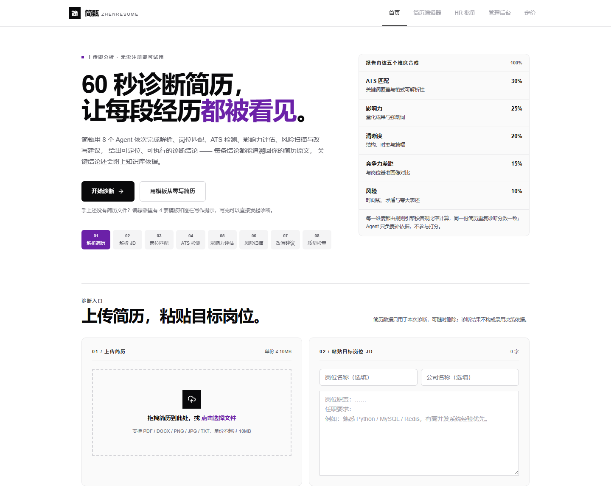
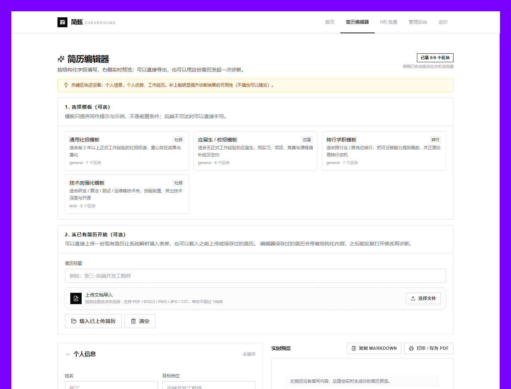
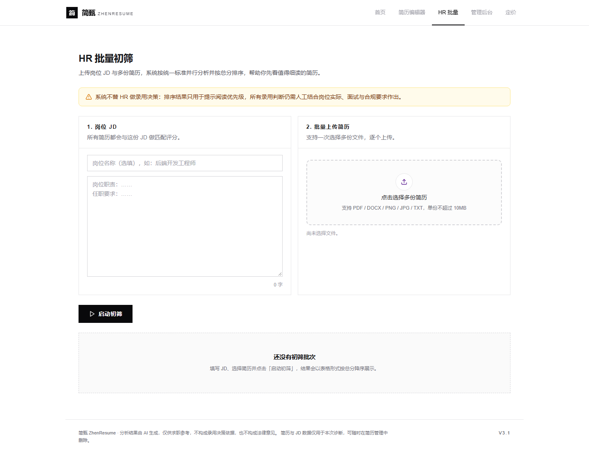
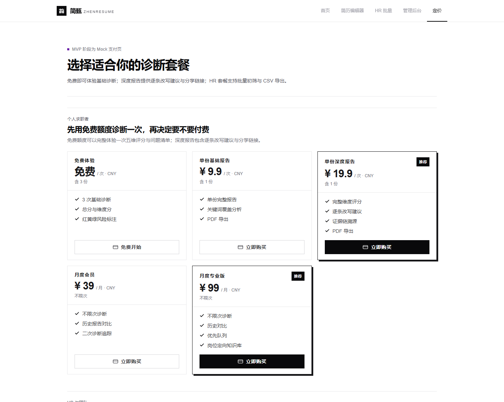
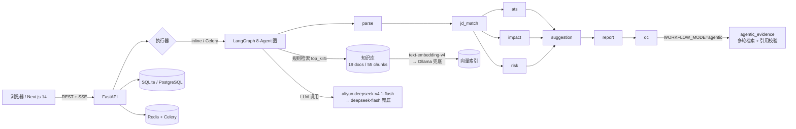

# ZhenResume 简甄

> **60 秒诊断简历，让每段经历都被看见。**
> 项目主线是 **Agentic RAG**：Agent 自主多轮检索、调用 9 只读工具取证，
> 把每条诊断结论绑定到简历原文与知识库切片，并由服务端逐字校验；
> 8 个 Agent 依次完成解析、岗位匹配、ATS 检测、影响力评估、风险扫描与逐条改写。

<p align="left">
  
  
  
  
  
  
  
</p>

| 首页 | 简历编辑器 |
|---|---|
|  |  |
| **HR 批量初筛** | **套餐与定价（MVP 为 Mock 支付）** |
|  |  |

> 一个面向求职者与 HR 的 AI 简历诊断系统：**FastAPI + LangGraph 多 Agent + RAG + Next.js**。
> 核心指标（2026-10-22 真实模型实测）：单份报告 **38.6s / ¥0.05**，HR 批量 **100 份 52.7s / 100% 成功**，
> 契约回归 **175/175**。完整数据与口径见 [性能与价格实测报告](docs/ZhenResume_性能与价格实测报告_2026-10-22.md)。

---

## 目录

- [为什么做这个](#为什么做这个)
- [为什么主线是 Agentic RAG](#为什么主线是-agentic-rag)
- [核心能力](#核心能力)
- [实测数据](#实测数据)
- [系统架构](#系统架构)
- [技术栈](#技术栈)
- [快速开始](#快速开始)
- [配置说明](#配置说明)
- [测试与质量](#测试与质量)
- [项目结构](#项目结构)
- [关键设计取舍](#关键设计取舍)
- [已知边界（MVP）](#已知边界mvp)
- [文档索引](#文档索引)
- [Roadmap](#roadmap)
- [安全提示](#安全提示)

---

## 为什么做这个

市面上的简历工具大多停在「关键词打分」：告诉你缺什么词，却不告诉你**这句话该怎么改**，更不会解释「为什么要改」。
ZhenResume 想解决三个具体问题：

1. **结论要可执行**：不是「ATS 匹配度 62 分」，而是「JD 要求『微服务』，你的项目经历里没有落地描述 → 建议补充一条：拆分了哪个服务、QPS/延迟变化多少」。
2. **结论要有依据**：每条发现项必须能在简历原文中定位（`span` 坐标 + `quote` 逐字校验）；关键结论挂知识库引用，引用由服务端逐字校验，**拒绝模型编造**。
3. **分数要可回归**：同一份简历重复诊断，总分与维度分必须一致 —— 所以**分数由确定性规则引擎计算，Agent 只负责补充证据与改写建议，不参与打分**。

---

## 为什么主线是 Agentic RAG

一个常见误解是「Agentic RAG 比不过 fixed，所以 Agentic 没价值」。**问题出在对比口径**：

- fixed 线并不是「规则检索」，而是 **固定检索策略 + 8 个 LLM Agent**（parse / jd_match / ats / impact / risk /
  suggestion / report / qc 全部走模型）。所以 fixed vs agentic 的差异**只有检索策略**，不是「有没有 LLM」。
- 如果真把 fixed 的 LLM 去掉，它会退化成规则 ATS 工具：实测 **3.0s / ¥0**，但只剩 **5 条模板建议**、
  语义假差距 recall **0%**（mixed 与 equiv 两档 ATS 完全相同），而且解析边界、风险推理、逐条改写全部消失。
  拿这个对手去证明 Agentic 更强，等于用「有 LLM 赢没 LLM」，变量是错的。

因此本项目把 Agentic RAG 的价值定义为**三个「从无到有」**，而不是「覆盖率更高」：

| 层级 | 语义假差距 recall | 建议质量 | 引用能力 | 单份成本 / 延迟 |
|---|---|---|---|---|
| 规则-only（fixed 去掉 LLM） | **0%** | 5 条模板 | 固定 top-3，无 provenance | ¥0 / 3.0s |
| fixed + LLM（强基线） | **88.5%**（P-1） | 8 条、贴合原文 | 3 条知识引用 | ¥0.05 / 38.6s |
| **Agentic + LLM（主线）** | 检索覆盖 **87.1%**（55 片小库，未超越 fixed） | 8–14 条 + 依据 | **14/14、12/12 逐字校验通过 + 检索轨迹** | ¥0.45 / 112.9s |

**结论**：在 55 切片的小知识库上，Agentic 不赢覆盖、不赢分数（分数本来就由规则引擎算）；
它赢的是 **自主取证、引用可校验、过程可解释**——这正是简历诊断最需要、也最难造假的能力。
完整分析（含「fixed 去掉 LLM 后到底会怎样」的实测、以及知识库扩容/工具消融等后续实验设计）见
[Agentic RAG 定位与消融分析](docs/AgenticRAG_定位与消融分析.md)。

## 核心能力

- **Agentic RAG 主线**：4 个分析节点 + qc 后的证据节点升级为「自主多轮检索 + 工具调用」，
  统一封装预算、trace、缓存、模型回退与强制收尾；引用落库前做「chunk 存在 + quote 逐字定位 + 本轮检索返回过」校验。
- **8-Agent 诊断流水线**：`parse → jd_match → (ats ∥ impact ∥ risk) → suggestion → report → qc`，
  三路并行，单份端到端约 38.6s。
- **双分制**：规则层「基础分」+ 语义层「深度分」并列展示；语义层只修正「同义表述被误判为缺失」的假差距，不改排序口径。
- **证据链**：每条红色风险都有可定位原文引用；知识库结论级引用经过 `chunk 存在 + quote 逐字可定位` 双重校验。
- **HR 批量初筛**：上传 JD + 多份简历，走 3 节点轻量图，100 份并发 50 约 52.7s，按总分降序 + CSV 导出。
- **简历编辑器**：4 套真实版式模板、结构化区块、实时预览、Markdown / DOCX 导出、浏览器打印 PDF；编辑完可直接发起二次诊断。
- **完整产品闭环**：账号 / 验证码登录 / 匿名数据认领、报告分享（打码 + 撤销）、管理后台、Mock 支付与套餐。
- **可降级**：主模型不可用时自动切换备用模型；全部模型不可用时回落到规则引擎，仍产出契约合规的报告。

---

## 实测数据

> 2026-10-22，Windows 11 + Ryzen 9 7945HX，真实 `deepseek-v4.1-flash` 调用（非 mock），
> 完整报告与逐节点数据：[docs/ZhenResume_性能与价格实测报告_2026-10-22.md](docs/ZhenResume_性能与价格实测报告_2026-10-22.md)。

| 指标 | 实测 |
|---|---|
| 单份完整报告（fixed，5 次） | **38.6s**（32.3–41.8s）/ 13,149 tokens / **¥0.0513** |
| 单份深度报告（agentic，2 次） | **112.9s** / 190,155 tokens / **¥0.4498** |
| HR 批量 100 份（并发 50） | **52.7s**，100/100 成功，**¥0.0184/份** |
| 4 份单份并发 | 总墙钟 **40.6s**，**3.80×** 加速 |
| RAG 检索（55 切片） | search p50 **232ms**（其中 embedding 网络占 ~83%，纯检索 48ms） |
| 契约回归 | `scripts.verify` **175/175**、账号 **55/55**、真实 HTTP 黑盒 **74/74** |
| 前端 | typecheck / lint / `next build` **3/3 成功**（Node 24 + Next 14.2） |

**成本口径**：`LLM_PRICE_INPUT_PER_M=2.0 / OUTPUT_PER_M=8.0` 恰好等于百炼 `deepseek-v4.1-flash-1017`
的**忙时原价**（闲时 1/4 元每百万 token），因此看板成本是**保守上限**，真实应付约为 0.5×（闲时）~1.0×（忙时）。
「单份 ≤ 0.5 元」验收通过；agentic 最坏一次 ¥0.4713，余量约 5.7%。

> ⚠️ 性能受供应商抖动影响极大：同一天单份 fixed 实测出现过 **35.9s → 169.2s**（阿里云 504/ReadTimeout 事故窗口）。
> 因此报告里的 A/B 对比全部采用「同时段交错执行」，单次数字不作为 SLA。

---

## 系统架构



### 8 节点编排

| 节点 | 职责 |
|---|---|
| `parse` | 简历 / JD 结构化解析（规则解析 + LLM 纠错） |
| `jd_match` | 关键词覆盖、分层加权、假差距识别 |
| `ats` ∥ `impact` ∥ `risk` | ATS 可解析性 / 量化影响力 / 风险与合规，三路并行 |
| `suggestion` | 逐条改写建议（保留原文数字，不编造量化结果） |
| `report` | 五维分、摘要、红黄绿发现项 |
| `qc` | 质检：删改规则层红色条目一律否决、敏感字段过滤、公平性检查 |

### Agentic RAG（可选）

`WORKFLOW_MODE=agentic` 时，4 个分析节点改为「模型自主决定检索 → 读取切片 → 产出结论 + 引用」，
并在 qc 后追加非契约节点 `agentic_evidence`：

- 最多 4 轮检索，每轮自拟 query，可下钻 `read_chunk`；
- 引用必须通过服务端 provenance 校验（chunk 存在 + quote 逐字可定位 + 本轮确实检索过）；
- 报告页展示完整检索轨迹（自拟 query、被预算拦截的方向、校验统计、Agent 自述）。

代价：时间约 2.9×、tokens 约 14.5×、成本约 8.8×。**它是「能力增量」，不是「性能选项」**，默认关闭。

---

## 技术栈

| 层 | 选型 |
|---|---|
| 后端 | Python 3.10+ / FastAPI / Uvicorn / Pydantic v2 / SQLAlchemy 2.0 |
| 编排 | **LangGraph 1.2**（图编排、三路并行、可选 checkpoint）+ LangChain 1.x |
| 执行 | inline（开发） / **Celery 5 + Redis**（生产，worker 并发 4） |
| 存储 | SQLite（默认，WAL） / **PostgreSQL 17 + pgvector** |
| 模型 | 阿里云百炼 `deepseek-v4.1-flash-1017`（主）→ DeepSeek 官方 `deepseek-flash`（兜底） |
| 向量 | `text-embedding-v4`（1024 维，主）→ 本地 Ollama `mxbai-embed-large`（兜底） |
| 前端 | Next.js 14（App Router）/ TypeScript / Tailwind CSS / 手写 SSE 流式解析 |
| 导出 | python-docx / Markdown / pypdf / LibreOffice（可选 PDF） |
| 部署 | Docker Compose（PG + Redis + API + Worker + 前端） |

---

## 快速开始

### 方式一：Docker 全栈（推荐）

```bash
# 1. 准备环境变量（含 PG / Redis 密码）
cp .env.local.example .env.local
#    编辑 .env.local，至少设置 POSTGRES_PASSWORD / REDIS_PASSWORD
#    backend/.env 填入 ALIYUN_API_KEY（或 DEEPSEEK_API_KEY）

# 2. 启动
docker compose -f docker-compose.local.yml --env-file .env.local up -d --build

# 3. 访问
#    前端 http://localhost:3000
#    API  http://localhost:8000/docs
```

### 方式二：本地开发

```bash
# 后端
cd backend
python -m venv .venv
source .venv/bin/activate        # Windows: .\.venv\Scripts\activate
pip install -r requirements.txt
cp .env.example .env             # 填入模型 Key（不填则走 mock/规则模式）
python -m uvicorn app.main:app --reload --port 8000

# 前端（另开终端）
cd frontend
pnpm install
# .env.local 设置 NEXT_PUBLIC_API_BASE=http://127.0.0.1:8000
pnpm dev
```

> **没有模型 Key 也能跑**：无 Key 时自动进入 mock 模式，用规则引擎产出契约合规的完整报告，
> 适合看 UI / 跑契约回归；真实诊断质量需要配置模型 Key。

### 最小自检

```bash
cd backend
python -m scripts.verify                       # 端到端契约回归（约 175 项）
python -m scripts.check_report_consistency     # 报告内部一致性（总分/风险等级/证据 span）
python -m scripts.verify_auth                  # 账号 / 鉴权 / 数据认领（55 项）
```

---

## 配置说明

配置全部通过 `backend/.env`（参考 `backend/.env.example`）：

| 变量 | 说明 | 默认 |
|---|---|---|
| `ALIYUN_API_KEY` / `ALIYUN_MODEL` | 主模型（百炼 OpenAI 兼容端点） | `deepseek-v4.1-flash-1017` |
| `DEEPSEEK_API_KEY` / `LLM_MODEL` | 兜底模型（DeepSeek 官方） | `deepseek-flash` |
| `WORKFLOW_ENGINE` / `WORKFLOW_PARALLEL` | 编排引擎 / 三路并行 | `langgraph` / `true` |
| `WORKFLOW_MODE` | `fixed`（快）/ `agentic`（带证据链） | `fixed` |
| `WORKFLOW_EXECUTOR` | `inline` / `celery` | `inline` |
| `DATABASE_URL` | SQLite 或 PostgreSQL 连接串 | SQLite |
| `CELERY_BROKER_URL` / `CELERY_RESULT_BACKEND` | Redis 队列 | `redis://127.0.0.1:6379` |
| `EMBEDDING_PROVIDER` / `EMBEDDING_MODEL` | `hash`（离线）/ `http`（语义向量） | `hash` |
| `RAG_TOP_K` / `HR_BATCH_CONCURRENCY` | 检索条数 / 批量并发 | `5` / `50` |
| `LLM_PRICE_INPUT_PER_M` / `OUTPUT_PER_M` | 成本看板单价（元/百万 token） | `2.0` / `8.0` |

> ⚠️ 生产部署前请设置 `AUTH_SECRET`、关闭 `SMS_DEV_MODE`、打开 `QUOTA_ENFORCED`，详见 [安全提示](#安全提示)。

---

## 测试与质量

### 契约回归

| 测试 | 结果 |
|---|---|
| `scripts.verify`（8-Agent 全链路、报告契约、导出、批量、错误码） | **175/175** |
| `scripts.verify_auth`（注册/登录/改密/401/管理员门禁/数据认领） | **55/55** |
| 真实 HTTP 黑盒（uvicorn + SSE + 分享 + 导出 + IDOR） | **74/74**（LLM 段）/ **39/39**（非 LLM 段） |
| `check_report_consistency`（B-1~B-4 历史缺陷） | **20/20** |

### 检索与排序评测

评测集：**32 例** A/B/C/D 分档夹具（v2 gold 由规则层结论自动推导）。

| 指标 | 结果 |
|---|---|
| 基线 recall@10（32 例，v2 gold） | **56.0%** |
| 产品口径：注入 prompt 的前 3 条 recall@k=3~12 | 恒定 **26.2%**（证明改 `top_k` 无收益） |
| 排序 Spearman（规则 v1 / oracle 上界） | **+0.825 / +0.939** |
| BM25 / MMR 重排 | 在所有 k 上无稳定正收益 → **未合入** |

> 评测结论与复现命令见 [P9 评测记录](docs/P9_评测集扩容32例与重调参数.md) 与
> [性能报告 §5](docs/ZhenResume_性能与价格实测报告_2026-10-22.md)。

### 前端

```bash
cd frontend
pnpm run typecheck
pnpm run lint
pnpm run build
```

---

## 项目结构

```text
ZhenResume/
├── backend/
│   ├── app/
│   │   ├── api/            # 40+ REST 端点（resumes/tasks/reports/hr/auth/admin/...）
│   │   ├── agents/         # 8 个流水线 Agent + 语义判定
│   │   ├── agentic/        # Agentic RAG 运行时（预算 / trace / 引用校验）
│   │   ├── workflow/       # LangGraph 图、节点、HR 轻量图
│   │   ├── services/       # 解析、评分、RAG、LLM 链、成本、证据定位
│   │   ├── models.py       # SQLAlchemy 模型
│   │   └── main.py         # FastAPI 入口（建表 / 种子 / SSE）
│   ├── eval/               # 32 例排序夹具 + 30 例评测集 + ground truth
│   ├── scripts/            # verify / bench_* / eval_* / 迁移与运维脚本
│   └── samples/            # 弱/中/强三份样例简历与 JD
├── frontend/
│   ├── app/                # Next.js App Router 页面
│   ├── components/         # 编辑器、报告、HR、账号中心等
│   └── lib/                # API 客户端（含 SSE / 下载 / 鉴权）
├── docs/                   # 架构、契约、评测、部署与实测报告
├── deploy/                 # VM / 中间件部署脚本
└── docker-compose.local.yml
```

---

## 关键设计取舍

1. **LangGraph 内嵌 FastAPI，而不是独立 Agent Server**：单机部署少一个服务、少一层网络；
   任务状态与业务表同库，调试链路更短。代价是 worker 与 API 需要共享代码版本。
2. **分数用规则引擎，Agent 不参与打分**：这样同一输入多次诊断分数可回归；
   语义判定只用于修正「同义表述被误判为缺失」的假差距。Agent 化只加证据，不改分。
3. **引用必须服务端逐字校验**：模型编造 `chunk_id` 是常态（实测 agentic 分析节点自身引用通过率仅 2/5–4/5），
   所以引用落库前必须校验「切片存在 + quote 逐字可定位 + 本轮检索确实返回过」。
4. **HR 批量走 3 节点轻量图**：完整流水线 100 份外推约 82s，排序表图 52.7s 且成本仅为 35%。
   产品上「初筛」不需要改写建议，砍掉 impact/suggestion/report 是正确取舍。
5. **SQLite / inline 是开发默认，PG + Celery 是生产形态**：
   实测换栈**不提升单份速度**（同时段交错 A/B 甚至略快），它买到的是并发安全、任务不丢、可扩展与断点续跑。
6. **成本看板按「忙时原价」计**：宁可高估也不低估；真实账单需按供应商控制台核对。

---

## 已知边界（MVP）

- **安全加固未完成**：当前 `.env` 是本地演示配置（`SMS_DEV_MODE=true`、`AUTH_SECRET` 为空、`QUOTA_ENFORCED=false`）。
  **不要直接公网部署**，上线前必须按 [性能报告 §8.3](docs/ZhenResume_性能与价格实测报告_2026-10-22.md) 完成加固。
- **支付是 Mock**：回调未验签，仅用于演示套餐流程；接真实渠道需补签名校验与对账。
- **真实简历质量尚未人工验收**：评测使用合成夹具与 3 份样例，真实用户分布下的解析/建议质量是下一步重点。
- **Agentic 是主线能力但默认关闭**：约 0.45 元/份、112s/份，成本是 fixed 的 8.8×；
  它证明的是「自主取证 + 引用可校验 + 过程可解释」，不是「分数更准」，因此按需开启（审计/演示场景）。
- **OCR / PDF 为可选能力**：图片简历需安装本地 OCR 引擎；PDF 导出需配置 LibreOffice，缺失时返回 503 并引导 DOCX。
- **排序质量未被证明提升**：语义接入修正了分数低估，但 Spearman 未显著提升（32 例评测）。
- **单机 / 小规模验证**：未做多机、多租户、长时间稳定性与限流压测。

---

## 文档索引

- [性能与价格实测报告（2026-10-22）](docs/ZhenResume_性能与价格实测报告_2026-10-22.md) —— 全方面测试、性能、成本与定价
- [Agentic RAG 定位与消融分析](docs/AgenticRAG_定位与消融分析.md) —— 为什么 Agentic 不赢覆盖、价值在哪、如何证明
- [API 契约](docs/api-contract.md) —— 前后端唯一接口依据
- [关键代码与设计原理](docs/ZhenResume_关键代码与设计原理.md)
- [新链路：LangChain 多 Agent + Agentic RAG 方案](docs/ZhenResume_新链路LangChain-多Agent-AgenticRAG方案.md)
- [检索评测系列 P4–P9](docs/P9_评测集扩容32例与重调参数.md)
- [当前状态与待办](docs/ZhenResume_当前状态与待办.md)
- [本机 Docker 全栈部署](docs/ZhenResume_本机Docker全栈部署.md)
- [简历项目描述（可直接用于简历/面试）](docs/简历项目描述.md)

---

## Roadmap

| 优先级 | 事项 |
|---|---|
| P0 | 安全加固：关闭短信 dev 模式、强制 `AUTH_SECRET`、支付回调验签、限流与审计 |
| P0 | 修复 agentic 兜底 DeepSeek thinking 模式 400（`reasoning_content` 回传） |
| P1 | 真实用户简历 20–50 份人工验收 + 质量迭代 |
| P1 | 配额与定价修复（免费次数、9.9 买断、HR 份数校验） |
| P2 | 可观测性：p95 延迟、504/429 告警、成本看板口径修正 |
| P2 | pgvector + HNSW（知识库到千级切片后） |
| P3 | 多租户、团队协作、开放 API |

---

## 安全提示

本项目是**个人作品 / MVP 演示版**，不是开箱即用的生产系统。公开部署前至少完成：

1. `AUTH_SECRET` 设为随机长字符串，关闭 `SMS_DEV_MODE`，关闭 `/auth/_debug/*`；
2. 打开 `AUTH_REQUIRED` 与 `QUOTA_ENFORCED`，修复付费用户「一次付费永久不限次」；
3. 支付回调接入真实渠道并验签；
4. 知识库写接口改为管理员权限；`/static` 简历文件加归属校验或改用签名 URL；
5. 反向代理层加限流，接入 504/429 告警与备份。

---

## License

本仓库用于学习与作品展示。如需商用、二次分发或引用其中数据，请先通过 GitHub 联系作者。

> 联系：GitHub [@xiaoqi1203](https://github.com/xiaoqi1203)