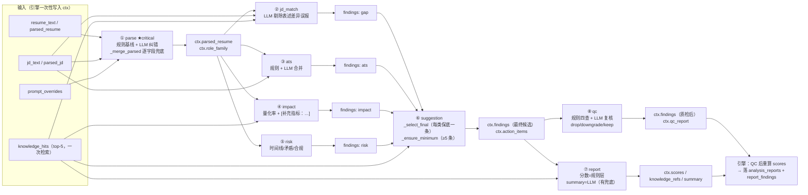
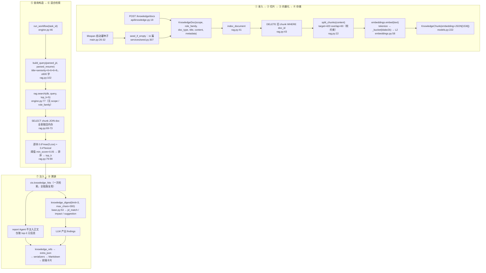

# ZhenResume（简甄）技术解析文档

> 覆盖范围：**项目工作流 · Agent 设计 · RAG 设计 · 关键代码解析**
> 分析对象：`E:\ZhenResume`（后端 FastAPI + SQLAlchemy + SQLite，前端 Next.js 14）
> 代码基线：`backend/app`（约 6.5k 行 Python）+ `frontend`（约 2.5k 行 TS/TSX）

---

## 0. 导读

### 0.1 本文回答什么

| 章节 | 内容 | 对应需求 |
|---|---|---|
| 第 1 章 | 项目总览、技术栈与文档的差异、模块地图 | 背景 |
| 第 2 章 | **工作流**：端到端 10 跳、后台执行模型、8 步状态机、降级链、边界与实测风险 | 工作流 |
| 第 3 章 | **Agent 设计**：契约、共享状态、8 个 Agent 的机制、Prompt 工程、证据链、质检闸门 | agent 设计 |
| 第 4 章 | **RAG 设计**：切片、哈希向量、混合检索、存储与迁移、注入与溯源、治理、升级清单 | rag 设计 |
| 第 5 章 | **关键代码解析**：评分引擎、规则检测器、finding 生命周期、规则解析器、数据契约、LLM 降级链、配置/DB/自检/渲染 | 关键代码解析 |
| 第 6 章 | 附录：验收标准对照、技术债汇总、升级路线 | 结论 |

### 0.2 证据分级约定（全文强制）

本文所有结论都标注来源等级，避免把推测当事实：

| 标记 | 含义 |
|---|---|
| 【代码】 | 通过阅读源码可确定，均给出 `文件:行号`，关键处附原文摘录 |
| 【实测】 | 分析期间用**仓库自带解释器**在进程内复现得到（不改动项目源码，只读写临时 `/` 自有 SQLite 文件或只读查询本机 DB） |
| 【推断】 | 由代码结构推导、未端到端运行验证 |
| 【建议】 | 本文给出的改进动作，不是现状描述 |

> 提醒：本文不美化现状。项目有明确的能力边界与若干真实缺陷（第 2.9、3.8、4.9、5.11 节），这些是文档最有价值的部分。

### 0.3 与项目内既有文档的关系

| 文档 | 定位 |
|---|---|
| `aaa.md` | 需求与技术选型来源（SRS + 概要设计），**未改动** |
| `README.md` | 交付说明与差异清单（"用了什么、为什么这样换"） |
| `docs/api-contract.md` | 前后端唯一接口契约（冻结版） |
| **本文** | 实现侧的技术解析：把"代码实际怎么跑"讲清楚，并给出风险与升级路径 |

---

## 1. 项目总览

### 1.1 一句话定位

上传简历 + 粘贴 JD → 8 个 Agent 串行分析 → 产出**每条建议都能定位回原文**的五维诊断报告；知识库（RAG）为分析提供岗位能力模型与表达范式依据。

### 1.2 技术栈：文档方案 vs 实际实现

设计铁律是「**接口、契约、表结构照文档不动，只换实现**」，因此每一项替换都是可回退的（来源：`README.md:161-177`）。

| 文档方案（`aaa.md:344-358`） | 实际实现 | 为什么可以换 | 升级动作 |
|---|---|---|---|
| LangGraph 编排 | `workflow/engine.py` 手写状态机 | 8 节点是确定线性链，无分支/循环/人机回环 | 只换 `engine.py`，节点签名已对齐 LangGraph |
| PostgreSQL + pgvector | SQLite（DDL 同构）+ Python 暴力检索 | 表名列名一一对应；MVP 数据量够用 | 改 `DATABASE_URL` + `embedding` 换 `Vector(1536)` + HNSW |
| Redis + Celery | `BackgroundTasks` + 任务状态表 | 免两个额外进程 | `launch_workflow` 换成 Celery task |
| LlamaIndex | 自研切片 + 混合检索（0.6 向量 + 0.4 词面） | 检索逻辑透明可调 | 换 `services/rag.py` 为 LlamaIndex retriever |
| 多模型路由 | DeepSeek 单供应商 + 适配层 | 适配层走 OpenAI 兼容协议 | `services/llm.py` 加 provider 分支 |
| Langfuse + Sentry | `workflow_steps` 表记 tokens/cost/latency | 数据模型本来就要求这些字段 | 引擎里加转发回调 |
| Clerk / Supabase Auth | `X-Device-Id` 匿名隔离 | MVP 不做登录 | 换 `api/deps.py::get_current_user` |
| 单份报告 PDF | Markdown 导出（浏览器可打印） | 零依赖 | 接 Playwright / WeasyPrint |

### 1.3 后端模块地图

```
backend/app/
├── main.py            应用入口：lifespan 建表+灌种子、异常统一结构、CORS、静态文件、11 路由
├── config.py          全部配置（环境变量驱动）；无 API Key 自动进 mock 模式
├── db.py              引擎与会话（SQLite ⇄ PostgreSQL 切换点）
├── models.py          17 张表的 ORM，逐表对齐 aaa.md 的 DDL
├── schemas.py         请求校验 + ParsedResume / ParsedJd / EditorContent
├── serializers.py     响应序列化（严格按契约构造，缺步骤补 pending）
├── errors.py          契约 §8 统一错误结构 {detail:{code,message}}
├── agents/            ★ 8 个 Agent（一文件一个，独立可观测）+ base/finding_utils
├── workflow/engine.py ★ 手写状态机（LangGraph 的替换点）
├── services/
│   ├── llm.py         DeepSeek 适配层 + 三级降级链
│   ├── analyze.py     ★ 五维评分 + 全部规则检测器（37KB，确定性核心）
│   ├── parse_rules.py 规则解析器（确定性基线，23KB）
│   ├── evidence.py    ★ 证据链：引文定位回原文
│   ├── embeddings.py  本地确定性哈希向量（embedding 升级点）
│   ├── rag.py         切片 / 入库 / 混合检索
│   ├── prompts.py     Prompt 注册表（可被后台覆盖）
│   ├── extract.py     PDF/DOCX/图片/文本抽取 + 可插拔 OCR
│   ├── resume_render.py   纯文本/Markdown/DOCX/PDF 四路渲染 + 双向转换
│   ├── resume_templates.py 4 套内置模板（结构与写作提示即代码常量）
│   ├── report_render.py   诊断报告 Markdown 导出
│   ├── cost.py        token 估算与成本核算
│   └── seed.py        11 篇知识库种子
└── api/               11 个路由模块（resumes/jds/tasks/reports/knowledge/billing/hr/admin/…）
```

### 1.4 两个"刻意不简化"的决策（全篇最重要的两条）

来源：`README.md:179-186`，代码印证如下。

**① 评分不让 LLM 打分。** 五维分全部由 `services/analyze.py` 的确定性公式算出（`analyze.py:626-673`），LLM 只写一段 `summary`（`agents/report_agent.py:22,53-58`）。

> 原因：同一份简历两次诊断必须给出同样的分数，否则"改完再测、对比分数变化"这个卖点就是假的。`scripts/verify.py:243` 有回归断言「同一简历两次诊断分数一致」。

**② 证据链不信任模型给出的位置。** 模型只输出引文 `quote`，字符区间由 `services/evidence.py:43-75` 在原文里**重新定位**；定位不到就打 `unverified` 标记（`evidence.py:109-110`），质检会把这类红色风险强制降级（`agents/qc_agent.py:142-154`）。

---

## 2. 工作流（Workflow）

### 2.1 端到端 10 跳

```
① 上传简历   POST /api/v1/resumes → 抽文 → 规则解析 → 落 raw_text + parsed_json
② 创建 JD    POST /api/v1/jds     → 规则解析 → 技能/年限/学历/关键词
③ 创建任务   POST /api/v1/tasks   → 202 立即返回 → BackgroundTasks 挂后台
④ 后台启动   launch_workflow → asyncio.run(run_workflow)
⑤ 前段准备   读上下文 → status=running → 一次性 RAG 检索
⑥ 8 步循环   parse → jd_match → ats → impact → risk → suggestion → report → qc
⑦ 报告落库   qc 步骤之后：重算分数 → 写 analysis_reports + report_findings
⑧ 终态写回   status=done / progress=1.0 / current_step=qc
⑨ 前端轮询   GET /api/v1/tasks/{id}（1.5s 一次）
⑩ 跳转报告   GET /api/v1/reports/{report_id}
```

逐跳的关键位置：

| 跳 | 入口函数 | 位置 | 要点 |
|---|---|---|---|
| ① | `create_resume` | `api/resumes.py:68-113` | 落盘后**同步**抽文（`:92`）+ 规则解析（`:93-94`），`raw_text`/`parsed_json` 此刻已入库（`:100-101`）；**空文本不拦截** |
| ② | `create_jd` | `api/jds.py:20-37` | `parse_jd_text(payload.raw_text)`（`:26`）；入参下限 20 字（`schemas.py:25-33`） |
| ③ | `create_task` | `api/tasks.py:29-63` | `status_code=202`；归属校验 → 免费额度闸门（`:44`）→ 建 `AnalysisTask(status="pending")` → 扣配额 → `commit` → `background_tasks.add_task(launch_workflow, task.id)`（`:61`） |
| ④ | `launch_workflow` | `workflow/engine.py:38-43` | **同步函数**内 `asyncio.run(...)`，异常只 `traceback.print_exc()` |
| ⑤ | `run_workflow` 前段 | `engine.py:50-77` | 一个 `session_scope()` 包住整条流水线；`AgentContext` 用上传时的 `parsed_json` 初始化；`rag.build_query` → `rag.search(top_k=5)` |
| ⑥ | 步骤循环 | `engine.py:81-131` | 每步建一行 `WorkflowStep`，`status="done"/"degraded"` |
| ⑦ | `if agent.name == "qc"` | `engine.py:116-120` | 重算分数 + `_persist_report`（`:159-201`） |
| ⑧ | 终态 | `engine.py:126-130` | `done` / `progress=1.0` / `current_step="qc"` |
| ⑨ | `get_task` | `api/tasks.py:85-96` | 归属校验 → 查 report_id → `serialize_task`（`serializers.py:115-129`，缺步骤补 `pending`） |
| ⑩ | 前端 | `frontend/app/analyze/[taskId]/page.tsx:68-73` | `status==="done" && report_id` → `router.replace('/report/'+id)` |

**一个容易被忽略的耦合**：RAG 检索用的是 ① 中**上传时**的规则解析结果，早于 ⑥ 中 `ParseAgent` 用 LLM 纠错后的版本（`engine.py:65-77`）。

### 2.2 后台执行的精确模型：`BackgroundTasks` + `asyncio.run`

```python
# backend/app/workflow/engine.py:38-43
def launch_workflow(task_id: str) -> None:
    """后台任务入口（供 FastAPI BackgroundTasks 调用）。异常全部吞掉并落到任务状态里。"""
    try:
        asyncio.run(run_workflow(task_id))
    except Exception:  # noqa: BLE001 —— 后台任务不能再往外抛，否则会静默丢失
        traceback.print_exc()
```

- **调用链**【代码 + 第三方实读】：响应先发送（`starlette/responses.py:155-158`）→ Starlette 执行后台任务；因为 `launch_workflow` 是**同步函数**，Starlette 走 `run_in_threadpool`（`starlette/background.py:24-28`），即在线程池线程里跑。
- **为什么必须有 `asyncio.run`**：该线程没有运行中的事件循环，而 `run_workflow` 是 `async def`（`engine.py:46`），链路一直异步到 `httpx.AsyncClient`（`services/llm.py:153`）。`asyncio.run` 负责在线程内新建/关闭事件循环。
- **约束**：`asyncio.run` 不允许在已有事件循环的线程调用，所以 `launch_workflow` **必须保持同步**；若有人把它改成 `async def`，这里会直接 `RuntimeError`。
- **另外两个入口不重复建循环**：HR 批量在自己的事件循环里直接 `await run_workflow`（`api/hr.py:35-39,72`）；离线脚本 `scripts/inspect.py:58-63`、`scripts/demo_improve_loop.py:155-160` 各自 `asyncio.run`。
- **注释与代码不一致**（`api/tasks.py:60`）：注释写"Starlette 会 await 这个 async 函数"，实际 `launch_workflow` 是同步函数。结论"请求立即返回 202"仍成立，但成立原因是"响应先发、后台后跑"。

> 【实测】轮询端在**整个执行期只能看到 `pending`**。原因见 2.9.1。实测状态序列只有两项：`('pending', None, 0.0)` → `('done', 'qc', 1.0)`。

### 2.3 8 步循环：状态、进度与计量

```python
# backend/app/workflow/engine.py:81-131（节选）
        for index, agent_cls in enumerate(AGENT_PIPELINE, start=1):
            agent = agent_cls()
            step = WorkflowStep(
                task_id=task_id,
                step_name=agent.name,
                status="running",
                input_json=_input_digest(agent.name, ctx),
            )
            db.add(step)
            task.current_step = agent.name
            db.flush()

            started = time.perf_counter()
            try:
                output = await agent.safe_run(ctx, llm)
                if output.status == "degraded":
                    step.status = "degraded"
                else:
                    step.status = "done"
                step.notes = output.notes
            except Exception as exc:  # noqa: BLE001 —— critical Agent 失败即终止整个任务
                step.status = "failed"
                step.latency_ms = int((time.perf_counter() - started) * 1000)
                step.notes = f"{type(exc).__name__}: {str(exc)[:300]}"
                _fail(db, task, f"{agent.title} 执行失败：{str(exc)[:200]}")
                return None
```

| 关注点 | 事实 | 证据 |
|---|---|---|
| 建行时机 | 进入某步**之前**建行，且**没有 `pending` 阶段**——库里一建就是 `running` | `engine.py:83-88` |
| 前端看到的 `pending` | 序列化层按 `STEP_ORDER` 把缺失步骤补成 `pending`（不是 DB 真值） | `serializers.py:117-118` |
| `input_json` | Agent 运行**之前**计算，只记计数（`resume_chars/jd_chars/work_count/.../knowledge_hits/findings_so_far/role_family`） | `engine.py:204-218` |
| `current_step` | 该步**执行前**写入，语义是"正在跑的步骤" | `engine.py:90` |
| `progress` | 该步**成功后**写入 `round(index/TOTAL_STEPS, 4)` → `0.125/0.25/…/1.0`；失败步骤不贡献进度 | `engine.py:113` |
| `status` 取值 | `running` / `done` / `degraded` / `failed` | `engine.py:83,97,99,102`；`models.py:188-189` |
| `degraded` 两个来源 | ① 非 critical Agent 抛异常被 `safe_run` 兜底（`agents/base.py:97-104`）；② LLM 重试耗尽回落规则引擎（`services/llm.py:116-131`） | 同上 |
| 只有 `parse` 是 critical | `critical = True`，异常会穿透 `safe_run` 到引擎 | `agents/parse_agent.py:59`、`base.py:98-99` |
| 计量写入 | 成功后写 `latency_ms/tokens/cost/output_json`；失败只写 `latency_ms` 与 `notes`，`tokens/cost` 保留默认 0 | `engine.py:103-111` |
| 收尾 | `current_step` 被硬编码成常量 `"qc"`（与循环最后一次赋值重复） | `engine.py:128` |
| `total_steps` | 来自序列化常量 `len(STEP_ORDER)`（=8），**不是** `TOTAL_STEPS` | `serializers.py:112,125` vs `engine.py:35` |

**mock 模式下的可预测表现**：`complete_json` 直接调 `mock_factory`，把规则引擎耗时当 `latency_ms`，`tokens_in/out = 0`、`cost = 0`（`services/llm.py:90-104`）。因此时间线上的 token 恒为 0、耗时是毫秒级——**不是真实模型耗时**。

`_truncate` 落库前裁剪：字符串 >4000 截断、列表 >30 项、字典 >40 键（`engine.py:221-235`）。

### 2.4 状态机总表

任务级（`analysis_tasks.status`）：

| 当前态 | 事件 | 次态 | 设置者 | 附带写入 |
|---|---|---|---|---|
| — | 创建任务 | `pending` | `api/tasks.py:47-55` | `progress=0.0`、`type="single"` |
| `pending` | 后台启动 | `running` | `engine.py:60-63` | `progress=0.0`、`error=None` |
| `pending` | 简历/JD 行缺失 | `failed` | `engine.py:56-58` → `_fail:138-142` | `error="简历或 JD 记录缺失"` |
| `running` | Agent 抛异常（critical） | `failed` | `engine.py:101-106` | `error="{title} 执行失败：…"` |
| `running` | 循环结束但无报告 | `failed` | `engine.py:122-124` | `error="工作流未产出报告"` |
| `running` | 8 步完成且报告落库 | `done` | `engine.py:126-130` | `progress=1.0`、`current_step="qc"`、`completed_at` |
| `done`/`failed` | — | 终态，**无重试/回退路径** | — | — |

步骤级（`workflow_steps.status`）：

| 当前态 | 事件 | 次态 | 设置者 |
|---|---|---|---|
| — | 进入该步 | `running` | `engine.py:83-89` |
| `running` | Agent 正常返回 | `done` | `engine.py:96-100` |
| `running` | LLM 降级 / 非 critical 异常 | `degraded`（流水线继续） | `engine.py:97` |
| `running` | critical Agent 抛异常（仅 `parse`） | `failed`（任务同时 failed，后续不建行） | `engine.py:101-104` |
| 未建行 | — | 仅 API/前端展示为 `pending` | `serializers.py:117-118` |

### 2.5 两个文档化的引擎设计决策

`engine.py:12-14` 的 docstring 明确宣告：

**决策一：QC 之后重算分数**（`engine.py:116-120`）

```python
            if agent.name == "qc":
                # QC 会改动 findings，必须在它之后再定稿分数，保证总分与问题清单一致
                ctx.scores = analyze.compute_scores(ctx.findings, ctx.parsed_resume, ctx.parsed_jd, ctx.resume_text)
                report = _persist_report(db, task, ctx)
                report_id = report.id
```

注意：`ReportAgent`（第 7 步）已经算过一次分数，QC 后又算一次，**报告顶层分数以第二次为准**。副作用是 `extra_json.agent_outputs.report.scores` 里留的是 QC **之前**的分数（`report_agent.py:61` 写入，`engine.py:179` 原样落库），两者不同源。

**决策二：`input_json` 只存摘要**（`engine.py:204-218`）

不把简历全文写进 `workflow_steps`，避免库膨胀与隐私外泄。边界：同一次落库里的 `extra_json.agent_outputs.parse` 包含**完整结构化简历**（未经 `_truncate`），所以"不写全文"只对 `workflow_steps` 成立。

### 2.6 RAG 在流水线中的位置

```python
# backend/app/workflow/engine.py:74-77
        # RAG 检索：一次检索，全链路复用，避免每个 Agent 重复打库
        query = rag.build_query(ctx.parsed_jd.model_dump(), ctx.parsed_resume.model_dump())
        if query.strip():
            ctx.knowledge_hits = rag.search(db, query, top_k=5)
```

- **一次检索**，结果存放在 `ctx.knowledge_hits`，后续 3 个 Agent 各自做纯内存字符串拼接（`ctx.knowledge_digest()`），无二次查库。
- `top_k=5` **硬编码**，`settings.rag_top_k`（`config.py:45`）未被使用。
- 工作流路径**不传 `scope`，也不传 `role_family`** → 每次都在全库范围内检索（详见 4.8）。
- query 来自上传时的 `parsed_json`，早于 `ParseAgent` 的 LLM 纠错。

### 2.7 前端轮询契约

| 项 | 值 | 位置 |
|---|---|---|
| 轮询间隔 | `POLL_INTERVAL_MS = 1500` | `frontend/app/analyze/[taskId]/page.tsx:16` |
| 驱动方式 | `setTimeout` 自续期（非 `setInterval`），组件卸载时 `clearTimer` | 同上 `:50-95` |
| 终态 1 | `status === "done" && report_id` → `router.replace('/report/'+id)`，用 `redirectedRef` 防重复跳转 | 同上 `:68-73` |
| 终态 2 | `status === "failed"` → 停止轮询，展示 `task.error` + 重试按钮 | 同上 `:75-77,124-147` |
| 进度条 | `Math.round(clamp(progress,0,1)*100)`，文案来自 `current_step` + `total_steps` | 同上 `:100,159-167` |
| 触发侧并发保护 | 首页三步串行（上传→建 JD→建任务），任一失败回 `idle` 并 `setError` | `frontend/app/page.tsx:71-105` |

**契约定义**（`docs/api-contract.md:218-242`）：`status ∈ pending|running|done|failed`，`progress ∈ [0,1]`，`step_name` 顺序固定 8 项，`done` 时 `report_id` 非空，`failed` 时 `error` 非空。

### 2.8 降级链（"支持失败重试与降级"的具体含义）

```
live 调用 DeepSeek
  ├─ 成功 ─────────────────────────────────→ 正常产出
  ├─ 失败 → 重试（llm_max_retries=2，指数退避 min(2^(n-1),4) 秒）
  │        └─ 仍失败 → 回落到该 Agent 的 mock_factory（规则引擎），步骤标记 degraded
  └─ critical Agent（仅 parse）失败 ────────→ 任务 failed，前端提示重试
```

- mock 模式（无 Key）走的就是这条规则引擎路径，因此**零 Key 也能产出契约合规的完整报告**（`services/llm.py:90-104`）。
- 降级不静默：`workflow_steps.status = degraded`、`notes` 记原因，管理后台可见（`api/admin.py` 的 `step_breakdown`）。
- 单步异常不影响链路可用性，只有 `parse` 失败才终止任务（后续节点没有输入）。

### 2.9 工作流的边界与风险（按严重度排列）

#### 2.9.1 【实测】轮询端在整个执行期只能看到 `pending`

- **机制**：`run_workflow` 把整条流水线包在**一个** `session_scope()` 里（`engine.py:50`），中间只 `db.flush()`（`:63,91,114,130`），`db.commit()` 只在退出时执行一次（`db.py:61-72`）。另一个连接（`GET /tasks/{id}` 的请求级 session）在提交前看不到这些写入。
- **实测**（mock 模式真实调用 `run_workflow`，另一线程以 4ms 间隔轮询）：观察到的状态只有

  ```
  ('pending', None, 0.0)
  ('done', 'qc', 1.0)
  ```

- **结论**：`running`、`current_step=parse…`、`progress=0.125…`、单步 `done/degraded/failed` 在任务结束前对 API **完全不可见**。所以 `page.tsx:118`「你可以留在本页观察每个 Agent 的实时状态」与 `frontend/app/page.tsx:279` 的同类文案**与现状不符**（用户实际看到的是长时间 0% + 一次跳转）。
- **方向**【建议】：按步 `commit`，或把进度写独立会话/独立表，或改用推送通道。

#### 2.9.2 【实测】一次工作流全程持写锁：并发写请求会 500

- **机制**：同一事务从 `engine.py:63` 的第一次 `flush` 起持有 SQLite 写锁，直到 `session_scope` 提交；期间所有 LLM 调用（单次超时 60s × 最多 3 次尝试）都在事务内。
- **实测**：第二个会话执行 `UPDATE analysis_tasks` 约 5.5s 后抛 `sqlite3.OperationalError: database is locked`（pysqlite 默认 `timeout=5.0`，`db.py:24-29` 未覆盖）。
- **影响面**：分析进行中，其他请求的写操作会一并撞锁——`create_resume`（`resumes.py:107`）、`create_jd`（`jds.py:35`）、`create_task`（`tasks.py:57`）、首次建设备用户（`deps.py:27`）、`create_batch`（`hr.py:122`）等，最终由兜底处理器变成 `500 INTERNAL_ERROR`（`main.py:79-85`），且**不会**记到任务状态里。
- 读操作不受影响（WAL + 快照读）。

#### 2.9.3 【代码】异常逃出事务块 → 回滚 + 静默吞异常 → 任务永久 `pending`

- `session_scope` 异常时 `rollback()` 并重抛（`db.py:68-70`）。`run_workflow` 内多处可抛且**不在** try 内：`rag.search`（`engine.py:77`）、`prompts.load_overrides`（`:71`）、`analyze.compute_scores`（`:118`）、`_persist_report`（`:119`）。
- 一旦发生：本事务所有 `flush`（含 `status="running"`、各步骤行、进度）**全部回滚**，任务在库里仍是 `pending`；`launch_workflow` 只 `traceback.print_exc()`，不写 `error`、不置 `failed`。
- 后果：前端 `status` 一直是 `pending`，轮询永不终止（`page.tsx:84-86` 无条件续期），无超时兜底、无僵尸任务回收。

#### 2.9.4 【代码】`degraded` 是后端契约内的状态，前端却不认识

- 后端会写 `status="degraded"`（`engine.py:97`）并原样透传（`serializers.py:106`）。
- 前端 `StepStatus` 只声明 `'pending' | 'running' | 'done' | 'failed'`（`frontend/lib/types.ts:293`）；`STATUS_TEXT` 无 `degraded` 键（`step-timeline.tsx:68-73`）→ 渲染出空状态文字、图标落到默认虚线圆。
- 触发条件：live 模式某 Agent 的 LLM 连续失败，或非 critical Agent 抛异常。用户会看到"某一步没有状态文字、像还没开始"，而任务其实已带降级产物跑完。

#### 2.9.5 【代码】触发、幂等与配额

- `POST /api/v1/tasks` 无幂等键、无"同 resume+jd 进行中任务"去重（`tasks.py:29-63`）：双击/重试会创建多条任务，各扣一次免费额度（`:56` 在 commit 前无条件自增）。
- 配额闸门只在前端做按钮禁用；后端每请求独立判定（`:44`），并发两次可能都通过。
- 配额在任务创建时即消耗，**失败不返还**（全代码无回退逻辑）。
- `tasks.py:95` 用 `scalar_one_or_none()` 取报告：若同一任务被跑两次（`run_workflow` 是导出函数，`hr.py` 与脚本可直调）会产生两行报告 → `MultipleResultsFound` → 500【推断，仅重复执行时成立】。

#### 2.9.6 【代码】缺失记录与空文本

- 记录缺失：`task.resume_id/jd_id` 为 NULL 或行已删（`resumes.py:235` 级联删除任务）→ `_fail("简历或 JD 记录缺失")`（`engine.py:54-58`）。
- 空文本是**正常分支**：抽文为空仍落库（`resumes.py:92-105`），引擎用 `resume.raw_text or ""` 继续跑，规则解析空文本不抛异常 → **一份无文本的扫描件会"成功"产出低分报告**；错误只在 `resumes` 接口的 `extract_note` 里，而首页不消费该字段。

#### 2.9.7 【代码】前端错误路径不会停止轮询

`page.tsx:78-86`：`catch` 里只 `setError`，随后仍 `setTimeout(poll, …)`。因此任务 ID 不存在时会**永久**每 1.5s 打一次 404，网络闪断也不退避。

#### 2.9.8 【代码】"20–60 秒"与真实上界不一致

UI 承诺 20–60 秒（`page.tsx:118`、`frontend/app/page.tsx:279`）。代码上界：`llm_timeout_s=60` × 3 次尝试 + 退避 3s ≈ **183s/步**，8 步串行且每步恰一次 `complete_json` → 最坏 20 分钟量级；前端无超时兜底。另：`httpx.AsyncClient` 每次调用新建（`llm.py:153`），无连接复用。

#### 2.9.9 【代码】"8"与"qc"的多处硬编码

`TOTAL_STEPS = len(AGENT_PIPELINE)`（`engine.py:35`）、`serializers.STEP_ORDER`（`serializers.py:112`）、前端 `STEP_ORDER` + `StepName`（`step-timeline.tsx:6-15`、`types.ts:283-291`）三处独立定义；`"qc"` 在 `engine.py:116,128` 被硬编码为"触发报告落库的最后一步"。流水线增删改序会同时打破进度分母、API 步数、前端渲染与报告落库触发点。

#### 2.9.10 【代码】可观测性与持久化的其它缺口

- `_input_digest` 只记 `knowledge_hits` **数量**，不记 query 与命中标题/分数 → 检索过程不可复盘（`engine.py:215`）。
- `WorkflowStep` 无 `updated_at/completed_at`（`models.py:182-199`），"步骤何时结束"只能靠 `created_at + latency_ms` 反推。
- 后台任务无队列、无持久化调度：进程重启即丢失在途工作（任务永久 `pending`），无启动期回收。
- `get_llm()` 是模块级单例（`llm.py:188-195`），多后台线程共享；`LLMClient` 只持配置、`AsyncClient` 按调用创建，因此**当前**线程安全【代码】；若将来在客户端内缓存连接/状态，该单例会变成跨线程共享可变状态【推断】。

### 2.10 时序图

```mermaid
sequenceDiagram
    autonumber
    participant FE as 前端 (Next.js)
    participant API as FastAPI
    participant BG as BackgroundTasks<br/>(线程池线程)
    participant ENG as run_workflow<br/>(单个事务)
    participant LLM as DeepSeek / mock
    participant DB as SQLite

    FE->>API: POST /resumes (multipart)
    API->>API: extract_text → parse_resume_text
    API->>DB: INSERT resumes (raw_text, parsed_json)  [commit]
    API-->>FE: 201 {resume_id, parsed}
    FE->>API: POST /jds
    API->>DB: INSERT job_descriptions  [commit]
    API-->>FE: 201 {jd_id, parsed}
    FE->>API: POST /tasks {resume_id, jd_id}
    API->>DB: INSERT analysis_tasks(status=pending)  [commit]
    API-->>FE: 202 {task_id, status:"pending"}
    API->>BG: add_task(launch_workflow, task_id)
    Note over FE: router.push(/analyze/{task_id})
    loop 每 1.5s
        FE->>API: GET /tasks/{task_id}
        API->>DB: SELECT（看不到未提交写入）
        API-->>FE: status=pending, progress=0.0
    end
    BG->>ENG: asyncio.run(run_workflow(task_id))
    ENG->>DB: BEGIN; status=running; RAG 一次检索
    loop 8 个 Agent（串行）
        ENG->>LLM: complete_json(system, user, mock_factory)
        LLM-->>ENG: JSON（或降级→mock_factory）
        ENG->>DB: INSERT workflow_steps / UPDATE 状态、进度（仅 flush）
    end
    ENG->>ENG: QC 后重算分数
    ENG->>DB: INSERT analysis_reports + report_findings
    ENG->>DB: status=done, progress=1.0
    ENG->>DB: COMMIT  ← 此刻才对读连接可见
    FE->>API: GET /tasks/{task_id}
    API-->>FE: status=done, report_id
    FE->>API: GET /reports/{report_id}
    API-->>FE: 完整报告 → 渲染
```

---

## 3. Agent 设计

### 3.1 流水线总览

顺序在 `agents/__init__.py:13-22` 定义，并被注释锁定为"契约 §4.2 的 step_name 顺序，不要随意调整"；与 `docs/api-contract.md:240` 一致。

```
parse → jd_match → ats → impact → risk → suggestion → report → qc
```

| # | `name` | `title` | critical | 主要输入 | 写回 `ctx` 的字段 | 失败影响 |
|---|---|---|---|---|---|---|
| 1 | `parse` | 解析 Agent | **是** | `resume_text`、`jd_text`、`parsed_jd` | `parsed_resume`、必要时 `parsed_jd`、`role_family` | **任务 failed**（后续节点无输入） |
| 2 | `jd_match` | JD 匹配 Agent | 否 | `parsed_resume`、`parsed_jd`、`knowledge_hits` | `missing_keywords`、`covered_keywords`、过滤 `findings`、`add_findings(gap)` | degraded，空产出，链路继续 |
| 3 | `ats` | ATS Agent | 否 | `parsed_resume`、`parsed_jd` | `add_findings(ats)` | 同上 |
| 4 | `impact` | 影响力 Agent | 否 | `parsed_resume`、`role_family`、`knowledge_hits` | `add_findings(impact)` | 同上 |
| 5 | `risk` | 风险 Agent | 否 | `parsed_resume`、`resume_text`、`jd_text` | `add_findings(risk)` | 同上 |
| 6 | `suggestion` | 建议 Agent | 否 | 全部 `findings`、`knowledge_hits` | **覆盖** `findings`、`action_items` | 同上 |
| 7 | `report` | 报告合成 Agent | 否 | `findings`、五维规则分、`knowledge_hits` | `scores`、`knowledge_refs`、`summary` | 同上（`summary` 有确定性兜底） |
| 8 | `qc` | 质检 Agent | 否 | 全部 `findings`、`resume_text` | **覆盖** `findings`、`qc_report` | 同上 |

每个 Agent 的产物都会写入 `ctx.outputs[name]`，最终进 `analysis_reports.extra_json.agent_outputs`（`engine.py:179`）。

**一个硬事实**：8 个 Agent **全部**调用 `llm.complete_json(system, user, mock_factory, agent=...)`，不存在"纯规则 Agent"或"纯 LLM Agent"；规则层负责给**硬事实**，LLM 负责**语义判断与改写**，两者用 `merge_findings` 合并。

### 3.2 Agent 契约（`agents/base.py`）

```python
# backend/app/agents/base.py:85-104
class Agent(ABC):
    name: str = "agent"
    title: str = "Agent"
    critical: bool = False

    @abstractmethod
    async def run(self, ctx: AgentContext, llm: LLMClient) -> AgentOutput: ...

    async def safe_run(self, ctx: AgentContext, llm: LLMClient) -> AgentOutput:
        """统一异常处理：非 critical 的失败降级为空产出，由引擎记录 notes。"""
        try:
            return await self.run(ctx, llm)
        except Exception as exc:  # noqa: BLE001
            if self.critical:
                raise
            return AgentOutput(
                data={},
                status="degraded",
                notes=f"{self.name} 执行失败，已降级：{type(exc).__name__}: {str(exc)[:200]}",
            )
```

**两层容错语义必须区分清楚**（这是设计上最容易被误读的地方）：

| 层 | 触发 | 行为 | 证据 |
|---|---|---|---|
| 引擎级熔断 | `run()` 抛异常且 `critical=True` | 该步 `failed` → `_fail` 任务 → `return None`，后续步骤不建行 | `engine.py:101-106` |
| 节点级降级 | 非 critical Agent 抛任何异常 | `safe_run` 返回 `data={}, status="degraded"`，**不写 `ctx` 任何字段**，链路继续 | `base.py:97-104` |
| LLM 级降级 | live 调用重试耗尽 | `LLMResult.degraded=True`；Agent 把它转成 `AgentOutput.status="degraded"` | `services/llm.py:116-131`、`report_agent.py:70` |

`AgentOutput` 同时是可观测载体：`tokens = tokens_in + tokens_out`、`cost = llm.cost`、`latency_ms = llm.latency_ms`（`base.py:70-82`），由引擎写入 `workflow_steps`。

> 注意 `data={}` 的语义：降级步骤在 `ctx` 上**什么都不留**，但 `output_json` 会是 `{}`。所以"报告里少了某个维度的发现项"在这种情况下的真实原因是"该 Agent 崩了"，而线索只存在于该步的 `notes` 里。

### 3.3 共享状态：`AgentContext`

```python
# backend/app/agents/base.py:21-60（节选）
@dataclass
class AgentContext:
    """工作流共享状态。Agent 只读输入部分，产出写回自己负责的字段。"""

    task_id: str
    resume_text: str
    jd_text: str
    parsed_resume: ParsedResume
    parsed_jd: ParsedJd
    role_family: str = "general"
    knowledge_hits: list[dict] = field(default_factory=list)
    prompt_overrides: dict[str, str] = field(default_factory=dict)

    # 逐层累积的产出
    findings: list[dict] = field(default_factory=list)
    missing_keywords: list[str] = field(default_factory=list)
    covered_keywords: list[str] = field(default_factory=list)
    action_items: list[str] = field(default_factory=list)
    knowledge_refs: list[dict] = field(default_factory=list)
    scores: dict = field(default_factory=dict)
    summary: str = ""
    qc_report: dict = field(default_factory=dict)
    outputs: dict = field(default_factory=dict)
```

字段分三类：

| 类别 | 字段 | 谁写 |
|---|---|---|
| 输入（只读） | `task_id`、`resume_text`、`jd_text`、`parsed_resume*`、`parsed_jd*`、`knowledge_hits`、`prompt_overrides` | 引擎在 `engine.py:65-77` 一次性写入（`parsed_resume/parsed_jd/role_family` 可被 `parse` 覆盖） |
| 累积产出 | `findings`、`missing_keywords`、`covered_keywords`、`action_items`、`knowledge_refs`、`scores`、`summary`、`qc_report` | 各 Agent 按职责写 |
| 审计 | `outputs` | 每个 Agent 写自己的 `outputs[name]` |

**写回只有三个原语**（没有隐藏通道）：

1. `ctx.add_findings(items)` → `findings.extend(...)`（`base.py:45-46`），用于 ats/impact/risk/jd_match；
2. `ctx.findings = [...]` 直接覆盖，用于 `jd_match`（过滤误报，`jd_match_agent.py:74`）、`suggestion`（`:67`）、`qc`（`:102`）；
3. 其余字段直接赋值（`missing_keywords`、`action_items`、`scores`、`summary`、`qc_report`、`outputs[name]`）。

**为什么用显式状态而不是全局变量**：节点间只通过这个对象传递；每次执行都落一行 `workflow_steps`，输入是摘要、输出是裁剪后的 JSON，因此**单步可独立复现与回溯**。代价是两处：`@dataclass` 无运行时字段校验（写错字段名不会报错），以及同一字段被不同 Agent 以"追加/覆盖"两种语义操作（见 3.8.5）。

### 3.4 逐 Agent 机制详解

#### 3.4.1 ParseAgent（第 1 步，唯一 critical）

`agents/parse_agent.py`（109 行）

- **策略**：规则解析给出**确定性基线**（`parse_resume_text`），LLM 做**纠错与补全**，最后逐字段合并。
- **prompt**：`ctx.prompt("parse_agent")`（`prompts.py:25-34`），要求输出 `basics/education/work/projects/skills/certificates/timeline`。
- **user 内容**：简历全文**截断到 12000 字** + 规则基线 JSON（`parse_agent.py:67-74`）。
- **mock_factory**：`return baseline.model_dump()`（`:64-65`）——mock 模式等于"纯规则结果"。
- **合并规则**（`_merge_parsed`，`:16-53`）：以 LLM 结果为主；任何 LLM 为空的字段回落到基线；`work` 不足时按 `(company, start)` 去重补齐遗漏条目；LLM 结构非法则**整段回落基线**（`:19-21`）。
- **附带职责**：若 `parsed_jd` 没有 `title` 也没有 `skills_core`，补一次规则 JD 解析（`:84-85`）；计算 `role_family`（`:87`）。
- **notes 增强**：解析不出工作/项目经历时追加说明（`:101-102`）。

> 设计意图："避免模型越改越少"——这是 LLM 与规则层协作的典型防退化写法。

#### 3.4.2 JdMatchAgent（第 2 步）

`agents/jd_match_agent.py`（142 行）

- **规则层硬事实**：`analyze.missing_keywords` 给"字面缺失/已覆盖"清单；`analyze.gap_findings` 给年限/学历/覆盖率差距。
- **LLM 的独特权限**：区分**真差距**与**表述差异**——这是**唯一允许 LLM 推翻规则结论**的地方（`:1-6` docstring）。
- **误报抑制**（`:65-74`）：LLM 返回的 `false_gaps` 关键词集合，用于从 `baseline_gaps` 与 `ctx.findings` 中剔除命中项（`_suppressed_by` 做子串匹配，`:124-129`）。
- **补充真差距**（`:77-97`）：LLM 判定为真差距、且规则层未识别的，手工构造成 finding（`priority=="high"` → red，否则 yellow）。
- **mock_factory**（`:36-45`）：`real_gaps: []` 是**刻意留空**——注释说明关键词缺失已由 ATS Agent 逐条产出，规则层再重复会挤占报告条数（红色名额被关键词问题占满）。
- **写回**：`ctx.missing_keywords`（剔除误报后）、`ctx.covered_keywords`、`merge_findings(kept_gaps, llm_gaps)` → `add_findings`。
- **注入知识库**：是（`:56`）。

> 一处命名不一致：`:70` 消费的是 `real_gaps_as_findings`，而 prompt 声明的字段是 `real_gaps`（`prompts.py:39-40`）。规则上 `coerce_findings(None)` 恒返回 `[]`，即该行实际恒空；LLM 产出的 `real_gaps` 走的是 `:77` 的手工构造路径。

#### 3.4.3 AtsAgent（第 3 步）

`agents/ats_agent.py`（69 行）

- **规则层**：`analyze.ats_findings` → 关键词缺失（只取前 4 条，严重度按整体覆盖率定）、无技能栏、无联系方式、篇幅 >3000 字、表格线/分隔符。
- **LLM 职责**：补充版式与措辞类可解析性问题，确认/补充/剔除，并给 `ats_summary`。
- **合并**：`merge_findings(llm_findings, baseline)` → **LLM 优先**（同 key 时保留 LLM 的那条）。
- **user 内容**：目标岗位、核心技能、已覆盖/未覆盖关键词、技能栏、简历全文前 3000 字、规则发现摘要（`:37-46`）。
- **不注入知识库**。

#### 3.4.4 ImpactAgent（第 4 步）

`agents/impact_agent.py`（81 行）

- **规则层**：`analyze.impact_findings` + `content_bullets`（剔除 `技术栈：…` 这类标签行）+ `_is_quantified`。
- **可解释的量化率**：`quant_ratio = 量化要点数 / 要点总数`，并据此生成基线总结（`:26-34`）。
- **按岗位族给量化维度**：`analyze.METRIC_HINTS[ctx.role_family]`（`:29`），注入 prompt 作为"这个岗位该量化什么"的提示。
- **不编数字**：prompt 与题面都要求缺失数据写成 `[补充指标：…]` 占位（`:44-45`）。
- **合并**：`merge_findings(llm_findings, baseline)` → LLM 优先。
- **注入知识库**：是（`:43`）。

#### 3.4.5 RiskAgent（第 5 步）

`agents/risk_agent.py`（85 行）

- **规则层**：`analyze.risk_findings`（时间线空窗/重叠、项目技术与技能栏矛盾、`DISCRIMINATION_RE` 命中）+ `timeline_gaps`。
- **合规职责的显式化**：先把简历与 JD 中命中的敏感字段**列出来**注入 prompt（`:31-32,47-48`），并硬性要求"敏感字段只能作为'建议删除以规避合规争议'提出，绝不能据此评价候选人能力"（`:51-52`）。
- **双层拦截**：LLM 输出先过 `_is_discriminatory` 正则（`:77-81`，拦截"适合/优先/劣势…+性别/年龄…"这类组合），再与规则层合并；qc 阶段还有第三层。
- **合并**：`merge_findings(llm_findings, baseline)` → LLM 优先。
- **不注入知识库**（合规依据主要靠正则，而非 RAG）。

#### 3.4.6 SuggestionAgent（第 6 步，最大，447 行）

`agents/suggestion_agent.py`

三个关键常量与三段逻辑：

```python
# backend/app/agents/suggestion_agent.py:16-17
MIN_FINDINGS = 5
MAX_FINAL = 8
```

**① 候选基线**：`candidates = analyze.sort_findings(ctx.findings)` → `_finalize`（补 `evidence_quote` 别名字段便于 LLM 往返，取前 8 条）。

**② LLM 主 + 规则红色兜底**（`:47-56`）：

```python
        if llm_findings:
            # LLM 版本为主，但保留规则层中被 LLM 漏掉的红色风险（不能因为模型疏忽而丢风险）
            red_kept = [f for f in baseline if f["severity"] == "red" and not _covered(f, llm_findings)]
            findings = merge_findings(llm_findings, red_kept)
```

**③ 每类保底一条**（`_select_final`，`:98-129`）：先按类别各取最严重的一条，再按严重度补足到 8 条。docstring 记录了真实事故：

> "关键词缺失类问题动辄 4–8 条且都是红色，会把'时间线空窗''技能与项目矛盾'这类只有黄色、但危害更大的风险挤出报告，导致风险维度得分虚高（曾经出现过弱简历风险安全度 100 分的情况）。"

**④ 条数保底**（`_ensure_minimum`，`:187-216`）：不足 5 条时，先补**确实缺失的通用检查项**（`_supplementary_findings`），再补**简历里真实存在的优点**（`_positive_findings`，`severity=green`，附原文证据 + "面试时怎么用好它"）。docstring 明确了取舍理由：

> "一份各方面都达标的简历，第 1 步几乎触发不了任何条目……但硬造 5 个'问题'就是编造问题。"

> 这是 `aaa.md §5`「报告含至少 5 条可执行建议」与"不编造"之间的一条诚实解法：`severity` 已经说明它不是问题。

**⑤ `action_items`**：优先用 LLM 产出（去空、取前 6）；不足 3 条则回落到规则生成的 `_action_items(findings)`（`:59-65`）。

#### 3.4.7 ReportAgent（第 7 步）

`agents/report_agent.py`（98 行）

- **分数不让 LLM 算**：`scores = analyze.compute_scores(...)`、`risk_level = analyze.risk_level_from_score(...)`（`:22-23`）。
- **知识库引用**：取 `ctx.knowledge_hits[:3]` 的 `doc_id/chunk_id/title/scope/score`（`:27-36`）→ 最终落 `extra_json.knowledge_refs`。
- **LLM 只写 `summary`**（≤150 字），且有**确定性兜底** `_compose_summary`（`:73-87`）——live 失败也不会让报告缺字段。
- **user 内容**：岗位、五维分、风险等级、红黄绿分布、最严重问题（`:43-51`）。

#### 3.4.8 QcAgent（第 8 步）

见 3.7 专章。

### 3.5 Prompt 工程

#### 3.5.1 结构：代码默认值 + DB 覆盖

```python
# backend/app/services/prompts.py:86-99
def load_overrides(db: Session) -> dict[str, str]:
    """取每个 name 的最新版本作为覆盖值。"""
    rows = db.execute(select(PromptTemplate).order_by(PromptTemplate.name, PromptTemplate.version)).scalars().all()
    overrides: dict[str, str] = {}
    for row in rows:
        if row.content:
            overrides[row.name] = row.content
    return overrides


def resolve(name: str, overrides: dict[str, str] | None = None) -> str:
    if overrides and name in overrides:
        return overrides[name]
    return DEFAULTS.get(name, COMMON_SYSTEM)
```

- 8 个 `name`（`parse_agent`、`jd_match_agent`、`ats_agent`、`impact_agent`、`risk_agent`、`suggestion_agent`、`report_agent`、`qc_agent`）与 8 个 Agent 一一对应。
- **工作流启动时一次性加载**（`engine.py:71`），注入 `ctx.prompt_overrides`，Agent 侧无数据库依赖。
- 后台覆盖写入 `prompt_templates`（版本自增，`api/admin.py`），`verify.py:322` 断言"Prompt 版本号自增"。
- **注意事项**：`resolve` 是**整段替换**，覆盖内容若不带 `COMMON_SYSTEM` 的 5 条铁律，就等于把铁律丢掉了【代码】。

#### 3.5.2 双层结构：`COMMON_SYSTEM` 铁律 + 每 Agent 任务说明

```python
# backend/app/services/prompts.py:14-22
COMMON_SYSTEM = (
    "你是资深简历诊断专家，服务中国大陆求职者与中小企业 HR。"
    "铁律：\n"
    "1) 只依据用户提供的简历原文与 JD 原文下结论，绝不编造经历、公司、数字或技术栈；\n"
    "2) 每条结论必须给出原文引文（quote），引文必须是原文的连续片段，不得改写；\n"
    "3) 不输出任何涉及性别、年龄、婚育、户籍、民族、外貌等歧视性判断或建议；\n"
    "4) 建议必须可执行：给出能直接复制进简历的改写句，而不是「建议优化表述」这类空话；\n"
    "5) 只输出 JSON，不要输出 markdown 代码块或任何解释性文字。"
)
```

每个 Agent 的 prompt = `COMMON_SYSTEM` + 任务说明 + **显式的输出 JSON 骨架**。三个代表性例子：

| Agent | 任务说明要点 | 输出骨架 |
|---|---|---|
| `impact_agent`（`prompts.py:49-54`） | 审查是否量化、是否强动词；"改写句必须保留原意，用 `[补充指标：…]` 标出需要用户填写的数据，不要自己编造数字" | `{findings:[{category:'impact',severity,title,original_text,issue,suggestion,rewritten_text}], impact_summary}` |
| `suggestion_agent`（`prompts.py:61-69`） | 按严重度排序红色优先最多 8 条；每条含可直接复制的 `rewritten_text`；合并重复剔除空话；另给 3–5 条当天可执行的 `action_items` | `{findings:[{category,severity,title,original_text,issue,evidence_quote,suggestion,rewritten_text}], action_items:[string]}` |
| `qc_agent`（`prompts.py:76-82`） | 逐条检查①引文真实存在②改写句可执行③无歧视④引用知识库依据，给 `keep/downgrade/drop` | `{decisions:[{index:int,action,reason}], fairness_comment}` |

**Prompt 的"约束力"在代码里还有第二道保险**：铁律 ②的引文要求由 `evidence.py` 强制重定位；铁律 ③的公平性由 `analyze.DISCRIMINATION_RE` + `risk_agent._is_discriminatory` + `qc_agent._check` 三层正则兜底；铁律 ⑤的"只输出 JSON"由 `_extract_json` 容错解析（见 5.6）。**产品原则是"不信任模型"**，这一点贯穿全项目。

### 3.6 发现项契约与证据锚定

#### 3.6.1 finding 的严格结构

由 `finding_utils.coerce_findings`（`agents/finding_utils.py:43-109`）把 LLM 的自由输出收敛成契约结构：

```python
# backend/app/agents/finding_utils.py:16-22
VALID_SEVERITY = {"red", "yellow", "green"}
VALID_CATEGORY = {"ats", "impact", "clarity", "risk", "gap"}

# 空话检测：只有这类措辞而没有具体动作的建议一律视为无效
EMPTY_TALK_RE = re.compile(r"^(建议)?(优化|完善|提升|加强|改进|注意|丰富)(一下)?(表述|内容|描述|简历)?[。.]?$")

MAX_FINDINGS = 12
```

七步收敛：跳过非 dict → `category` 白名单（越界回落 `default_category`）→ `severity` 白名单（越界回落 `yellow`）→ 字段提取与别名兼容（`problem/advice/rewrite`）→ **引文优先级** → **三条硬性要求**（有问题、有建议、有可复制改写句，缺一即丢）→ 按 `(category, 前 48 字)` 去重 + 上限 12。

**引文优先级的注释是一条真实缺陷的修复记录**：

```python
# backend/app/agents/finding_utils.py:70-80（节选）
        # 引文优先级：显式 quote > 规则层已构造的 evidence.quote > original_text。
        # 注意不能直接用 original_text 兜底优先 —— 例如「JD 关键词缺失」这类发现项，
        # original_text 是 JD 首行（岗位名），真正该引用的证据是关键词本身。
        quote = str(
            entry.get("evidence_quote")
            or entry.get("quote")
            or existing_evidence.get("quote")
            or original
            or ""
        ).strip()
```

#### 3.6.2 证据锚定：不信模型的 offset

```python
# backend/app/services/evidence.py:43-75（节选）
def locate_quote(raw_text: str, quote: str, *, min_prefix: int = 8) -> list[int] | None:
    """在 raw_text 中定位 quote，返回 [start, end) 字符区间；定位不到返回 None。"""
    ...
    # 1) 精确匹配
    idx = raw_text.find(quote)
    if idx >= 0:
        return [idx, idx + len(quote)]

    # 2) 折叠空白后匹配（应对模型把换行写成了空格）
    norm_text, index_map = _normalized_index_map(raw_text)
    norm_quote = normalize(quote)
    if norm_quote:
        nidx = norm_text.find(norm_quote)
        ...
        # 3) 退化到最长可定位前缀（模型可能截断或润色了引文尾部）
        for cut in range(len(norm_quote), min_prefix - 1, -1):
            nidx = norm_text.find(norm_quote[:cut])
```

三级定位 + `index_map` 反查原文下标（`evidence.py:20-40`），保证"折叠空白后匹配"仍能返回**原文的真实字符区间**。定位失败时：

```python
# backend/app/services/evidence.py:108-110
    evidence: dict = {"source": source, "quote": quote, "span": span, "field": field}
    if span is None and source in ("resume", "jd"):
        evidence["unverified"] = True
    return evidence
```

`source` 的判定顺序在 `resolve_evidence`（`finding_utils.py:25-35`）：简历原文能定位 → `resume`；JD 原文能定位 → `jd`；命中知识库切片原文 → `knowledge`（带 `doc_id/chunk_id`，`span=None`）；都不行 → 标 `unverified=True`，由 QC 处理。

`rewritten_text` 的产生有两种来源：规则层模板（如 `analyze.impact_findings` 的强动词改写句）与 LLM 改写句；两者都必须非空，否则在 `coerce_findings` 就被丢弃（`finding_utils.py:83-84`）。

#### 3.6.3 跨 Agent 合并去重

```python
# backend/app/agents/finding_utils.py:112-123
def merge_findings(*groups: list[dict]) -> list[dict]:
    """跨 Agent 合并并按 (category, original_text) 去重，保留先出现的（严重度更高的先来）。"""
    merged: list[dict] = []
    seen: set[str] = set()
    for group in groups:
        for item in group or []:
            key = _dedupe_key(item)
```

`_dedupe_key = f"{category}|{(original_text or title)[:48]}"`（`:38-40`）。

**关键含义**：参数顺序即优先级（先出现的保留）。各 Agent 的调用顺序**并不统一**：

| Agent | 调用 | 谁优先 |
|---|---|---|
| `jd_match` | `merge_findings(kept_gaps, llm_gaps)`（`jd_match_agent.py:99`） | **规则层**优先 |
| `ats` | `merge_findings(llm_findings, baseline)`（`ats_agent.py:53`） | LLM 优先 |
| `impact` | `merge_findings(llm_findings, baseline)`（`impact_agent.py:53`） | LLM 优先 |
| `risk` | `merge_findings(llm_findings, baseline)`（`risk_agent.py:61`） | LLM 优先 |

### 3.7 质检 Agent（最后一道闸门）

`agents/qc_agent.py`（172 行）。模块 docstring 把四项要求与"降级优先于删除"的原则写死了：

```python
# backend/app/agents/qc_agent.py:1-13（节选）
按 aaa.md §五.3 的四项要求逐条校验：
    ① 是否有原文依据（红色风险必须有可定位引文）
    ② 是否含歧视性内容
    ③ 是否给出可执行建议
    ④ 是否引用知识库来源

动作：不合格条目 keep / downgrade / drop。降级比删除优先 —— 保留信息量，
但绝不让「无证据的红色风险」出现在报告里。
质检是流水线最后一步，它会改动 findings，因此引擎会在 qc 之后**重算分数**，
否则总分与最终展示的问题清单会不一致。
```

#### 3.7.1 规则四查（`_check`，按短路顺序）

| 顺序 | 判据 | 动作 | 位置 |
|---|---|---|---|
| ① | `DISCRIMINATION_RE` 命中 `title+issue+suggestion+rewritten_text` | **drop（一票否决）** | `qc_agent.py:137-139` |
| ② | `severity == "red"` 且引文无法在简历/JD 定位、且 source 不是 knowledge | **downgrade**（red→yellow） | `:141-154` |
| ③ | 缺 `rewritten_text` 或 `suggestion` | **drop** | `:156-158` |
| ④ | 知识库引用 | **keep（只记录，不拦截）** | `:160-161` |

降级映射：`SEVERITY_DOWNGRADE = {"red": "yellow", "yellow": "green", "green": "green"}`（`:29`）。

#### 3.7.2 主循环：先规则、后 LLM 复核

```python
# backend/app/agents/qc_agent.py:43-54
        for index, finding in enumerate(ctx.findings):
            verdict = _check(index, finding, ctx)
            if verdict["action"] == "drop":
                dropped += 1
                violations.append(verdict)
                continue
            if verdict["action"] == "downgrade":
                downgraded += 1
                violations.append(verdict)
                finding = dict(finding)
                finding["severity"] = SEVERITY_DOWNGRADE[finding["severity"]]
            kept.append(finding)
```

LLM 复核在**规则过滤之后**，只处理保留下来的条目：`drop` 用 `kept[idx] = None` 标记后统一过滤；`downgrade` 只在非 green 时生效（`:83-92`）。LLM 的 `index` 越界或非整数会被跳过（`:75-82`），**不信任索引**。

mock 模式下 LLM 无决策（`{"decisions": [], "fairness_comment": "规则质检通过"}`，`:57-58`），因此规则层就是全部。

#### 3.7.3 质检后的重排与"条数再保底"

```python
# backend/app/agents/qc_agent.py:94-96
        kept = [f for f in kept if f]
        kept = _ensure_minimum(kept, ctx)
        kept = analyze.sort_findings(kept)
```

QC 之后再调一次 `suggestion_agent._ensure_minimum`，保证"剔除/降级"后仍满足验收的 ≥5 条。

> ⚠️ 副作用【代码】：`_ensure_minimum` 的补充条目（`suggestion_agent.py:328-349` 里的补充项）可能带有 `unverified=True` 的证据（`finding_utils.py:35`），而它们**不经过本轮 `_check`**——因为 `_check` 已经跑完了。即"无证据的补充条目"有机会绕过红色风险闸门。补充条目的严重度通常是 yellow/green，所以影响面有限【推断】。

#### 3.7.4 `qc_report` 的形状

```python
# backend/app/agents/qc_agent.py:103-110
        ctx.qc_report = {
            "passed": not any(v["action"] == "drop" for v in violations),
            "evaluated": evaluated,
            "dropped": dropped,
            "downgraded": downgraded,
            "fairness_pass_rate": round(fairness_pass_rate, 4),
            "violations": violations[:10],
        }
```

- `passed` 只看**是否存在 drop**；downgrade 不算失败。
- `fairness_pass_rate = 1 - (rule=="discrimination" 的违规数) / evaluated`（`:98-100`），钳制到 `[0,1]`；`verify.py:311` 断言其为 100%。
- `_ensure_minimum` 之后 `kept` 的条数才是 `final_findings_count`，`evaluated` 仍是**质检前**条数。
- 引擎的分数重算发生在 `qc` 步骤**之后**（`engine.py:116-120`），用的是 QC 后的 `ctx.findings`，因此总分与展示清单一致。

> ⚠️ 不一致【代码】：`summary` 与报告步骤的 `severity_breakdown` **不会**随 QC 重算——`summary` 由 `ReportAgent` 在第 7 步基于当时的 findings 生成（`report_agent.py:58,78-86`），`severity_breakdown` 同样在 `report_agent.py:62` 定稿。若 QC 删除/降级了条目，报告里的文字可能与最终清单的口径不同。

### 3.8 多 Agent 设计的取舍与已存在的漂移

#### 3.8.1 成立的取舍

| 决策 | 收益 | 代价 |
|---|---|---|
| 规则层给硬事实、LLM 做语义 | 分数可回归、结论可解释（`verify.py:243` 有断言） | mock 模式能力上限低（同义归并不存在） |
| 每个 Agent 自带 `mock_factory` 且都调用规则层 | 零 Key 也能产出契约合规的完整报告；降级不是"返回假数据" | 8 份 mock 逻辑与 8 份 rule 逻辑需要同步维护 |
| 单步落 `workflow_steps`（tokens/cost/latency/notes） | 单步可独立观测与回溯 | 事务粒度问题使"实时观测"落空（见 2.9.1） |
| 显式 `AgentContext` | 无隐式全局状态，节点签名可平移到 LangGraph | 无运行时字段校验；追加/覆盖两种语义混用 |
| QC 作为独立最后一步 | 闸门与产出分离，可统计 fairness/dropped | QC 自身改动 findings 后需重算派生数据（分数做了，summary 没做） |

#### 3.8.2 漂移清单（逐条有代码证据）

| # | 现象 | 证据 | 影响 |
|---|---|---|---|
| 1 | `analyze.clarity_findings` **定义了但全后端无调用点** | `analyze.py:299`；全仓 grep 仅此一处 | `clarity` 维度没有规则层发现项来源，只能靠 LLM 自带 `category='clarity'` 或 `suggestion` 的补充条目——**规则层最大的空洞** |
| 2 | QC 后 `_ensure_minimum` 可能重注入未过质检的条目 | `qc_agent.py:95` → `suggestion_agent.py:328-349` → `finding_utils.py:35` | 无证据条目绕过 QC（严重度多为 yellow/green） |
| 3 | QC 的"④ 知识库引用"检查是**空实现** | `qc_agent.py:160-161` 直接 `return keep`；且 QC 的 user prompt 未注入知识库正文（`:60-65`） | 该验收要求在质检环节实际无法验证（`verify.py:204` 只在报告级断言"引用非空"） |
| 4 | QC 只重算 `scores/risk_level`，不重算 `summary` 与 `severity_breakdown` | `engine.py:118` vs `report_agent.py:58,62` | 报告文字与最终清单口径可能不一致 |
| 5 | 跨 Agent 合并优先级不统一 | `jd_match_agent.py:99`（规则优先）vs `ats_agent.py:53`/`impact_agent.py:53`/`risk_agent.py:61`（LLM 优先） | 同一事实在"规则更准"的维度上反而被 LLM 版本覆盖/或反之 |
| 6 | `report.highlights`、`qc.fairness_comment` 被 prompt 要求但代码从不读取 | `prompts.py:74,81`、`report_agent.py:41`、`qc_agent.py:58` | 白耗 token（无功能影响） |
| 7 | `evidence.snippet()` 与 `analyze._find()` 无调用点 | `evidence.py:78`、`analyze.py:73` | 死代码 |
| 8 | `complete_json(agent=...)` 参数未被使用 | `llm.py:110` 传入、`llm.py:136` 接收、函数体内未引用 | 无法按 Agent 维度做 LLM 侧统计 |
| 9 | `jd_match` 消费的 `real_gaps_as_findings` 与 prompt 声明的 `real_gaps` 字段名不一致 | `jd_match_agent.py:70` vs `prompts.py:39-40` | 该 `coerce_findings` 调用恒为空（无害，但是误导） |
| 10 | `ReportAgent` 与 QC 之后各有一次 `compute_scores`，`agent_outputs.report.scores` 留的是旧值 | `report_agent.py:61`、`engine.py:118,179` | 排查分数问题时容易被误导 |

### 3.9 Agent 数据流图



---

## 4. RAG 设计

### 4.0 结论速览

| 维度 | 实际实现 | 位置 |
|---|---|---|
| 切片 | 段落正则聚合，`target=420 / overlap=60`，**超长单段不切** | `services/rag.py:18-38` |
| 向量 | **本地确定性哈希向量**（blake2b + 符号 + L2），非语义 embedding | `services/embeddings.py:51-64` |
| 维度 | `settings.embedding_dim = 1536` | `config.py:44` |
| 存储 | SQLite `JSON` 列存 1536 维 float 数组，**无向量索引** | `models.py:228-229` |
| 检索 | Python 侧暴力全表扫描 + 混合打分 `0.6*cos + 0.4*lexical` | `services/rag.py:60-99` |
| 过滤 | 仅支持 `scope`；**`role_family` 有列、有索引、有返回值，但检索从不使用** | `rag.py:70-71,92` |
| 触发点 | 每个分析任务开始时检索**一次**，`top_k=5`，全链路复用 | `workflow/engine.py:74-77` |
| 注入 | 仅 3 个 Agent 拿到 `knowledge_digest()`（默认 3 片 × 300 字） | `agents/base.py:53-60` |
| 溯源 | 报告级 `knowledge_refs`（top-3）落 `extra_json` | `agents/report_agent.py:27-36` |
| 向量库 | **无 pgvector、无 ANN、无 `<=>`**——全仓仅注释提到未来迁移 | 见 4.6.4 |
| 种子 | 11 篇 / 4 个 scope，启动时 `seed_if_empty` 灌入（切片后 16 个 chunk） | `services/seed.py:19-304`、`main.py:26-32` |

### 4.1 RAG 流水线总览

| 阶段 | 函数 / 位置 | 说明 |
|---|---|---|
| ① 文档录入 | `create_doc` — `api/knowledge.py:19-40` | `POST /knowledge/docs`，`flush` 拿 id 后立刻索引 |
| ① 录入（脚本） | `seed_if_empty` — `services/seed.py:307-334` | 启动期灌种子；`--force` 全量重建 |
| ② 切片 | `split_chunks` — `rag.py:22-38` | 段落正则 → 420/60 聚合 |
| ③ 向量化 | `embeddings.embed` — `embeddings.py:58-64`（内部 `tokenize:30-48`、`_bucket:51-55`、`l2_normalize:67-71`） | 每 chunk 一次 |
| ④ 存储 | `index_document` — `rag.py:41-57` | **先删旧切片**再逐条写入 |
| ⑤ 查询构造 | `build_query` — `rag.py:102-115` | 唯一调用点 `engine.py:75` |
| ⑥ 混合检索 | `search` — `rag.py:60-99` | 两个调用点：`engine.py:77`（top_k=5 无 scope）、`api/knowledge.py:75`（可传 scope） |
| ⑦ 提示词注入 | `knowledge_digest` — `base.py:53-60` | 被 `jd_match:56`、`impact:43`、`suggestion:37` 调用 |
| ⑧ 报告溯源 | `report_agent.py:27-36` → `engine.py:176` → `serializers.py:191` → `report_render.py:102-108` → `report-view.tsx:238-250` | 三层落点：DB / Markdown / 前端 |

触发时序（`engine.py:65-77`）：

```python
        ctx = AgentContext(
            task_id=task_id,
            resume_text=resume.raw_text or "",
            jd_text=jd.raw_text or "",
            parsed_resume=_safe_resume(resume.parsed_json),
            parsed_jd=_safe_jd(jd.parsed_json),
            prompt_overrides=prompts.load_overrides(db),
        )

        # RAG 检索：一次检索，全链路复用，避免每个 Agent 重复打库
        query = rag.build_query(ctx.parsed_jd.model_dump(), ctx.parsed_resume.model_dump())
        if query.strip():
            ctx.knowledge_hits = rag.search(db, query, top_k=5)
```

两个容易忽略的事实：

1. 检索发生在**任何 Agent 之前**，用的是 ① 阶段（上传时）规则解析的 `parsed_json`，不是 `ParseAgent` 修正后的版本。
2. `ctx.knowledge_hits` 只存一次；后续 3 个 Agent 的 `knowledge_digest()` 是纯内存字符串拼接，无二次查库。

### 4.2 切片策略（深度）

#### 4.2.1 参数与实现

```python
# backend/app/services/rag.py:18-19
_CHUNK_TARGET = 420
_CHUNK_OVERLAP = 60
```

```python
# backend/app/services/rag.py:22-38
def split_chunks(content: str, *, target: int = _CHUNK_TARGET, overlap: int = _CHUNK_OVERLAP) -> list[str]:
    """按段落聚合成定长切片，带少量重叠以保留跨段语义。"""
    paragraphs = [p.strip() for p in re.split(r"\n\s*\n|\n(?=[#\-*\d])", content or "") if p.strip()]
    if not paragraphs:
        return []

    chunks: list[str] = []
    buf = ""
    for para in paragraphs:
        if buf and len(buf) + len(para) + 1 > target:
            chunks.append(buf)
            buf = (buf[-overlap:] + "\n" + para) if overlap else para
        else:
            buf = f"{buf}\n{para}" if buf else para
    if buf:
        chunks.append(buf)
    return chunks
```

#### 4.2.2 段落正则的精确语义

`re.split(r"\n\s*\n|\n(?=[#\-*\d])", content)`：

- `\n\s*\n`：空行（含只含空白的行）分段。
- `\n(?=[#\-*\d])`：换行后紧跟 `#`（Markdown 标题）、`-`/`*`（列表）、数字（有序列表）时切分；**零宽前瞻**，`\n` 被吃掉、列表标记留在下一段段首。
- **软换行不切分**：一行以中文/字母开头时不是切分点。

#### 4.2.3 overlap 如何携带

只有 `buf` 非空且 `len(buf)+len(para)+1 > target` 时才 flush；新 buffer 初值 = **上一块尾部 `overlap` 个字符** + `\n` + 当前段（`rag.py:33`）。

后果：overlap 是**按字符**切片的，可能从词/句中间截断（Python 按码位切，不会产生半个 UTF-8 字符，但会出现半截词）；overlap 会占用下一块的**长度预算**，所以块长普遍略小于 `target`。

#### 4.2.4 【实测】种子数据的真实切片结果

`SEED_DOCS` → **11 篇 → 16 个 chunk**：

| 文档 | 字数 → chunk 数（各块长度） |
|---|---|
| role/backend | 595 → 2（403, 246） |
| role/frontend | 472 → 2（411, 115） |
| role/algorithm | 394 → 1（388） |
| role/product | 322 → 1（316） |
| role/data | 323 → 1（317） |
| role/marketing | 301 → 1（296） |
| resume_template/general | 516 → 2（402, 168） |
| resume_template/general | 491 → 2（390, 158） |
| resume_template/general | 317 → 1（314） |
| compliance/general | 399 → 1（395） |
| industry/general | 518 → 2（382, 191） |

单块长度分布 115–411：`target=420` **只在跨段累计时生效**，尾块普遍偏短（只是"剩下没装进去的部分"）。

#### 4.2.5 【实测】失败模式

| 失败模式 | 复现输入 | 结果 | 后果 |
|---|---|---|---|
| **超长单段不切** | 无空行、无列表标记的 3200 字文本 | `chunks=1, lens=[3200]` | 远超 target；检索粒度变粗，一个块混多个主题，向量被稀释 |
| **overlap + 超长段叠加** | `"A"*100 + "\n\n" + "B"*500 + "\n\n" + "C"*100` | `lens=[100, 561, 161]` | `561 = 60(overlap) + 1 + 500`，target 只是软约束 |
| **软换行段落膨胀** | 443 字样例（列表项后接散文） | 段落 4 = 223 字 | 列表项与其后散文被绑成一个检索单元 |
| **无兜底长度上限** | 任意超长 content | 无长度校验（`schemas.py:46` 只有 `min_length=1`） | 5 万字无空行文档 → 数万字单块 |
| **overlap 可能大于块** | 极短段落序列 | 尾块可短于 60（115/158） | 短块与 overlap 重复度高 |

> **关键结论**：`target/overlap` 是**聚合目标**，不是**硬上限**。没有 `max_chunk_chars`、没有按句号的二次切分、没有 token 上限收口。

### 4.3 向量化：本地确定性哈希向量

#### 4.3.1 为什么不用真实 embedding 模型

```python
# backend/app/services/embeddings.py:1-12（节选）
"""文本向量化。

**重要取舍**：DeepSeek 目前不提供 embedding 接口（只有 chat/completions）。
为了让 RAG 在 MVP 阶段零成本、可离线、结果可复现，这里用**本地确定性哈希向量**：

- 中文按「单字 + 相邻双字」切分，英文按词切分（覆盖中文岗位知识库的主要检索场景）
- 用 blake2b 哈希到固定维度（不用内置 hash()，因为其对 str 带随机种子，跨进程不稳定）
- L2 归一化后可直接用点积当余弦相似度

升级路径：把 `embed()` 换成 bge-m3 或 text-embedding-3-small 的调用即可，
`knowledge_chunks.embedding` 换成 pgvector 的 Vector(1536) 列，检索层无需改动。
"""
```

#### 4.3.2 分词：CJK 单字 + 相邻双字，英文/数字按词

```python
# backend/app/services/embeddings.py:30-48
def tokenize(text: str) -> list[str]:
    """产出检索用 token：中文单字 + 双字，英文/数字词。"""
    text = (text or "").lower()
    tokens: list[str] = []

    for run in _CJK_RUN_RE.findall(text):
        for ch in run:
            if ch not in _STOPWORDS:
                tokens.append(ch)
        for i in range(len(run) - 1):
            bigram = run[i : i + 2]
            if bigram not in _STOPWORDS:
                tokens.append(bigram)

    for word in _LATIN_RE.findall(text):
        if word not in _STOPWORDS and len(word) > 1:
            tokens.append(word)

    return tokens
```

- CJK 区间含扩展 A 与兼容区（`_CJK_RUN_RE`，`embeddings.py:22`）。
- 停用词表含中英常见词（`:24-27`）。
- **为什么加双字**：中文单字歧义太大（"工""程"），双字能捕捉"工程""经历"这类词级信号，是 **bigram 特征 + 词袋**的经典折中。

#### 4.3.3 哈希分桶（含符号）与 L2 归一化

```python
# backend/app/services/embeddings.py:51-64
def _bucket(token: str, dim: int) -> tuple[int, float]:
    """哈希到 [0, dim)，并给一个确定性的正负号以降低碰撞偏置。"""
    digest = hashlib.blake2b(token.encode("utf-8"), digest_size=8).digest()
    value = int.from_bytes(digest, "big")
    return value % dim, 1.0 if (value >> 63) & 1 else -1.0


def embed(text: str, dim: int | None = None) -> list[float]:
    dim = dim or settings.embedding_dim
    vec = [0.0] * dim
    for token in tokenize(text):
        idx, sign = _bucket(token, dim)
        vec[idx] += sign
    return l2_normalize(vec)
```

- 等价于 **hashing trick / 随机投影**：每个 token 一次性映射到一个维度并带 ±1 符号。
- **加符号的意义**：无符号时所有碰撞只会正向累加，产生系统性偏置；±1 让碰撞近似零均值（类似随机投影的 Johnson–Lindenstrauss 直觉）。
- 权重是**等权 TF**：**无 IDF**，所以"工程/能力/经历"这类高频 bigram 与低频专有名词（`RocketMQ`）地位相同。
- `cosine`（`:74-83`）做了防御性归一化并钳制到 `[-1,1]`；维度不等时**返回 0.0**（这是 4.6.5 的隐患来源）。

#### 4.3.4 【实测】哈希向量的噪声地板

- 无关 chunk 两两余弦的**中位数 = 0.1364** → 乘 0.6 后约 **0.082 > `min_score=0.05`**，即"不相干的文本也能过阈值"。
- 纯 ASCII 无意义 query（`asdfghjkl`）top-1 = **0.0387**，22 个 chunk **0 个**通过阈值。
- 结论：哈希向量不是"零信息"，但它的**判别力弱**——表现为候选过宽而非完全无序。

### 4.4 混合打分

```python
# backend/app/services/rag.py:60-99（节选）
def search(
    db: Session,
    query: str,
    *,
    top_k: int = 5,
    scope: str | None = None,
    min_score: float = 0.05,
) -> list[dict]:
    """混合检索，返回 [{chunk_id, doc_id, title, scope, score, text}]，按相关度降序。"""
    stmt = select(KnowledgeChunk, KnowledgeDoc).join(KnowledgeDoc, KnowledgeChunk.doc_id == KnowledgeDoc.id)
    if scope:
        stmt = stmt.where(KnowledgeDoc.scope == scope)

    rows = db.execute(stmt).all()
    ...
    query_vec = embeddings.embed(query)
    hits: list[dict] = []
    for chunk, doc in rows:
        text = chunk.chunk_text or ""
        vector_score = embeddings.cosine(query_vec, chunk.embedding)
        lex_score = embeddings.lexical_overlap(query, text)
        score = 0.6 * max(0.0, vector_score) + 0.4 * lex_score
        if score < min_score:
            continue
        ...
    hits.sort(key=lambda h: h["score"], reverse=True)
    return hits[:top_k]
```

模块 docstring 直接给出了这个公式的理由：

```python
# backend/app/services/rag.py:3-5
检索打分 = 0.6 × 向量余弦 + 0.4 × 词面重合度。
纯向量对短查询（如「Kubernetes」）召回不稳，混合打分的工程性价比更高。
MVP 在 Python 侧做暴力检索；换 pgvector 后改为 SQL `ORDER BY embedding <=> :q` 即可。
```

词面信号的定义（`embeddings.py:86-94`）：

```python
def lexical_overlap(query: str, text: str) -> float:
    """词面重合度，作为向量分的补充信号（对短关键词检索更稳）。"""
    q = set(tokenize(query))
    if not q:
        return 0.0
    t = set(tokenize(text))
    if not t:
        return 0.0
    return len(q & t) / len(q)
```

- 分母是 **query 的 token 集合大小**，所以它是"**query 覆盖率**"而非对称相似度：极短 query 只要命中就接近 1.0。
- 集合化抹掉了词频与 chunk 长度，也**没有 IDF**。
- 结构上偏向"长 chunk 更容易覆盖 query"。

#### 4.4.1 【实测】为什么纯向量对短查询不稳：真实排名

真实库 22 个 chunk、真实函数，4 组 query：

| query | top-1（score / cos / lex） | 观察 |
|---|---|---|
| `Kubernetes 服务治理 高并发 分布式事务` | role/backend《后端工程师能力模型与量化标准》 0.5422 / 0.3322 / 0.8571 | **命中正确**；12/22 chunk ≥ 0.05（候选过宽） |
| `后端工程师` | **role/frontend《前端工程师能力模型与量化标准》 0.5191** | **单标题式短 query 排序错误**：两块都命中"工程师/工程/程师"，frontend 块 token 分布恰好更接近而反超（backend 屈居第二） |
| `产品经理 需求分析` | role/product 0.4998 / 0.3092 / 0.7857 | 正确；2–5 名是 data/frontend/backend，全是模板化文案 |
| `简历 排版 表格 ATS` | industry《ATS 关键词匹配…》 0.4474 与 resume_template《简历结构与排版规范》 0.4232 | 正确；第 3 名是 compliance，属噪声 |

**结论：多字段 query 尚可，单字段/单关键词 query 不可靠。** 而 `build_query`（4.5）恰好把 JD 标题 + 技能 + 关键词 + 职责拼成**长 query**，实际路径比上表第一行更接近可用区——即"设计上选对了 query 形态，弥补了向量的弱判别力"。

`min_score=0.05` 的阈值能力有限：噪声地板约 0.08，因此它主要过滤"完全无关"而不是"弱相关"。

### 4.5 查询构造

```python
# backend/app/services/rag.py:102-115
def build_query(parsed_jd: dict | None, parsed_resume: dict | None) -> str:
    """用 JD 的岗位名 + 技能 + 关键词拼检索 query。"""
    jd = parsed_jd or {}
    parts: list[str] = []
    for key in ("title", "seniority"):
        if jd.get(key):
            parts.append(str(jd[key]))
    for key in ("skills_core", "keywords", "responsibilities"):
        values = jd.get(key) or []
        if isinstance(values, list):
            parts.extend(str(v) for v in values[:6])
    skills = (parsed_resume or {}).get("skills") or []
    parts.extend(str(s) for s in skills[:8])
    return " ".join(parts)[:600]
```

| 来源 | 字段 | 条数上限 |
|---|---|---|
| JD | `title`、`seniority` | 各 1（存在时） |
| JD | `skills_core` | 6 |
| JD | `keywords` | 6 |
| JD | `responsibilities` | **6 条整句** |
| 简历 | `skills` | 8 |
| 合计 | `" ".join(...)` | **600 字符硬截断** |

两点值得注意：

- **只用结构化字段**，不用 `jd_text` 原文，也不用简历的经历/项目文本；`skills_bonus` 未使用。
- **JD 技能与简历技能拼进同一个 query**：这是刻意折中（让检索同时对齐"岗位要求"与"候选人已有"），但意味着 query 的语义中心会随简历漂移——**换一份简历，为同一个 JD 检索到的知识依据就会变**。

【实测】取库中真实一条 JD 复现，产出 query 长度 229 字符：

```
后端开发工程师 3-5年 Java Go Spring Spring Boot Spring Cloud MySQL 高并发 分布式 微服务 性能优化 稳定性 架构设计 1. 负责核心服务架构设计与开发，保障高并发场景下的稳定性； 2. 负责微服务体系搭建，推动服务治理落地； …… Python Docker MySQL Redis Kafka Go
```

尾部 `Docker MySQL Redis Kafka Go` 来自**简历技能栏**。`responsibilities` 是自然语言长句，会明显拉长 query 并稀释信号。

`engine.py:76` 有 `if query.strip():` 守卫：query 为空则不检索，`knowledge_digest()` 走兜底文案（`base.py:56`）。

### 4.6 存储模型与迁移

#### 4.6.1 表结构

| 表 | 列 | 类型 / 备注 |
|---|---|---|
| `knowledge_docs` | `id` | `String(36)` PK（Python 侧 `uuid4`） |
| | `scope` | `String(50)`，**索引**（`models.py:210`） |
| | `role_family` | `String(100)`，**索引**（`:211`） |
| | `doc_type` | `String(50)` |
| | `title` / `content` | `String(255)` / `Text` |
| | `doc_metadata` | 映射列名 `"metadata"`，`JSON`（`:216`，与 DDL 对齐） |
| `knowledge_chunks` | `id` | `String(36)` PK |
| | `doc_id` | FK → `knowledge_docs.id` `ondelete=CASCADE`，**无索引** |
| | `chunk_text` | `Text` |
| | `embedding` | `JSON`（SQLite 下是 1536 维 float 数组，`:228-229`） |
| | `doc_metadata` | `JSON`，列名 `"metadata"` |

关系：`KnowledgeDoc.chunks` 为 `cascade="all, delete-orphan"`（`:219`），删 doc 连带删 chunk；`ondelete="CASCADE"` 由 `PRAGMA foreign_keys=ON` 生效（`db.py:34-38`）。

#### 4.6.2 【实测】向量的实际落盘形态

- `SELECT length(embedding)` 抽样：**13081 / 11592 / 13047 字节**——即每块 1536 个浮点数的 JSON 文本（约 11.5–13 KB）。
- chunk metadata 实例：`{"index": 0, "title": "后端工程师能力模型与量化标准", "scope": "role", "seeded": true}`，构造见 `rag.py:52`：

  ```python
                  doc_metadata={"index": i, "title": doc.title, "scope": doc.scope, **(doc.doc_metadata or {})},
  ```

  `**` 展开在最后，所以 `doc_metadata` 可覆盖 `index/title/scope`；chunk 元数据**不含** `role_family`/`doc_type`。
- 索引现状（读 `sqlite_master`）：`knowledge_docs` 有 `ix_knowledge_docs_scope`、`ix_knowledge_docs_role_family`；`knowledge_chunks` **只有主键索引**，`doc_id` 无索引 → `index_document` 的 `DELETE ... WHERE doc_id=?`（`rag.py:43`）与检索 join 在数据量上升后是全表扫描。

#### 4.6.3 为什么现在是 Python 侧暴力检索

`search` 把符合条件的**全部行**取回内存（`rag.py:69-73`）：没有 `LIMIT`、没有 ANN，代价 = O(全部 chunk 数 × 1536) 的 Python 循环 + 每行 `json.loads`。22 行规模无压力，万级 chunk 会明显吃力。

`models.py:7-8` 已把迁移意图写在注释里：

```python
4. SQLite 没有 VECTOR 类型，`knowledge_chunks.embedding` 先用 JSON 存向量；
   换 PG 时改为 `Vector(1536)` 并建 HNSW 索引即可，检索层代码不用动。
```

#### 4.6.4 pgvector / ANN 的真实状态：**完全未使用**

grep 全仓 `pgvector|Vector|<=>|hnsw`：**只出现在注释与文档**里，没有任何可执行代码路径。

| 位置 | 性质 |
|---|---|
| `aaa.md:174,277,349,351,370` | DDL 草案 `embedding VECTOR(1536)`、技术选型表 |
| `README.md:135,168,316-317,335` | 目录说明、差异表、已知边界、下一步 |
| `models.py:4,7-8,228`、`db.py:3`、`config.py:29` | 迁移注释 |
| `embeddings.py:3,10-11`、`rag.py:5` | 升级路径注释 |
| `Dockerfile:64` | 注释（数字有误，见 4.8.3） |

即：**没有 pgvector 依赖、没有 `Vector` 列、没有 `<=>` 查询、没有 HNSW/IVFFlat 索引、没有 Alembic 迁移**。

#### 4.6.5 迁移到 pgvector 的精确清单

**必须改（否则不生效）**

1. 依赖加 `pgvector`（SQLAlchemy 侧 `from pgvector.sqlalchemy import Vector`）。
2. `models.py:229`：`mapped_column(JSON)` → `mapped_column(Vector(1536))`。
3. `config.py:30` 改 `postgresql+psycopg://...`；`db.py:22,28,32-39` 的 SQLite 专用分支（`check_same_thread`、WAL pragma）自动失效，建议清理。
4. **手工建 ANN 索引**（`init_db` 不会建）：
   `CREATE INDEX ix_knowledge_chunks_embedding ON knowledge_chunks USING hnsw (embedding vector_cosine_ops);`
5. `rag.search` 改**两段式**：`ORDER BY embedding <=> :q LIMIT top_k*N` 取候选，再在 Python 里做 lex 融合——因为 `lexical_overlap` 依赖 Python 分词（`embeddings.py:30-48`），**SQL 里没有等价函数，混合打分无法直接下推**。
6. 补 `knowledge_chunks.doc_id` 索引。

**不用改**：`split_chunks`、`build_query`、`index_document` 的"先删后插"语义、`knowledge_digest` 与三个注入点、`knowledge_refs` 全链路、API 契约与前端类型。

**换真实 embedding 时必然发生、但代码里没有机制保障的两件事**

- **维度必须与模型一致**：`embedding_dim=1536` 与 `text-embedding-3-small` 一致，但 docstring 同时提到 `bge-m3`——**bge-m3 的 dense 维度是 1024**。直接换会命中 `embeddings.py:76` 的 `len(a) != len(b)` 分支，`cosine` **静默返回 0.0**，检索退化为纯词面分**而不报错**。
- **存量 JSON 向量会变成垃圾**：必须全量重新切片入库。当前**没有 re-index API**，唯一途径是 `python -m scripts.seed_knowledge --force`，而它会删掉全部 `knowledge_docs`（`seed.py:313-316`）——**手工通过 API 录入的文档会一起被删**。

### 4.7 检索结果的消费与溯源

#### 4.7.1 注入：`knowledge_digest`

```python
# backend/app/agents/base.py:53-60
    def knowledge_digest(self, limit: int = 3, max_chars: int = 300) -> str:
        """把检索到的知识库切片压成提示词片段。"""
        if not self.knowledge_hits:
            return "（无可用知识库依据，请仅依据简历与 JD 原文判断）"
        lines: list[str] = []
        for hit in self.knowledge_hits[:limit]:
            lines.append(f"- [{hit.get('title') or '知识库'}] {str(hit.get('text') or '')[:max_chars]}")
        return "\n".join(lines)
```

- **默认 `limit=3 / max_chars=300`**：即使检索取 top-5，prompt 最多只看到 3 片 × 300 字；**第 4、5 条命中永远不会进入任何 prompt**。
- 格式是 `- [标题] 正文前 300 字`，**不带 doc_id/chunk_id/score** → 模型无法引用出处，只能复述内容。
- 三个消费点全用默认参数：`jd_match_agent.py:56`、`impact_agent.py:43`、`suggestion_agent.py:37`。
- **`report_agent` 不注入知识正文**（只读元信息生成引用）；`ats`、`risk`、`qc`、`parse` 完全不用 digest（grep `knowledge_digest` 仅 3 处命中）。
- 因此知识库**内容**只影响 jd_match / impact / suggestion 三个 Agent 的输出，**不直接决定报告分数**（分数由 `analyze.compute_scores` 规则计算）。

#### 4.7.2 溯源：`knowledge_refs`

```python
# backend/app/agents/report_agent.py:27-36
        ctx.knowledge_refs = [
            {
                "doc_id": hit.get("doc_id"),
                "chunk_id": hit.get("chunk_id"),
                "title": hit.get("title") or "",
                "scope": hit.get("scope") or "",
                "score": hit.get("score"),
            }
            for hit in ctx.knowledge_hits[:3]
        ]
```

- 取 **top-3**，比契约样例（`docs/api-contract.md:291-293`）多一个 `score` 字段。
- 落库路径：`report_agent` → `ctx.outputs` → `engine._persist_report` 的 `extra_json["knowledge_refs"]`（`engine.py:172-181`）。
- 读出：`serializers.py:191` `"knowledge_refs": extra.get("knowledge_refs") or []`（缺省空数组，契约不破）。
- Markdown 导出：`report_render.py:102-108` 渲染为「## 六、知识库依据」+ `- [scope] title（相关度 score）`。
- 前端：`report-view.tsx:238-250` 仅在 `knowledge_refs.length > 0` 时渲染该区块。
- **发现项级还有一条独立通路**（`finding_utils.py:32-35`）：引文是某 chunk 原文的**精确子串**时，`evidence.source = "knowledge"` 并带 `doc_id/chunk_id`。由于 prompt 只暴露前 300 字，**finding 级知识证据只能落在注入窗口内**。
- QC 对引用"只记录不拦截"（`qc_agent.py:160-161`），而审核脚本更严：`verify.py:204` 断言 `len(report["knowledge_refs"]) >= 1`。

#### 4.7.3 可观测性缺口

`_input_digest` 每步只记命中**数量**（`engine.py:215` 的 `"knowledge_hits": len(ctx.knowledge_hits)`）→ `workflow_steps.input_json` 里**没有 query、没有命中标题/分数/scope**。要复盘"这次为什么引用了这几篇"，只能看 `extra_json.knowledge_refs`（3 条）或 `agent_outputs`；中间过程（query 字符串、5 条命中的完整评分）**没有落盘**。

### 4.8 治理

#### 4.8.1 scope / role_family 过滤：只实现了一半

- `rag.search` 支持 `scope`（`rag.py:70-71`）并透传到 SQL；**唯一使用者**是 `api/knowledge.py:75`。
- **工作流路径完全不传 scope**（`engine.py:77`：`rag.search(db, query, top_k=5)`）→ 每次分析都在**全库**（11 篇、全 scope）里检索：6 篇 role 模型、3 篇表达范式、1 篇合规、1 篇行业互相竞争。【实测】backend 关键词的 query 里，第 2–5 名分别是 resume_template（自我评价）、industry（ATS）、resume_template（黄金结构 ×2）。
- **`role_family` 从不参与过滤**：列有索引（`models.py:211`）、`search` 会返回它（`rag.py:92`）、`ctx.role_family` 也确实被算出来（`parse_agent.py:87` → `parse_rules.guess_role_family:522-536`），而 `parse_rules.py:504` 的注释自称"用于知识库 scope/role_family 过滤"——但 `rag.search` **没有 `role_family` 参数**，`engine.py:77` 也没法传。即：**该过滤能力属于未接线的死代码**。
- `guess_role_family` 取值集 12 个（backend/frontend/algorithm/data/test/ops/product/design/marketing/hr/finance/sales），而种子只覆盖 6 个 role_family → test/ops/design/hr/finance/sales 岗位**没有对应知识**，只能靠 `general` 文档兜底。

#### 4.8.2 重建索引与文档生命周期

`index_document` 每次索引前先清旧切片（`rag.py:41-57`），语义是对的；但**"重复入库"这条路走不通**：它只有两个调用点——`api/knowledge.py:36`（仅在 `POST /docs` 新建时）与 `seed.py:330`。而 `api/knowledge.py` 全文 76 行只有 3 个端点：`POST /docs`、`GET /docs`、`POST /search`——**没有 PUT/PATCH/DELETE**。

后果：

- 改一篇文档内容 → **无 API**；
- 删一篇文档 → **无 API**（只能整体 `--force` 重建或直接改库）；
- 重新向量化（换 embedding 后）→ 只能全量 `--force`。

`api/admin.py` 也没有知识库端点（只有 metrics / prompts / feedback），与 `aaa.md:104`「管理后台：知识库维护…」相比，**知识库维护缺失**。

权限：`get_current_user` 只认 `X-Device-Id`，不存在即创建 `role="jobseeker"` 用户（`deps.py:18-29`）；`POST /knowledge/docs` 用的就是这个依赖，**不做 admin/role 校验**——任何客户端带一个 `X-Device-Id` 就能写知识库，而写入的内容会进入后续所有分析任务的 prompt。

前端封装已存在（`lib/api.ts:371-388`、`lib/types.ts:486-523`），但 grep `*.tsx` 未发现任何页面调用 `listKnowledgeDocs`/`createKnowledgeDoc` → **知识库维护在 UI 上不可达**。

#### 4.8.3 启动期种子引导与一个【实测】坑

```python
# backend/app/main.py:26-32
@asynccontextmanager
async def lifespan(_app: FastAPI):
    init_db()
    with session_scope() as db:
        created = seed_if_empty(db)
    if created:
        logger.info("知识库已灌入 %s 篇种子文档", created)
```

```python
# backend/app/services/seed.py:307-311
def seed_if_empty(db: Session, *, force: bool = False) -> int:
    """知识库为空时写入种子数据；force=True 时全量重建。"""
    existing = db.execute(select(func.count()).select_from(KnowledgeDoc)).scalar_one()
    if existing and not force:
        return 0
```

判据是 `knowledge_docs` 的**任意一行**，不校验来源、不校验 scope 覆盖、不校验 chunk 是否为空。

**【实测】风险已被现网数据印证**：本机 DB `knowledge_docs` **17 行**、`knowledge_chunks` **22 行** = 11 篇种子（16 chunk）+ **6 篇"验证用文档"**（各 1 chunk、39 字），后者由 `scripts/verify.py:292-298` 每次跑验收时写入：

```python
    new_doc = client.post(
        "/api/v1/knowledge/docs",
        headers=headers,
        json={"scope": "role", "role_family": "test", "doc_type": "skill_model", "title": "验证用文档", "content": "这是一篇用于验证入库与切片流程的测试文档。\n\n第二段内容，用于产生第二个切片。"},
    )
```

- 这些 `role_family="test"` 的 39 字文档**会参与真实检索**；一旦先于种子写入，**启动灌种子会被永久跳过**。
- 【实测】它们对常规岗位 query 得分为 0.0，但对词面贴近的 query（`验证用文档 入库 切片流程 测试文档`）得 **0.6973 并包揽 top-5**——即测试残留会挤掉真正的知识依据进入注入窗口。
- `Dockerfile:64` 注释写"知识库为空则灌 16 篇种子文档"：实际是 **11 篇文档 / 16 个切片**，该注释把切片数当成了文档数。

#### 4.8.4 种子内容盘点

| # | scope | role_family | doc_type | title |
|---|---|---|---|---|
| 1–6 | role | backend / frontend / algorithm / product / data / marketing（各 1） | skill_model | 《后端/前端/算法工程师能力模型与量化标准》《产品经理能力模型与量化标准》《数据分析师能力模型与量化标准》《运营与市场岗能力模型与量化标准》 |
| 7–9 | resume_template | general | expression_pattern / structure / self_evaluation | 《经历要点的黄金表达结构》《简历结构与排版规范》《自我评价怎么写才有信息量》 |
| 10 | compliance | general | fairness_rules | 《简历与招聘中的公平性红线》 |
| 11 | industry | general | ats_notes | 《ATS 关键词匹配的实际工作方式》 |

分布：`role 6 / resume_template 3 / compliance 1 / industry 1`；`general 5 + 各岗位族 1`；全部带 `doc_metadata={"seeded": True}`（`seed.py:326`）。

**内容性质**：可判断依据型的结构化清单（"分层能力要求 + 量化标准 + 常见减分项"、"弱→强对照"），正文用空行与列表组织，因此切片效果良好。代表性片段（`seed.py:183-205`，实测 chunk 0 长度 402 字）：

```
弱：负责订单接口开发与维护。
强：主导订单核心接口的设计与重构，引入本地缓存与批量查询，支撑日均 200 万次调用，
    P99 延迟从 480ms 降至 120ms。
```

```
写不出数字时的三个补救角度：
1. 规模替代：没有百分比，就写量级（服务多少用户、处理多少条数据、覆盖多少门店）；
2. 频次替代：没有改善幅度，就写频率（每天交付多少次、每周支撑多少场活动）；
3. 范围替代：没有结果数据，就写负责边界（独立负责 4 个模块、带 3 人小组）。
```

注意：合规红线的**实际执行靠正则拦截**（`analyze.py:50`、`qc_agent.py:25` 两处 `DISCRIMINATION_RE`），RAG 只提供**解释性依据**——这是"知识库不承担硬约束"的正确分工。

#### 4.8.5 API 面（`api/knowledge.py` 全文 76 行）

| 端点 | 行为 | 关键细节 |
|---|---|---|
| `POST /knowledge/docs` → 201 | 建 doc → `flush` 拿 id → `index_document` → `commit` → 响应带 `chunk_count` | `payload.metadata or {}` 写 `doc_metadata`（`:31`） |
| `GET /knowledge/docs?scope=&limit=&offset=` | 分页列表 + `total` + 每篇 `chunk_count` | `limit` 默认 20 / 上限 100；按 `created_at desc`；chunk 数用一次 `GROUP BY doc_id` 批量取，避免 N+1（`:57-64`） |
| `POST /knowledge/search` | 直接转发 `rag.search`，返回 `{"items": hits}` | 支持 `query`、`top_k`（1–20，默认 5）、`scope`；**不支持 `role_family`**；`min_score` 不可调 |

### 4.9 诚实评估：这个设计**没有**做什么

1. **没有真实语义 embedding**：哈希向量等价于"稀疏字面特征 + 随机投影"，同义（`K8s` vs `Kubernetes`）、改述（"优化慢查询" vs "性能优化"）、跨语言一律不可见。README 自陈（`README.md:316-317`）。
2. **没有 reranker**：`hits[:top_k]` 直接截断（`rag.py:98-99`），无 cross-encoder、无 MMR 去冗余。【实测】top-5 里常出现**同一文档的两个 chunk**（如 ATS 篇 191 与 382 字两块同时进前 5），吃掉名额。
3. **没有 query 扩展 / 改写 / HyDE**：`build_query` 是纯拼接，无同义扩展、无字段加权（`title` 与第 6 条 `responsibilities` 权重相同）。
4. **没有 ANN 索引 / 没有向量库**：全表扫 + 每行 `json.loads`。
5. **没有 embedding 质量保障**：没有离线评测集（无 recall@k / nDCG / MRR）、没有 golden query 回归；`verify.py` 只断言"检索结果降序"（`:288`）与"引用非空"（`:204`），**不断言检索内容对不对**。
6. **没有 role_family 过滤**、**没有按 scope 的工作流策略**（合规篇不是"总是注入"，而是与其它文档平等竞争）。
7. **没有文档生命周期管理**：无编辑/删除端点、无版本、无过期、无 `org_id` 租户隔离。
8. **没有索引维护告警**：`doc_id` 无索引；`content` 无长度上限（`schemas.py:46` 只有 `min_length=1`）。
9. **没有反序列化缓存**：每次检索把全部 embedding 从 JSON 解析成 list（22 行约 260 KB JSON）。
10. **阈值能力有限**：`min_score=0.05` 低于噪声地板（余弦中位 0.1364 × 0.6 ≈ 0.08），实测"12/22 通过阈值"。
11. **注入窗口浪费**：top-5 只注入 3 条、每条 300 字；被截断的 300 字之后的内容对模型不可见，却仍被计入 `resolve_evidence` 的子串匹配范围。

#### 升级清单（按收益/成本排序）【建议】

| 优先级 | 动作 | 触及文件 | 验收方式 |
|---|---|---|---|
| P0 | 固化评测集：≥30 条 `(query, 期望 doc_id)`，实现 recall@3 / MRR 并纳入 CI | 新增 `backend/scripts/eval_rag.py` | 改检索前后有可比数字 |
| P0 | `rag.search` 加 `role_family` 参数，并在 `engine.py:77` 传 `ctx.role_family` | `rag.py:60-71`、`engine.py:77` | 同 query 下候选集中在目标岗位族 |
| P0 | 聚合 top-k 时按 `doc_id` 去重（每篇最多 1–2 块） | `rag.py:98-99` | top-5 覆盖的 doc 数上升 |
| P1 | 补 `POST/PUT/DELETE /knowledge/docs/{id}` 与 `/reindex`（复用 `index_document` 已有语义） | `api/knowledge.py`、`schemas.py` | 编辑后 chunk 数/内容同步变化 |
| P1 | 换真实 embedding（`text-embedding-3-small`=1536 或 `bge-m3`=1024），**同步改 `embedding_dim` 与 `Vector(dim)`，必须全量重建** | `embeddings.py:58-64`、`config.py:44`、`models.py:229` | 评测集 recall@3 提升；维度不匹配不再静默 0 |
| P1 | 迁移 PostgreSQL + pgvector，加 HNSW 与 `doc_id` 索引；两段式检索 | `models.py`、`db.py`、`rag.py:69-99` | 全表扫描消失；万级 chunk 下 P95 可测 |
| P2 | 引入 reranker 只对 top-20 候选重排 | `rag.py` | 评测集 nDCG 提升 |
| P2 | query 构造升级：字段加权、`responsibilities` 只取关键词、加 JD 摘要（或 HyDE） | `rag.py:102-115` | 长 query 稀释缓解 |
| P2 | `min_score` 改为可配置并按 scope 设不同阈值；`rag_top_k` 真正接线 | `config.py:44-45`、`rag.py:66`、`engine.py:77` | 噪声候选数下降 |
| P2 | 注入更多上下文：`knowledge_digest(limit=5, max_chars=600)`，片段带 `chunk_id` 供模型引用 | `base.py:53-60` | finding 级 `source="knowledge"` 命中率上升 |
| P3 | 可观测性：把 query 与 top-5（title/score/scope）写进 `workflow_steps.input_json` | `engine.py:204-218` | 一次任务可完整复盘检索 |
| P3 | 种子判空加固：按 `doc_metadata.seeded` 计数，或排除 `role_family="test"` 残留 | `seed.py:307-311` | 空种子库不再被一篇测试文档永久跳过 |
| P3 | `cosine` 去掉重复范数计算；维度不符改为**显式报错** | `embeddings.py:74-83` | 大库 CPU 下降；不再静默退化 |

### 4.10 流程图



---

## 5. 关键代码解析

### 5.1 评分引擎（`services/analyze.py`，704 行）

#### 5.1.1 维度 × 权重 × 公式

权重来自 `aaa.md:452-458`，在 docstring 里被显式复述（`analyze.py:632-641`）。

```python
# backend/app/services/analyze.py:642-673
    missing, covered = missing_keywords(parsed_resume, parsed_jd, raw_text)
    total_kw = len(missing) + len(covered)
    coverage = (len(covered) / total_kw) if total_kw else 0.85

    bullets = content_bullets(parsed_resume)
    quant_ratio = (len([t for _, t in bullets if _is_quantified(t)]) / len(bullets)) if bullets else 0.0

    ats_score = _clamp(45 + coverage * 55 - _penalty(findings, "ats", red=5, yellow=2, cap=2))
    impact_score = _clamp(40 + quant_ratio * 60 - _penalty(findings, "impact", red=5, yellow=2, cap=2))
    clarity_score = _clamp(95 - _penalty(findings, "clarity", red=6, yellow=3, cap=2))
    match_score = _clamp(45 + coverage * 55 - _penalty(findings, "gap", red=7, yellow=3, cap=2))

    # 风险维度不设上限：任何一条未处理的风险项都值得把安全度拉下来（重证据的产品定位）
    risk_score = _clamp(
        100
        - 32 * len([f for f in findings if f["category"] == "risk" and f["severity"] == "red"])
        - 22 * len([f for f in findings if f["category"] == "risk" and f["severity"] == "yellow"])
        - 5 * len([f for f in findings if f["category"] == "risk" and f["severity"] == "green"])
    )

    overall = _clamp(
        ats_score * 0.30 + impact_score * 0.25 + clarity_score * 0.20 + match_score * 0.15 + risk_score * 0.10
    )
```

| 维度 | 权重 | 客观主项 | 发现项修正（`_penalty`，≤2 条） |
|---|---|---|---|
| `ats` | 30% | `45 + 覆盖率×55` | red −5 / yellow −2（green −1） |
| `impact` | 25% | `40 + 量化率×60` | red −5 / yellow −2 |
| `clarity` | 20% | 常数 95 | red −6 / yellow −3 |
| `match`（竞争力差距） | 15% | `45 + 覆盖率×55` | red −7 / yellow −3 |
| `risk`（安全度，越高越好） | 10% | 常数 100 | red −32/条、yellow −22/条、green −5/条（**不设条数上限**） |
| `overall` | — | 上面五项加权求和 | — |

`_clamp(value, 0, 100)` 四舍五入取整（`analyze.py:622-623`）。

**两个关键设计取舍**（`analyze.py:636-640` 的 docstring 原文）：

> 1. **同一事实只扣一次**：比如「3 条经历没量化」与「全篇没量化」是同一个根因，因此每个维度最多只计入 2 条发现项的扣分（按严重度取前 2），避免重复惩罚。
> 2. **分数线主要看客观比率**（关键词覆盖率、量化比例），发现项只做温和修正。这样分数对"报告条数"不敏感，只对简历本身的质量敏感，二次诊断对比才有意义。

第 2 点直接解释了为什么 `_penalty` 的上限是 `cap=2`：如果不设上限，"建议条数"会通过扣分影响分数，而 `_ensure_minimum` 会人为补条目，二者叠加会让分数不可回归。

#### 5.1.2 `_penalty`：同一根因只扣一次

```python
# backend/app/services/analyze.py:676-683
def _penalty(findings: list[dict], category: str, *, red: int, yellow: int, cap: int = 2) -> int:
    """按严重度取该类别前 cap 条扣分，避免同一根因被多次惩罚。"""
    weights = {"red": red, "yellow": yellow, "green": 1}
    items = sorted(
        (f for f in findings if f["category"] == category),
        key=lambda f: SEVERITY_ORDER.get(f.get("severity", "yellow"), 1),
    )
    return sum(weights.get(f.get("severity", "yellow"), yellow) for f in items[:cap])
```

注意 `green` 也扣 1 分——即"正面发现项"（`_ensure_minimum` 补充的绿色条目）会带来 1 分的轻微扣减；因为 `cap=2`，最多 2 分。

#### 5.1.3 风险分与 `risk_level`

```python
# backend/app/services/analyze.py:686-692
def risk_level_from_score(risk_score: int) -> str:
    """契约 §5.1：>=80 green，60-79 yellow，<60 red。"""
    if risk_score >= 80:
        return "green"
    if risk_score >= 60:
        return "yellow"
    return "red"
```

`verify.py:175` 断言 `risk_level` 与 `risk` 分派生一致。

#### 5.1.4 排序契约

```python
# backend/app/services/analyze.py:695-704
SEVERITY_ORDER = {"red": 0, "yellow": 1, "green": 2}


def sort_findings(findings: list[dict]) -> list[dict]:
    """red → yellow → green，同级按 category 固定顺序，保证前端展示稳定。"""
    category_order = {"ats": 0, "impact": 1, "risk": 2, "clarity": 3, "gap": 4}
    return sorted(
        findings,
        key=lambda f: (SEVERITY_ORDER.get(f.get("severity", "yellow"), 1), category_order.get(f.get("category", ""), 9)),
    )
```

这个函数被三处复用：`suggestion`（生成候选）、`qc`（最终定稿）、引擎 `_persist_report`（写 `sort_order`）。

#### 5.1.5 确定性设计的三处硬约束

```python
# backend/app/services/analyze.py:1-9（节选）
"""确定性分析引擎：产出「发现项」候选与五维评分。
...
2. **可解释、可回归**：同一份简历两次跑出的分数必须一致，否则「二次诊断对比分数变化」就是假的；
3. **mock 模式下它就是全部**：无 API Key 时报告质量完全由这一层决定。
```

对应实现：`report_agent.py:3-5` 明确"评分由规则层计算，不让 LLM 打分"；`verify.py:237-247` 用"同一简历重跑两次分数必须一致"做回归断言。

#### 5.1.6 三个容易踩到的评分行为细节【代码】

这三处不影响"可回归"，但会造成"分数与文案不一致"或"正面条目反而扣分"，读代码时极易忽略。

**① 无 JD 关键词时，覆盖率默认值在两处不同**

```python
# backend/app/services/analyze.py:644
    coverage = (len(covered) / total_kw) if total_kw else 0.85
```

```python
# backend/app/agents/ats_agent.py:26-27
    total = len(missing) + len(covered)
    coverage = (len(covered) / total) if total else 0.0
```

`compute_scores` 在 `total_kw == 0` 时按 **0.85** 给 `ats`/`match` 打底（→ `45 + 0.85×55 ≈ 92`），而 `ats_agent` 的总结文案按 **0.0** 计算（→ 显示"关键词覆盖 0/0（0%）"）。**同一份 JD 无关键词时，分数说 92 分、文案说 0%**。这是刻意的保守估计（无关键词不等于关键词不达标）与文案口径未对齐导致的。

**② 绿色的风险条目仍然扣分**

风险分公式对 green 也扣 5 分（`analyze.py:659`）。而"空窗期已主动说明"这一**正面**条目恰恰是 `category="risk", severity="green"`（`analyze.py:452-463`）：

```python
# backend/app/services/analyze.py:454-456
                        "category": "risk",
                        "severity": "green",
                        "title": f"约 {gap} 个月的空窗期已主动说明，处理得当",
```

即：用户"做对了事"反而让风险安全度 −5。同类问题也存在于其它维度的 `_penalty`（green 扣 1，`analyze.py:678`）。

**③ `_penalty` 直接下标 `f["category"]`**

```python
# backend/app/services/analyze.py:680
        (f for f in findings if f["category"] == category),
```

对不符合契约的 dict（缺 `category`）会抛 `KeyError`。当前所有 finding 都经过 `coerce_findings` 白名单化，所以**实际不会触发**；但 `compute_scores` 也被 `verify.py`、脚本与 HR 批量直接调用，属于潜在的脆弱点。

> 建议（见 6.2 P1 表末尾的对齐说明）：把"派生数据"的生成时机统一到 QC 之后，并让 coverage 口径只有一个来源（`analyze.missing_keywords`），green 条目改为不参与扣分或单独加权。

### 5.2 规则检测器清单（`analyze.py`）

#### 5.2.1 关键词覆盖（`missing_keywords`，`analyze.py:97-111`）

简历侧 haystack 由 `resume_haystack`（`:84-94`）拼装：公司/职位/要点、项目名/角色/要点/技术栈、学校/学历/专业。JD 侧取 `parsed_jd.all_skills()` + `keywords`。判定为字面子串匹配，**不做同义归并**（README 自陈：mock 模式下"性能优化"vs"优化慢查询"会被判缺失，live 模式由 `jd_match_agent` 的 `false_gaps` 修正）。

#### 5.2.2 ATS（`ats_findings`，`:114-198`）

| 触发条件 | severity | 说明 |
|---|---|---|
| JD 关键词缺失 | 动态：`base = "red" if ratio < 0.5 else "yellow"`；只取前 4 条，第 1 条用 base，其余降级 | 4 个缺失关键词是同一事实，不该产出 4 条红色 |
| 无技能栏 | red | |
| 无邮箱且无手机 | yellow | |
| `len(raw_text) > 3000` | yellow | 篇幅阈值 |
| `[│┃\|]{2,}|\+[-=]{3,}\+|={5,}` | yellow | 表格线/分隔符 |

严重度阶梯的原文：

```python
# backend/app/services/analyze.py:121-126
    if missing:
        # 严重度按「整体覆盖率」定，而不是给每个缺失词都标红 ——
        # 4 个缺失关键词是同一个事实，不该产出 4 条红色风险。
        base_severity = "red" if ratio < 0.5 else "yellow"
        for index, kw in enumerate(missing[:4]):
            severity = base_severity if index == 0 else ("yellow" if base_severity == "red" else "green")
```

#### 5.2.3 影响力（`impact_findings`，`:220-293`）

先剔除标签行：`LABEL_LINE_RE = ^(技术栈|技术选型|使用工具|开发环境|相关技术|标签|项目职责|关键词)[:：]`（`:28`，应用在 `content_bullets`，`:208-210`）。

| 触发条件 | severity |
|---|---|
| 要点 `len>=8` 且无量化信号，取前 3 条 | `red if weak_verb else yellow` |
| 有要点但零量化 | red |
| `EXAGGERATION_RE`（精通/极其/非常熟练/深入掌握/全面负责/完全独立）命中 ≥4 次 | yellow |
| 全部要点都不含 `STRONG_VERBS` | yellow |

量化信号正则（`:21-25`）——**带单位量词的数字，或任意 3 位以上数字**：

```python
QUANT_SIGNAL_RE = re.compile(
    r"(\d+(?:\.\d+)?\s*(?:%|％|万|亿|千|百|倍|人|个|次|条|款|单|笔|张|台|家|项|场|名|位|套|组|版|层|轮|份|页|行|"
    r"元|秒|分钟|小时|天|周|月|年|毫秒|ms|s|QPS|qps|TPS|tps|w|W|k|K|M))"
    r"|(\d[\d,]{2,})"
)
```

`WEAK_VERBS`（`:30-41`，10 组映射，如 `"负责": "主导"`、`"参与": "深度参与并独立交付"`）与 `STRONG_VERBS`（`:43-47`，中英 25 项）用于生成改写句与判定强动词缺失。

#### 5.2.4 清晰度（`clarity_findings`，`:299-367`）

| 触发条件 | severity |
|---|---|
| 单条要点 `len > 120`（只报最长一条） | yellow |
| 要点 `len < 8`（碎片，只报第一条） | yellow |
| 工作经历缺 `start` 或 `end` | yellow |
| 无教育经历 | **green** |

> ⚠️ **该函数全后端无调用点**（见 3.8.2 第 1 条），因此 `category="clarity"` 的发现项实际只能来自 LLM 自带分类或 `_supplementary_findings`。而 `clarity_score` 的客观主项是常数 95（只靠"清晰度发现项"扣分），【推断】这会让清晰度分**系统性偏高**——即"有要点其实既长又碎"的简历可能拿到接近满分的清晰度。修复优先级见 6.2 P0-4。

#### 5.2.5 风险与时间线（`risk_findings` `:500-544`、`timeline_gaps` `:409-497`）

时间基准换算：

```python
# backend/app/services/analyze.py:373-388
def _parse_ym(token: str) -> tuple[int, int] | None:
    token = (token or "").strip()
    if not token or re.search(r"至今|现在|今|present", token, re.IGNORECASE):
        return None
    match = re.search(r"(\d{4})\s*[年./\-]?\s*(\d{1,2})?", token)
    if not match:
        return None
    year = int(match.group(1))
    month = int(match.group(2)) if match.group(2) else 1
    if not 1 <= month <= 12:
        month = 1
    return year, month


def _months(ym: tuple[int, int]) -> int:
    return ym[0] * 12 + ym[1]
```

- `至今/现在/今/present` → `None`，随后被 `or now_ym` 兜底为当前月（`:424,436`）。
- 月份越界（如 `2022.13`）静默回落到 1 月。
- 时间以"绝对月序号"`year*12+month` 计算，差值即月数。

| 检测项 | 触发条件 | severity |
|---|---|---|
| 空窗期**已说明** | 相邻工作段 `gap >= 6` 且简历里有说明 | **green**（正面条目："约 N 个月的空窗期已主动说明，处理得当"） |
| 空窗期未说明 | 同上 | `red if gap >= 12 else yellow` |
| 时间线重叠 | `overlap >= 2` | yellow（`break`，只报第一处） |
| 项目技术未登记在技能栏 | `len(t) >= 2` | yellow |
| 歧视性字段命中 | `DISCRIMINATION_RE` | yellow |

技能一致性用**双向子串**判断，注释明确"宁漏勿假"：

```python
# backend/app/services/analyze.py:507-512
    def _listed(tech: str) -> bool:
        # 双向子串判断：既避免 "Spring Cloud" 因为技能栏写作 "Spring"/"Cloud" 而误报，
        # 也避免 "SQL" 因为技能栏只有 "MySQL" 而误报。宁可漏报也不制造假警报。
        return any(tech in skill or skill in tech for skill in skill_set)
```

空窗说明的检索是**按句扫描**，要求句子同时含"说明类关键词"与"时间锚点"（`:391-406`）：

```python
# backend/app/services/analyze.py:398-406
    for segment in re.split(r"[\n。；;]", raw_text):
        segment = segment.strip()
        if not segment or not GAP_EXPLANATION_RE.search(segment):
            continue
        if "空窗" in segment or "间隔" in segment:
            return segment
        if any(tok and tok in segment for tok in (start_token, end_token)):
            return segment
    return None
```

`GAP_EXPLANATION_RE`（`:68-70`）：`(备考|考研|进修|自学|学习|培训|课程|认证|考证|自由职业|接项目|外包|个人项目|创业|家庭|休整|间隔年|调整)`。

> 这一段的"已说明就转正面条目"是 `demo_improve_loop` 发现的真实缺陷修复：**让用户做已经做过的事，是最伤信任的一类建议**（`README.md:229`）。

#### 5.2.6 竞争力差距（`gap_findings`，`:550-616`）

三条判据：

```python
# backend/app/services/analyze.py:562-565
            now = datetime.now(timezone.utc)
            have_years = (now.year * 12 + now.month - _months(earliest)) / 12
            need = parsed_jd.experience_years
            if need and have_years + 0.5 < need:
```

- 年限：`have_years` 由**最早一段工作的 start** 推算；只有缺口**大于半年**才报；`red if need - have_years >= 2 else yellow`。
- 学历（`:580-584`）：

  ```python
          level_order = ["高中", "大专", "专科", "本科", "硕士", "博士"]
  ```

  取简历最高学历与 JD 要求做**列表下标**比较。注意 `大专`(1) 与 `专科`(2) 是两个独立项且不等价。
- 覆盖率：低于 60% 且 `coverage_hit` 非空才报（`:598-614`）。

#### 5.2.7 公开符号索引

| 符号 | 行号 | 类型 |
|---|---|---|
| `QUANT_SIGNAL_RE` / `LABEL_LINE_RE` / `EXAGGERATION_RE` / `DISCRIMINATION_RE` / `GAP_EXPLANATION_RE` | 21 / 28 / 49 / 50 / 68 | 正则常量 |
| `WEAK_VERBS` / `STRONG_VERBS` / `METRIC_HINTS` | 30 / 43 / 52 | 词表 |
| `resume_haystack` / `missing_keywords` | 84 / 97 | 关键词覆盖 |
| `ats_findings` / `impact_findings` / `clarity_findings` / `risk_findings` / `gap_findings` | 114 / 220 / 299 / 500 / 550 | 规则产出 |
| `content_bullets` / `_is_quantified` / `_weak_verb` | 208 / 204 / 213 | 辅助 |
| `timeline_gaps` / `_parse_ym` / `_months` / `_find_gap_explanation` | 409 / 373 / 387 / 391 | 时间线 |
| `compute_scores` / `_clamp` / `_penalty` / `risk_level_from_score` / `sort_findings` | 626 / 622 / 676 / 686 / 698 | 评分与排序 |

`_find`（`:73-74`）当前无调用点。

### 5.3 finding 的完整生命周期（八个阶段）

```
①规则层创建(裸 dict) → ②coerce_findings 规范化+去重 → ③merge_findings 跨 Agent 合并
→ ④_select_final/_ensure_minimum 条数与类别配额 → ⑤QC 闸门(drop/downgrade)
→ ⑥sort_findings 排序 → ⑦落库(analysis_reports + report_findings) → ⑧序列化与渲染
```

| 阶段 | 位置 | 要点 |
|---|---|---|
| ① 创建 | `analyze.ats_findings` / `impact_findings` / `risk_findings` / `gap_findings` | 纯 dict，含 `category/severity/title/original_text/issue/suggestion/rewritten_text/evidence` |
| ② 规范化 | `finding_utils.coerce_findings:43-109` | 白名单 + 空话剔除 + 字段别名 + 证据重定位 + 上限 12 |
| ③ 合并 | `finding_utils.merge_findings:112-123` | `(category, original_text[:48])` 去重，**先到先留**（见 3.6.3 的优先级不一致） |
| ④ 配额 | `suggestion_agent._select_final:98-129`、`_ensure_minimum:187-216` | 每类保底一条 + 按严重度补足 8 条；不足 5 条补缺失项/正面项 |
| ⑤ QC | `qc_agent._check:131-161` + LLM 复核 | 歧视 drop / 红无证据 downgrade / 不可执行 drop；QC 后再 `_ensure_minimum` |
| ⑥ 排序 | `analyze.sort_findings:698-704` | red→yellow→green，同级按 category 固定序 |
| ⑦ 落库 | `engine._persist_report:159-201` | 1 行 `AnalysisReport` + N 行 `ReportFinding`（写 `sort_order`） |
| ⑧ 输出 | `serializers.serialize_report` → `report_render.render_markdown` → 前端 `report-view.tsx` | 契约 §5.1 字段；Markdown 六章节 |

`ReportFinding` 的列与 finding 的对应关系（`engine.py:185-199`）：`category/severity/title[:250]/original_text/issue/suggestion/rewritten_text/evidence_ref=finding["evidence"]/sort_order`。

### 5.4 规则解析器（`services/parse_rules.py`，537 行）

#### 5.4.1 章节切分：关键词表 + **乱序兜底**

```python
# backend/app/services/parse_rules.py:35-49（节选）
SECTION_KEYWORDS: "OrderedDict[str, list[str]]" = OrderedDict(
    [
        ("basics", ["个人信息", "基本信息", "联系方式", "个人资料"]),
        ("education", ["教育经历", "教育背景", "教育情况", "学历背景", "教育与培训"]),
        ("work", ["工作经历", "工作经验", "职业经历", "工作履历", "实习经历", "实习经验", "工作与实习"]),
        ("projects", ["项目经历", "项目经验", "主要项目", "项目实践"]),
        ("skills", ["专业技能", "技能清单", "技能特长", "技术栈", "掌握技能", "技能"]),
        ("certificates", ["证书", "荣誉", "获奖经历", "获奖情况", "资格证书", "语言能力"]),
        ("summary", ["自我评价", "个人总结", "个人优势", "职业总结"]),
        # 编辑器导出的自定义区块统一归到这里。
        # 刻意不映射到 ParsedResume 的任何字段：自定义区块是荣誉/开源/社团这类补充信息，
        # 不应该参与「要点是否量化」这类逐条批评。
        ("others", ["其他信息", "补充信息", "其他"]),
    ]
)
```

```python
# backend/app/services/parse_rules.py:60-84（节选）
def is_section_heading(line: str) -> str | None:
    """判断一行是否是章节标题，返回章节 key。

    除精确/前后缀匹配外，还处理一种真实存在的 PDF 抽取伪影：
    pypdf 对带字距的 CJK 标题会输出乱序文本（如「项目经历」→「目项 经历」）。
    因此当整行的字符多重集与某个标题关键词完全一致时，也判定为标题。
    这个兜底很重要 —— 漏掉标题会让整段内容串到上一章节里，凭空造出虚假经历。
    """
    ...
    # 乱序标题兜底：字符多重集相同且长度 >= 3（长度太短容易误判）
    if len(norm) >= 3:
        scrambled = "".join(sorted(norm))
```

**"字符多重集相同"判定**（`sorted(norm)` 比较）是针对 pypdf 真实伪影的兜底，`verify.py:389-392` 有对应回归断言。

#### 5.4.2 条目聚合：两道守卫

```python
# backend/app/services/parse_rules.py:172-199（节选）
def _looks_like_entry_header(raw_line: str) -> bool:
    """判断一行是否是新的经历条目头（含日期或公司特征词）。

    两个必须的守卫（都踩过坑）：
    1. **以项目符号开头的行一定是要点，不是条目头**；
    2. **日期必须出现在行首或行尾**才算条目的时间标记。
       否则「参与大促稳定性保障，……，2023 年双十一期间可用性 99.98%」这种正文里提到年份的要点
       会被误判成新经历，凭空多出一段假经历（进而误报"经历没有内容要点"和"两段经历时间重叠"）。
    """
    stripped = (raw_line or "").strip()
    if not stripped:
        return False
    if BULLET_RE.match(stripped):
        return False
    ...
    date_match = DATE_RANGE_RE.search(cleaned) or SINGLE_DATE_RE.search(cleaned)
    if date_match:
        near_start = date_match.start() <= 2
        near_end = date_match.end() >= len(cleaned) - 2
        return near_start or near_end

    if 0 < len(cleaned) <= 40 and re.search(r"(公司|集团|科技|有限|银行|研究院|大学|学院|中学|事业部|中心)", cleaned):
        return True
    return False
```

`BULLET_RE`（`:28`）显式包含私用区 `\uf000-\uf0ff`——这是"PDF 项目符号落在私用区 `\uf0b7`"这一真实缺陷的修复（`README.md:222`）。

`_iter_entries`（`:202-229`）的行聚合规则：条目头 → 开新条目；否则长于 6 字且有当前条目 → 追加为要点；否则 ≤30 字的孤立短行 → 暂存为 `pending_header`（与下一行日期合并，处理"公司名与职位/日期分两行"的排版）。

#### 5.4.3 技能抽取：词表优先 + 分隔符补齐

```python
# backend/app/services/parse_rules.py:135-169（节选）
def extract_skills(section_lines: list[str]) -> list[str]:
    """从技能栏文本抽取技能列表。

    两步走，避免把多词技术名拆碎：
    1. 先按 TECH_DICT 抽已知技术名，长词优先（保证得到 "Spring Cloud" 而不是 "Spring"+"Cloud"；
       同时 "MySQL" 命中后 "SQL" 不再单独入列）；
    2. 其余内容按分隔符切分，剔除已被第 1 步长词覆盖的碎片，保留「微服务」「高并发」这类非词表技能。
    """
```

`TECH_DICT`（`:383` 起）同时被 JD 解析与项目技术抽取复用，上限 40 项（`:169`）。

#### 5.4.4 简历解析主流程（`parse_resume_text`，`:235-377`）

```python
# backend/app/services/parse_rules.py:236-240
    """先累积普通 dict/list，最后一次性 model_validate。

    不要往 ParsedResume 的列表里直接 append(dict) —— pydantic 不会校验 append 进去的元素，
    后续代码会拿到 dict 而不是模型实例（曾经在这里踩过 AttributeError）。
    """
```

顺序：`split_sections` → 基本信息（邮箱/手机全文正则，**不限定在 basics 段内**；姓名在前 6 行 preamble + 前 8 行 basics 找 2–4 个纯中文行；城市查 30 项 `CJK_CITY`；链接取前 5）→ 工作经历（`_iter_entries` + `_split_org_title`）→ 项目经历 → 教育（`degree` 用 7 项学历词，`school` 取切分后 `parts[0]`，`major` 仅在 `len(parts)>=3` 或 `len(parts)==2 且无学历词` 时取）→ 技能 → 证书（每行截 60 字，上限 15）→ 时间线（由 work + education 拼装）→ 一次性 `model_validate`。

项目技术栈抽取被刻意收紧：

```python
# backend/app/services/parse_rules.py:297-301
        # 只认已知技术词表里的名词。
        # 早期版本用「任意英文单词」抽取，结果把 MTTR / QPS / ROI 这类指标当成技术栈，
        # 进而误报「项目里用到的技术在技能栏没有列出」。宁少不滥。
        joined = " ".join(entry["highlights"])
        tech = [t for t in TECH_DICT if re.search(re.escape(t), joined, re.IGNORECASE)]
```

**降级行为**：该函数**不捕获异常**；结构不兼容时由调用方兜底（见 5.5.3）。纯文本为空时返回"字段齐全但全空"的合法模型，**不抛异常**——这是"空扫描件也能产出低分报告"的根因。

#### 5.4.5 JD 解析（`parse_jd_text`，`:424-500`）

以 `ParsedJd.empty()` 为起点，最后 `model_validate(parsed.model_dump())` 净化一次。

| 字段 | 提取方式 |
|---|---|
| `title` | 优先 `(岗位|职位)(名称)?[:：]` + 2–40 字；否则扫前 12 行命中 `JD_TITLE_HINTS` 且不含日期区间 |
| `company` | `公司[:：]` + 2–40 字 |
| `seniority`/`experience_years` | `(\d+)[-~—–至到](\d+)年` 取最小值 → `(\d+)年(以上|及以上|\+)` → `应届|校招|无经验` = 0 |
| `education` | 学历词 + 可选"及以上"后缀 |
| `responsibilities` | `_lines_under(RESP_HEADINGS, …)`，每行截 200 |
| `skills_core`/`skills_bonus` | 全文命中 `TECH_DICT`；出现在加分项段落的归 bonus；core ≤25、bonus ≤15 |
| `skills_core` 兜底 | core 为空时从任职要求段抽 `[A-Za-z][A-Za-z0-9+#.]{1,20}` 英文 token |
| `keywords` | 34 项业务域词池命中，≤20 |

`_lines_under`（`:407-421`）用 `norm.startswith(h)` 进入捕获、遇任一其他标题即 `break`，因此**标题列表顺序决定边界**。

#### 5.4.6 岗位族识别（`guess_role_family`，`:506-536`）

把 `title + skills_core + keywords + responsibilities[:500]` 拼成 haystack，按 `ROLE_FAMILY_RULES`（12 条）**顺序**做 `re.search`，首个命中即返回，否则 `"general"`（`:534-537`）。

> **顺序即优先级**：`backend` 规则含 `Python`，`data` 规则含 `数据分析/Spark`；一份"Python 数据工程师"JD 会先命中 `backend`。这是编码事实，不是 bug，但改规则表顺序会改变行为。

下游用途：`METRIC_HINTS` 选量化提示（`analyze.py:222`）、知识库检索过滤（**未接线**，见 4.8.1）、`_positive_findings` 的提示文案（`suggestion_agent.py:232`）。

### 5.5 数据契约（`schemas.py`）

#### 5.5.1 ParsedResume / ParsedJd

| 模型 | 关键字段 |
|---|---|
| `ParsedResume`（`:208-244`） | `basics{name,email,phone,city,links}`、`education[]`、`work[]`、`projects[]`、`skills[]`、`certificates[]`、`timeline[]`；方法 `bullets()`（产出 `work[i].highlights[j]` 这类字段路径，供证据链的 `field` 用）、`timeline_entries()` |
| `ParsedJd`（`:247-267`） | `title`、`company`、`seniority`、`experience_years`、`education`、`skills_core[]`、`skills_bonus[]`、`responsibilities[]`、`keywords[]`；方法 `all_skills()` |
| `EditorContent`（`:90-161`） | 比 `ParsedResume` 多 `summary`/`awards`/`custom_sections` 与 `basics.target_title`；`is_meaningful()` 是入库闸门 |

#### 5.5.2 枚举别名

`SEVERITY`（red/yellow/green）、`CATEGORY`（ats/impact/clarity/risk/gap）、`KnowledgeScope`（role/industry/resume_template/compliance）等在 `schemas.py` 顶部集中定义，与 `docs/api-contract.md:302-305` 一一对应。前端类型在 `frontend/lib/types.ts` 同步声明。

#### 5.5.3 `empty()` 与"校验失败 → empty"的四种引擎

```python
# backend/app/schemas.py:217-219
    @classmethod
    def empty(cls) -> "ParsedResume":
        return cls()
```

由于所有字段都有默认值，`empty()` 是"**构造完整、内容为空**"的合法实例，不是 `None`。四种兜底引擎：

| 位置 | 代码 | 行号 |
|---|---|---|
| 工作流引擎 | `model_validate(raw or {})` / `except → empty()` | `engine.py:145-156` |
| 序列化器 | 同上，输出 `empty().model_dump()` | `serializers.py:24-35` |
| 简历接口 | `model_validate(resume.parsed_json or {})` / `except → empty()` | `api/resumes.py:55-57` |
| 解析 Agent（LLM 输出） | `model_validate(candidate)` / `except → baseline`（**回落基线**而非 empty） | `agents/parse_agent.py:16-21` |

第四种是正确设计：`ParseAgent` 手里已有规则基线，模型结构非法时应该保留基线而不是清空。

`verify.py:77-78`、`:120` 对"键完整"做了显式断言 → 契约的可执行定义。

### 5.6 LLM 适配与三级降级链

#### 5.6.1 单一入口

所有 Agent 只调 `LLMClient.complete_json()`，不直接碰 HTTP（`services/llm.py:78-85`）。签名要求调用方提供 `mock_factory`，使"降级"成为接口的一部分而非可选项。

#### 5.6.2 三级链路

```python
# backend/app/services/llm.py:90-131（节选）
        if self.mode == "mock":
            started = time.perf_counter()
            data = mock_factory()
            ...
            return LLMResult(..., tokens_in=0, tokens_out=0, cost=0.0, mode="mock",
                             note="mock 模式：由规则引擎生成（未配置 DEEPSEEK_API_KEY）")

        last_error: Exception | None = None
        attempts = max(1, settings.llm_max_retries + 1)
        for attempt in range(1, attempts + 1):
            try:
                return await self._call_deepseek(system=system, user=user, agent=agent)
            except Exception as exc:  # noqa: BLE001 —— 网络/解析/限流都归为可重试
                last_error = exc
                if attempt < attempts:
                    await asyncio.sleep(min(2 ** (attempt - 1), 4))

        # 全部重试失败 → 降级到规则引擎，保证任务不整体失败
        ...
        return LLMResult(..., mode="mock", degraded=True,
                         note=f"LLM 调用失败，已降级为规则引擎：{type(last_error).__name__}: …")
```

| 级别 | 触发条件 | 行为 | 保证 |
|---|---|---|---|
| L1 mock 短路 | `settings.llm_mode == "mock"`（无 API Key） | 直接调 `mock_factory` | 零 Key 全链路可跑通，契约合规 |
| L2 live 重试 | live 模式调用失败 | 最多 `llm_max_retries+1 = 3` 次，退避 `min(2^(n-1),4)` 秒 | 网络抖动/限流被吸收 |
| L3 规则回落 | L2 全部失败 | 调 `mock_factory`，`degraded=True` | **任务不整体失败**，但步骤标 `degraded` |

只有 `parse` 的失败会真正冒泡成任务失败（`critical=True`）。`LlmError`（502）的语义是"内部重试链的异常类型"，正常路径下被吞掉转成 L3。

#### 5.6.3 `_extract_json`：对 markdown 围栏与前后废话的容忍

```python
# backend/app/services/llm.py:28,45-64（节选）
_FENCE_RE = re.compile(r"^```(?:json)?\s*|\s*```$", re.MULTILINE)

def _extract_json(text: str) -> dict:
    """从模型输出里抠出 JSON 对象，容忍 markdown 代码块与前后废话。"""
    cleaned = _FENCE_RE.sub("", (text or "").strip()).strip()
    try:
        parsed = json.loads(cleaned)
        if isinstance(parsed, dict):
            return parsed
    except json.JSONDecodeError:
        pass

    start = cleaned.find("{")
    end = cleaned.rfind("}")
    if start >= 0 and end > start:
        ...
    raise LlmError("模型未返回合法 JSON")
```

两级尝试：先剥围栏整体解析，再退化为"第一个 `{` 到最后一个 `}`"。请求侧同时用 `response_format={"type":"json_object"}`、`temperature=0.2`、`max_tokens=4096`（`:143-146`）压低格式风险。

#### 5.6.4 成本核算（`services/cost.py`）

```python
# backend/app/services/cost.py:12-29
def estimate_tokens(text: str) -> int:
    """粗估 token 数：中日韩字符按 1 token/字，其余按 4 字符/token。

    仅在 mock 模式或响应未返回 usage 时使用；live 模式优先用 API 返回的真实 usage。
    """
    if not text:
        return 0
    cjk = len(_CJK_RE.findall(text))
    other = max(0, len(text) - cjk)
    return int(cjk + other / 4) + 1


def compute_cost(tokens_in: int, tokens_out: int) -> float:
    """按配置单价折算人民币，保留 4 位小数以对齐 workflow_steps.cost NUMERIC(10,4)。"""
    cost = (
        tokens_in / 1_000_000 * settings.llm_price_input_per_m
        + tokens_out / 1_000_000 * settings.llm_price_output_per_m
    )
    return round(cost, 4)
```

单价默认输入 2.0 / 输出 8.0 **元/百万 token**（`config.py:40-41`）。汇总口径在 `api/admin.py:43`：`cost_per_report = cost_total / reports_total`，`verify.py:310` 断言 ≤ 0.5 元（对应 `aaa.md:492`）。

#### 5.6.5 错误契约（`errors.py`）

统一形状 `{"detail": {"code": ..., "message": ...}}`（`errors.py:23-24`）：

| 类 | status | code |
|---|---|---|
| `ValidationError` | 400 | `VALIDATION_ERROR` |
| `UnsupportedFileType` | 415 | `UNSUPPORTED_FILE_TYPE` |
| `FileTooLarge` | 413 | `FILE_TOO_LARGE` |
| `ResumeNotFound`/`JdNotFound`/`TaskNotFound`/`ReportNotFound`/`BatchNotFound` | 404 | 各自 `*_NOT_FOUND` |
| `PlanNotFound`/`TemplateNotFound` | 404 | `PLAN_NOT_FOUND`/`TEMPLATE_NOT_FOUND` |
| `PdfUnavailable` | 503 | `PDF_UNAVAILABLE` |
| `QuotaExceeded` | 402 | `QUOTA_EXCEEDED` |
| `LlmError` | 502 | `LLM_ERROR` |

`main.py` 注册了三个处理器：`AppError` → 契约结构；`RequestValidationError` → 400 且复用同一结构（避免前端处理两种错误形状，`main.py:67-76`）；`Exception` → 500 `INTERNAL_ERROR`。

#### 5.6.6 文件 → 文本抽取（`extract.py`，108 行）

```python
# backend/app/services/extract.py:15-16
SUPPORTED_EXTENSIONS = {".pdf", ".docx", ".png", ".jpg", ".jpeg", ".txt", ".md"}
IMAGE_EXTENSIONS = {".png", ".jpg", ".jpeg"}
```

| 类型 | 实现 | 降级 |
|---|---|---|
| PDF | `pypdf.PdfReader` 逐页 `extract_text()` | 无文本层 → 空文本 + note"可能是扫描件" |
| DOCX | `python-docx` 段落 + **表格按行拼 `" \| "`** | — |
| 图片 | `pytesseract.image_to_string(lang="chi_sim+eng")` | 未装依赖 → `method="ocr-unavailable"` + 空文本；识别失败 → `method="ocr-failed"` |
| 文本 | 依次尝试 `utf-8 / utf-8-sig / gb18030 / latin-1` | 全部失败 → 空文本 + note |

**统一约定**：`extract_text` **不抛异常**，失败信息放 `note`，由调用方决定是否继续（`extract.py:97-108`）。

### 5.7 配置面（`config.py`）

| 配置项 | 默认值 / 说明 |
|---|---|
| `app_name` / `version` | `"ZhenResume 简甄"` / `"1.0.0"` |
| `database_url` | `sqlite+pysqlite:///<backend>/data/zhenresume.db`；换 PG 只改这一行 |
| `upload_dir` / `max_upload_mb` | `data/uploads` / 10 |
| `deepseek_api_key` | 空 → 自动进 mock 模式 |
| `deepseek_base_url` / `llm_model` | `https://api.deepseek.com` / `deepseek-chat` |
| `llm_timeout_s` / `llm_max_retries` | 60.0 / 2 |
| `llm_price_input_per_m` / `llm_price_output_per_m` | 2.0 / 8.0（元/百万 token） |
| `embedding_dim` / `rag_top_k` | 1536 / 5（**`rag_top_k` 未被使用**） |
| `libreoffice_node` / `libreoffice_cli` / `pdf_timeout_s` | 空 / 空 / 120.0（留空 → PDF 导出 503） |
| `free_quota` | 3 |
| `frontend_base_url` / `cors_origins` | `http://127.0.0.1:3000` / 同地址 + localhost |
| 派生属性 | `llm_mode`（live/mock）、`llm_provider`、`pdf_enabled`、`cors_origin_list` |
| `get_settings()` | `@lru_cache` 单例，构造时 `ensure_dirs()` |

设计原则（`config.py:1-5`）：所有外部依赖通过环境变量暴露，升级到云上只改 `.env`。

### 5.8 数据库层（`db.py` + `models.py`）

#### 5.8.1 引擎与会话

```python
# backend/app/db.py:61-72
@contextmanager
def session_scope() -> Iterator[Session]:
    """后台任务（工作流）里使用，独立于请求生命周期。"""
    db = SessionLocal()
    try:
        yield db
        db.commit()
    except Exception:
        db.rollback()
        raise
    finally:
        db.close()
```

- 请求路径用 `Depends(get_db)`（`:52-58`），**不自动 commit**，由路由显式 commit。
- 后台路径用 `session_scope`，**退出时提交、异常时回滚**。第 2.9.1/2.9.2/2.9.3 三个风险全部源于"整条工作流共用一个 `session_scope`"。
- SQLite 专属：`check_same_thread=False`、`PRAGMA foreign_keys=ON`、`journal_mode=WAL`（`:22-39`）。
- `init_db()` 直接 `Base.metadata.create_all`，**无迁移工具**（`:45-49`）。

#### 5.8.2 表清单（17 张）

| 表 | 用途 |
|---|---|
| `organizations` | 组织（企业用户预留） |
| `users` | 用户；MVP 用 `X-Device-Id` 匿名隔离，`free_quota_used` 记配额 |
| `resumes` | 简历：`file_url`、`raw_text`、`parsed_json`、`source`（upload/editor） |
| `job_descriptions` | JD：`raw_text`、`parsed_json` |
| `analysis_tasks` | 分析任务：`status/progress/current_step/error/completed_at` |
| `analysis_reports` | 报告：五维分、`risk_level`、`summary`、`extra_json`（关键词/action_items/knowledge_refs/qc/agent_outputs） |
| `report_findings` | 报告发现项（契约字段 + `sort_order`） |
| `workflow_steps` | 每步一行：`status/input_json/output_json/tokens/cost/latency_ms/notes` |
| `knowledge_docs` | 知识库文档（scope/role_family/doc_type/metadata） |
| `knowledge_chunks` | 知识库切片 + `embedding` |
| `payments` | 支付订单（Mock） |
| `subscriptions` | 订阅 |
| `feedbacks` | 用户反馈（含评分，供 admin 看板） |
| `audit_logs` | 审计日志 |
| `hr_batches` | HR 批量任务 |
| `hr_batch_items` | 批量条目（关联单份报告与分数） |
| `prompt_templates` | Prompt 覆盖（name + version 自增） |

`AnalysisReport.extra_json` 是整份报告的"宽表逃生舱"：契约字段之外的产物都放这里，避免加列（无 Alembic）。

### 5.9 自检脚本（`scripts/verify.py`，约 660 行）

#### 5.9.1 定位与运行

```python
# backend/scripts/verify.py:4-9
用法（在 backend 目录下）：
    python -m scripts.verify

它会真的上传简历、解析 JD、执行 8-Agent 工作流、生成报告、下单支付、
建知识库、跑 HR 批量，并对 docs/api-contract.md 的每一项硬性要求做断言。
任何一项失败都会以非 0 退出码结束。
```

启动结构（`:43-50`）：显式 `init_db()` + `seed_if_empty(db)`（不依赖 TestClient 是否触发 lifespan）→ `with TestClient(app) as client: return _run(client)`。用 `TestClient` **同步**跑完整链路，因此"创建任务返回 202"后可以立即读到 `done`。

#### 5.9.2 检查机制

```python
# backend/scripts/verify.py:32-36
def check(name: str, condition: bool, detail: str = "") -> bool:
    results.append((bool(condition), name, detail))
    flag = "PASS" if condition else "FAIL"
    print(f"[{flag}] {name}" + (f"  —— {detail}" if detail and not condition else ""))
    return bool(condition)
```

全局 `results` 列表 + 逐项 PASS/FAIL + 末尾汇总；**全脚本没有 `assert`**，只有 `check()`；`detail` 仅在失败时打印。

#### 5.9.3 12 个 section

| # | 标题 | 代表性检查 |
|---|---|---|
| 1 | 健康检查（契约 §1） | `health 返回 200`、`health 字段完整`、`llm_mode 合法` |
| 2 | 简历上传与解析（§2） | `弱简历上传返回 201`、`ParsedResume 键完整`、`解析出工作经历`、`不支持的文件类型返回 415` |
| 3 | JD 解析（§3） | `ParsedJD 键完整`、`识别出年限要求`（==3）、`识别出学历要求`、`过短 JD 返回 400` |
| 4 | 分析任务与 8-Agent 工作流（§4） | `总步数为 8`、`步骤顺序与契约一致`、`所有步骤均完成或降级`、`progress 达到 1.0` |
| 5 | 报告结构与验收标准（§5 + `aaa.md §5`） | `五维分齐全`、`risk_level 与 risk 分派生一致`、`发现项 ≥ 5 条`、`每条红色风险都有可定位原文引用`、`同一简历两次诊断分数一致（可回归）` |
| 6 | 定价与支付（§6.1） | `套餐 code 集合与契约一致`、`订单金额与套餐一致`、`回调幂等` |
| 7 | 知识库 RAG（§6.2） | `种子知识库已灌入`、`检索结果按相关度降序`、`返回切片数` |
| 8 | 反馈与管理后台（§6.3/§6.4） | `单份成本 ≤ 0.5 元`、`公平性通过率 100%`、`步骤成本明细覆盖 8 步`、`Prompt 版本号自增` |
| 9 | HR 批量初筛（§6.5） | `批次已全部完成`、`按总分降序排列`、`强弱简历分数有区分度`、`CSV 含 BOM` |
| 10 | 隐私删除与错误处理（§8） | `删除简历返回 204`、`删除后返回 404`、`404 错误结构符合契约` |
| 11 | 文档格式抽取回归（DOCX/PDF） | `工作经历段数与纯文本基线一致`、`识别出项目经历（标题未被串段）` |
| 12 | 简历模板与编辑器（§2.3–§2.5/§6.6） | `内置模板 ≥ 4 套`、`每个区块都带写作提示与示例句`、`PDF 未配置时返回 503 而不是 500` |

#### 5.9.4 三类"回归保护"检查（防曾经真实发生过的倒退）

| 检查名 | 防的是什么 |
|---|---|
| `发现项按 red→yellow→green 排序`（`:183-185`） | `sort_findings` 排序契约 |
| `报告包含风险类别发现项`（`:206-209`） | 关键词类 red 挤掉 risk 类黄（对应 `_select_final` 注释所述事故） |
| `关键词类发现项的引文是关键词本身`（`:211-218`） | `original_text`（JD 首行）与 `evidence.quote`（关键词）写反 |
| `该样本触发时间线空窗检测`（`:219`） | 空窗检测失效 |
| `已说明空窗期时不再要求补充说明`（`:589-619`） | 让人做已经做过的事 |
| `PDF 转换后关键内容完整（未静默截断）`（`:512-525`） | DOCX→PDF 丢内容（读文本层核对，而非只看文件头） |

第 12 节的 PDF 降级路径是**主动造出来的**（`:533-542`）：临时把 `settings.libreoffice_node/cli` 抹空，显式验证"未配置时必须 503 而不是 500"。

#### 5.9.5 "通过"长什么样

```
验证结果：{passed}/{total} 项通过
      常见总数：177（含 PDF）/ 174（未配置 PDF）。两者都代表「全部通过」。
```

判定标准是 **`failed == []`（退出码 0）**，不是某个固定条数：总数随环境浮动（PDF 可用性 ±3 项、二次诊断一致性 ±1 项）。**它证明**：契约的字段/枚举/状态码/排序/幂等/降级在真实 HTTP 链路上成立，`aaa.md §5` 的验收项成立，评分可复现。**它不证明**：live LLM 输出质量（mock 模式全走规则引擎）、并发/性能、真实支付网关回调。

> 注：`README.md:153` 写"端到端契约验证（173 项）"，与脚本自身打印的 174/177 不一致，属文档陈旧【代码】。

### 5.10 渲染层架构

#### 5.10.1 `report_render.py`（114 行）：单格式纯 Markdown

```python
# backend/app/services/report_render.py:1-5
"""报告渲染：Markdown 导出（契约 §5.2）。

不做 PDF：MVP 阶段 Markdown 能被浏览器直接打印成 PDF，且零依赖；
后续接 Playwright / WeasyPrint 时复用本模块的渲染结果即可。
"""
```

`render_markdown(report)` 单一入口，输入即 `serializers.serialize_report` 的 dict；路由 `api/reports.py:52-58` 直接拼 `Content-Disposition: attachment`。输出六章节与 `aaa.md:433-448` 的报告结构一一对应（① 总分与维度分，含 `30%/25%/20%/15%/10%` 权重列 → ② 风险概览 → ③ 逐条发现（原文/问题/证据/建议/改写句）→ ④ 缺失关键词 → ⑤ 行动清单 → ⑥ 知识库依据 + 免责声明）。

证据呈现的诚实处理：无单条引文时不留空，而写"该结论基于全文统计，无单条引文"（`:74-75`）。

#### 5.10.2 `resume_render.py`（575 行）：四条渲染路径 + 双向转换

```python
# backend/app/services/resume_render.py:3-14（节选）
四条渲染路径必须保持一致：

1. **纯文本**：存进 `resumes.raw_text`，喂给现有的 8-Agent 诊断流水线。
   因此它的格式必须能被 `services/parse_rules.py` 正确读回 ——
   章节标题要用词表里的标准说法，经历条目的日期必须落在行尾，
   要点必须以 `- ` 开头。否则「编辑器写出来的简历」诊断质量会低于「上传的简历」。
2. **Markdown**：给用户复制粘贴到招聘网站或网申表单。
3. **DOCX**：给用户投递与微调。刻意**不使用表格、文本框、多栏排版**
4. **PDF**：由 DOCX 转出，因此与 DOCX 的版式完全一致
```

**"渲染 → 解析"闭环是被显式固化的**（`:28-37`）：

```python
# 纯文本里的章节标题：必须是 parse_rules.SECTION_KEYWORDS 认得的标准说法
H_BASICS = "个人信息"
H_SUMMARY = "个人优势"
H_WORK = "工作经历"
H_PROJECTS = "项目经历"
H_EDUCATION = "教育经历"
H_SKILLS = "专业技能"
H_CERTIFICATES = "证书"
H_AWARDS = "荣誉奖项"
H_OTHERS = "其他信息"
```

对照 `SECTION_KEYWORDS`：这 9 个标题全部可被识别。日期落行尾呼应 `_looks_like_entry_header` 的"行首/行尾 ±2 字符"守卫：

```python
# backend/app/services/resume_render.py:219-221
            date = _date_range(item.start, item.end)
            # 日期必须落在行尾：解析器靠「日期在行首或行尾」判定这是新的经历条目
            lines.append(f"{header}    {date}".rstrip() if date else header)
```

DOCX 的两个非显然实现细节：

1. **中文字体必须写 `w:eastAsia`**，否则 Word/WPS 回落宋体（`:348-366`）。
2. **章节标题用段落底边框而不是图形元素**——因为 ATS 常用下边框识别章节分隔（`:422`）。

PDF 路径 `docx_to_pdf`（`:519-560`）：`subprocess.run([libreoffice_node, libreoffice_cli, "convert", ...])`；未配置/超时/非 0 退出码全部转成 `PdfUnavailable`（503）。`verify.py:504` 断言响应头含 `filename*=UTF-8''`（RFC 5987，中文文件名）。

`to_parsed_resume` / `from_parsed_resume`（`:46-173`）是编辑器与诊断链路之间的桥：`awards` 并入 `certificates`，work/education 重建成 `timeline`；反向转换有**明确的信息损失**（`ParsedResume` 没有 `summary/awards/custom_sections`）。

#### 5.10.3 `resume_templates.py`（552 行）：模板即代码常量

```python
# backend/app/services/resume_templates.py:3-6
**为什么是代码常量而不是数据库表**（与 `services/plans.py` 同理）：
模板的结构（有哪些区块、每栏怎么写）属于产品定义，改动应该走发版与评审，
不应该是运行期可随意漂移的数据。这样也免去了额外建表与种子灌入。
要改成后台可维护，只需把 `TEMPLATES` 换成表查询，接口与前端一行都不用动。
```

- `_sec(key, title, tip, examples, *, required=False, max_items=None)` 是区块构造器；`COMMON_RULES` 7 条共享写作规则被各模板展开引用。
- 4 套模板：`general_experienced`、`campus_fresh`、`career_switch`、`tech_engineer`；每套含 `intro / writing_rules / sections / example_content`。
- 写作提示提炼自知识库 → **编辑器里看到的建议与诊断报告的建议不会自相矛盾**。

### 5.11 模块依赖与一个易错点

```
                        ┌──────────────────────────────────────────┐
  HTTP ────────────────▶│ FastAPI routers (app/api/*.py)           │
                        │  resumes / jds / tasks / reports / ...   │
                        └───────────────┬──────────────────────────┘
                                        │ Depends(get_db)   ← db.py:52
                                        ▼
       ┌────────────────────────────────────────────────────────────────┐
       │ 服务层编排                                                     │
       │  api/resumes.py ─▶ services/extract.extract_text  (文件→文本)  │
       │                 ─▶ services/parse_rules.parse_resume_text      │
       │                 ─▶ services/resume_render.{to,from}_parsed_*   │
       │  api/jds.py     ─▶ services/parse_rules.parse_jd_text          │
       │  api/tasks.py   ─▶ workflow/engine.launch_workflow (后台任务)   │
       │  api/reports.py ─▶ services/report_render.render_markdown      │
       └───────────────┬────────────────────────────────────────────────┘
                       ▼
       ┌────────────────────────────────────────────────────────────────┐
       │ workflow/engine.run_workflow（一个 session_scope）             │
       │   ├─ services/rag.build_query + search  （一次检索）           │
       │   ├─ services/prompts.load_overrides                           │
       │   └─ for agent in AGENT_PIPELINE:                              │
       │        agents/*.run(ctx, llm)                                  │
       │          ├─ services/analyze.*        （规则硬事实/评分）      │
       │          ├─ agents/finding_utils.*    （findings 收敛/合并）   │
       │          │    └─ services/evidence.*  （引文重定位）           │
       │          ├─ services/llm.complete_json（含三级降级）           │
       │          │    └─ services/cost.*      （token/成本）           │
       │          └─ services/embeddings.*     （仅通过 rag 间接）      │
       │   └─ services/analyze.compute_scores（QC 后重算）              │
       └────────────────────────────────────────────────────────────────┘
```

**一个易错点（读代码时最容易看反的地方）**：`ReportAgent`（第 7 步）会用 `analyze.compute_scores` 算一次分数，**QC（第 8 步）之后引擎又算一次并覆盖**。因此：

- 报告顶层 `scores` / `risk_level` = **QC 后**的值（`engine.py:118,163-169`）；
- `extra_json.agent_outputs.report.scores` = **QC 前**的值（`report_agent.py:61`）；
- `summary` 与 `severity_breakdown` = **QC 前**生成的文本（不会随 QC 更新）。

排查"分数/文案与清单不一致"时，先看这三个数据源的生成时刻。

---

## 6. 附录

### 6.1 验收标准对照（`aaa.md §5`）

| 验收项 | 实现位置 | 可执行验证项 |
|---|---|---|
| 上传简历 + JD 后 60 秒内生成报告 | 8-Agent 串行 + `BackgroundTasks` | 看板 `avg_latency_ms`；mock 模式实测约 1 秒 |
| 报告含至少 5 条可执行改写建议 | `suggestion_agent._ensure_minimum`（先补缺失项，再补正面发现项） | `发现项 ≥ 5 条（验收标准）`、`高质量简历的报告同样满足「≥5 条建议」` |
| 每条红色风险有原文引用与证据 | `evidence.py` 定位 + `qc_agent._check` ② | `每条红色风险都有可定位原文引用（验收标准）` |
| 支付成功后报告可下载 | `billing.py` + `reports.py` Markdown 导出 | `支付回调返回 200`、`Markdown 导出返回 200` |
| 用户可删除数据 | `DELETE /resumes/{id}` 级联删除 + 物理删文件 | `删除简历返回 204`、`删除后返回 404` |
| 公平性检查通过率 100% | `risk_agent` + `qc_agent` 双层歧视性内容拦截 | `公平性通过率 100%` |
| 单份报告 API 成本 ≤ 0.5 元 | `cost.py` 按可配置单价核算 | `单份成本 ≤ 0.5 元` |

> 这些验收项的"可执行验证项"全部由 `python -m scripts.verify` 断言，是目前项目质量的主要保障。

### 6.2 技术债与风险汇总

按"影响面 × 触发概率"排序。**修复建议均不改变对外契约**。

#### P0（影响主流程正确性或用户体验承诺）

| # | 问题 | 位置 | 建议 |
|---|---|---|---|
| 1 | 整个工作流共用一个事务 → 轮询期只能看到 `pending`，"实时步骤状态"承诺落空 | `engine.py:50`、`db.py:61-72` | 按步 `commit`，或进度写独立表/独立会话 |
| 2 | 长事务持 SQLite 写锁 → 并发写请求约 5.5s 后 `database is locked` → 500 | `db.py:24-29` 未设 `timeout`；`engine.py:50` | 缩短事务 + 设 `connect_args={"timeout": …}`；迁 PG 后变行锁但仍有长事务问题 |
| 3 | 异常逃出事务块 → 回滚 + 静默吞异常 → 任务永久 `pending`，前端无限轮询 | `engine.py:38-43`、`db.py:68-70` | 包一层 `try/except` 在**新会话**里写 `failed`；加超时 + 僵尸任务回收 |
| 4 | `clarity_findings` 定义了却无调用点 → 清晰度维度系统性偏高 | `analyze.py:299` | 接线到流程，或显式删除并在 docstring 说明该维度只由 LLM 负责 |
| 5 | 工作流检索不过滤 `role_family`/`scope` → 岗位知识依据被无关文档挤占 | `rag.py:60-71`、`engine.py:77` | 给 `search` 加 `role_family` 并传入 `ctx.role_family` |
| 6 | 测试残留文档可永久阻断种子灌入，并可能包揽 top-5 | `seed.py:307-311`、`verify.py:292-298` | 判空改为按 `doc_metadata.seeded` 统计；验收脚本写测试文档时用独立 scope 或事后清理 |

#### P1（能力缺失或一致性缺陷）

| # | 问题 | 位置 | 建议 |
|---|---|---|---|
| 7 | 知识库无编辑/删除/reindex 端点，无 admin 校验 | `api/knowledge.py`（76 行）、`deps.py:18-29` | 补 `PUT/DELETE/reindex` 与权限；换 embedding 后必须能重建索引 |
| 8 | QC 的"④ 知识库引用"检查是空实现，且 QC prompt 无知识库正文 | `qc_agent.py:160-161` | 把 `knowledge_digest` 注入 QC prompt，并实现引用核对 |
| 9 | QC 后 `_ensure_minimum` 可能重注入未过质检的条目 | `qc_agent.py:95` → `suggestion_agent.py:328-349` | 在 QC 之后对补充条目再跑一次 `_check` |
| 10 | QC 只重算分数，不重算 `summary` 与 `severity_breakdown` | `engine.py:118` vs `report_agent.py:58,62` | QC 后统一重算派生字段（summary 用确定性 `_compose_summary` 兜底） |
| 11 | `degraded` 步骤在前端无类型、无文案 | `types.ts:293`、`step-timeline.tsx:68-73` | 补 `degraded` 到 `StepStatus` 与文案表（"已降级"） |
| 12 | 换 embedding 时维度不符会**静默**退化为词面检索 | `embeddings.py:74-83` | `cosine` 维度不符时抛错而非返回 0 |
| 13 | 前端错误路径不停轮询（404 场景永久打点） | `page.tsx:78-86` | 区分"可重试"与"终态错误"；加最大次数/退避 |
| 14 | 任务创建无幂等、配额失败不返还、重复跑会产生两行报告 | `tasks.py:29-63,95` | 加幂等键；重跑前删旧报告，或查询改 `order_by(...).first()` |
| 15 | 空文本简历"成功"产出低分报告 | `resumes.py:92-105`、`engine.py:67` | `create_task` 前校验 `raw_text` 非空，或前端消费 `extract_note` |

> **另有两处口径不一致（详见 5.1.6，同为 P1）**：
> ① 无 JD 关键词时覆盖率默认值在 `analyze.py:644` 是 0.85、在 `ats_agent.py:27` 是 0.0 → 分数与文案矛盾；
> ② 绿色的风险条目仍扣 5 分（`analyze.py:659`），使"空窗期已主动说明"这一正面条目反而拉低风险安全度。
> 建议：coverage 收敛到单一来源；green 条目不参与扣分（或改为独立加权）。

#### P2（可维护性、可观测性、代码卫生）

| # | 问题 | 位置 |
|---|---|---|
| 16 | "8"与"qc"多处硬编码（进度分母 / API 步数 / 前端渲染 / 报告落库触发点） | `engine.py:35,116,128`、`serializers.py:112`、`step-timeline.tsx:6-15` |
| 17 | 跨 Agent `merge_findings` 优先级不统一（jd_match 规则优先，其余 LLM 优先） | `jd_match_agent.py:99` vs `ats_agent.py:53` 等 |
| 18 | 死代码/无效字段：`analyze._find`、`evidence.snippet`、`report.highlights`、`qc.fairness_comment`、`complete_json(agent=)`、`jd_match` 的 `real_gaps_as_findings` | 见 3.8.2 |
| 19 | `config.rag_top_k` 是死配置；`knowledge_digest` 的 `limit/max_chars` 硬编码在默认参数 | `config.py:45`、`base.py:53` |
| 20 | 检索过程不可复盘（`input_json` 只记命中数量） | `engine.py:215` |
| 21 | `WorkflowStep` 无 `updated_at/completed_at`，"步骤何时结束"需反推 | `models.py:182-199` |
| 22 | `knowledge_chunks.doc_id` 无索引 | 4.6.2 |
| 23 | 无 Alembic 迁移，加列不生效；`parsed_json` 被当成半结构化扩展位 | `db.py:45-49`、`README.md:321` |
| 24 | 注释与代码不一致：`tasks.py:60`（await vs 线程池）、`Dockerfile:64`（16 篇 vs 16 切片）、`README.md:153`（173 项 vs 174/177） | 见对应章节 |

### 6.3 升级路线【建议】

**第 0 阶段：先把"能观测"做实**（低风险、收益立竿见影）

1. 按步提交事务（或独立进度表）→ 恢复"实时步骤状态"；顺带缓解写锁问题。
2. 兜底异常写 `failed`（独立会话）+ 僵尸任务回收。
3. `input_json` 落 query 与 top-5 命中（title/score/scope）。
4. 前端补 `degraded` 类型与文案。

**第 1 阶段：把检索质量变成可测量**

5. 建 RAG 评测集（≥30 条 `(query, 期望 doc_id)`）+ recall@3 / MRR 脚本，纳入 CI。
6. 接入 `role_family` 过滤 + 按 `doc_id` 去重 + `min_score` 可配置。
7. 知识库补 `PUT/DELETE/reindex` 与权限校验。

**第 2 阶段：换检索内核**

8. PostgreSQL + pgvector（`Vector(1536)` + HNSW + `doc_id` 索引）+ 两段式检索。
9. 换真实语义 embedding（**同步改 `embedding_dim` 与列维度**，并全量重建索引）。
10. 加 reranker（对 top-20 候选重排）。

**第 3 阶段：产品化**

11. 真实认证（替换 `get_current_user`）与支付验签。
12. Redis + Celery：HR 批量并发 + 限流 + 持久化调度。
13. 评测驱动的 Prompt 迭代：用 `scripts/verify.py` 改造为批量质量评估脚本（`README.md:332-336` 的建议顺序）。

### 6.4 本文的取证方法与可复现命令

**取证方法**

1. **静态阅读**：逐行读取第 1.3 节列出的全部后端模块与关键前端文件（`workflow/engine.py`、`agents/*`、`services/*`、`api/*`、`models.py`、`schemas.py`、`frontend/app/analyze/[taskId]/page.tsx` 等），所有非显然结论均带 `文件:行号`。
2. **交叉验证**：对同一事实从"调用方 + 被调用方"两侧核对（例如 `total_steps` 同时看 `serializers.py:112` 与 `engine.py:35`），故意寻找不一致。
3. **进程内实测**：用仓库自带解释器复现关键结论，**不修改任何项目源码**：

   - 工作流事务可见性与写锁：用 `db.SessionLocal` / `session_scope` + 真实 `run_workflow`（mock 模式），在临时 SQLite 文件上运行，另一线程高频轮询 `GET /tasks` 的等价查询。
   - RAG：对 `SEED_DOCS` 跑真实 `split_chunks` 统计切片；对本机 `backend/data/zhenresume.db` 做**只读**查询与真实 `rag.search` 复现排名。

4. **口径声明**：标记【实测】的数字来自上述进程内复现；【代码】来自静态阅读；【推断】【建议】均已显式标注。

**自行复核的命令**

```powershell
# 1) 端到端契约自检（最有力的单条验证，退出码 0 = 全部通过）
cd E:\ZhenResume\backend
.\.venv\Scripts\python.exe -m scripts.verify

# 2) 离线跑一份简历并打印完整报告（人工评估报告质量）
.\.venv\Scripts\python.exe -m scripts.inspect

# 3) 演示"草稿版 → 改进版"分数对比（验证二次诊断卖点）
.\.venv\Scripts\python.exe -m scripts.demo_improve_loop

# 4) 复核关键事实（静态）
Select-String -Path .\app\services\analyze.py -Pattern 'clarity_findings'          # 只有定义，无调用点
Select-String -Path .\app\services\rag.py     -Pattern 'def search' -Context 0,4   # 无 role_family 参数
Select-String -Path .\app\workflow\engine.py  -Pattern 'if agent.name == "qc"'     # QC 后重算分数
```

> 运行 `scripts.verify` 会在知识库写入"验证用文档"（见 4.8.3）。若在意这一点，请在跑完后清理，或改造该脚本使用独立 scope。

### 6.5 素材与产物清单

| 文件 | 说明 |
|---|---|
| `docs/ZhenResume-技术解析.md` | **本文**（唯一正式交付物） |
| `.docs-source/workflow.md` | 工作流分析的完整取证记录（含实测复现方法、逐跳行号、658 行） |
| `.docs-source/agent-design.md` | Agent 设计的完整取证记录（1065 行，含逐 Agent 详解与漂移清单） |
| `.docs-source/rag.md` | RAG 设计的完整取证记录（含失败模式实测、迁移清单、升级清单） |
| `.docs-source/keycode.md` | 关键代码的完整取证记录（含全部公式 verbatim、逐模块索引） |

`.docs-source/` 是分析过程的**证据底稿**，可按需保留或删除；本文的所有结论都能在其中找到更细的行号引用与原文摘录。

---

**文档结束。** 全文结论均可由 `文件:行号` 或第 6.4 节的命令复核；发现任何与代码不符之处，以代码为准。


